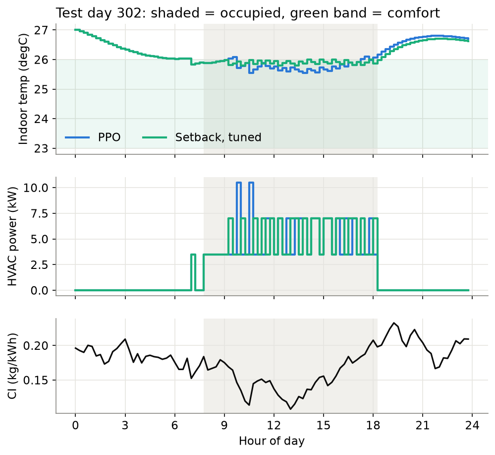
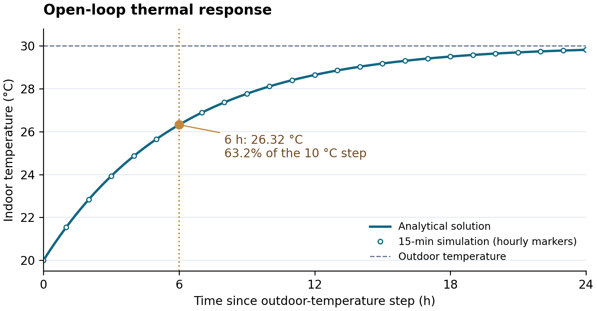
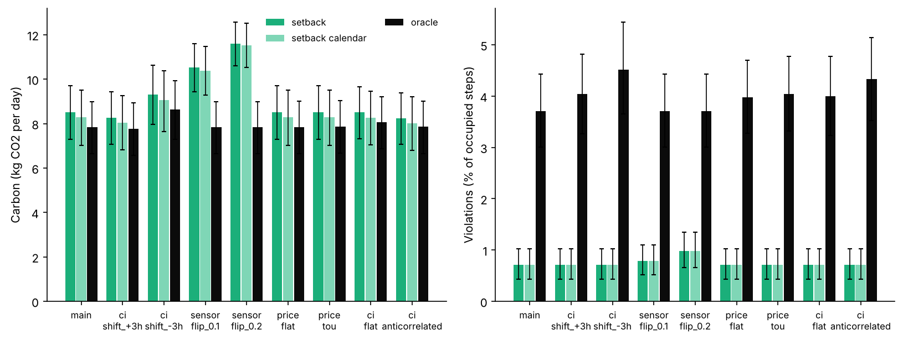

# 1. Abstract

Cooling uses about 60% of a Singapore office's electricity. On a grid whose carbon intensity varies through the day, when a building cools can matter as much as how much it cools. We ask whether reinforcement learning can cut carbon by shifting cooling in time without unreasonable discomfort. We model one office zone with a first-order thermal network and a synthetic, variable carbon profile, and pose its control as a Markov decision process that charges carbon, cost and discomfort. We compare proximal policy optimisation (PPO) and a deep Q-network with rules tuned under PPO's protocol and with a perfect-foresight dynamic-programming oracle, over five seeds and 92 held-out days. Against the best tuned rule, PPO cuts carbon by 3.7%, while occupied time outside the comfort band rises from 0.7% to 5.2%. Three public holidays, on which the rule cools an empty room, supply 72% of that saving; against a rule given the holiday calendar, the saving falls to 0.9%. Even the oracle gains only about 2% of carbon from timing. On ordinary days, knowing who will be present is worth eight times as much reward as knowing future carbon intensity. PPO's extra discomfort falls on late leavers and early arrivals, so for this building the calendar rule is the responsible choice.

```{=openxml}
<w:p><w:r><w:br w:type="page"/></w:r></w:p>
```

# 2. Introduction

Buildings and their construction accounted for 28% of global energy consumption in 2024 and running buildings emitted about 26% of energy-related CO₂ [1]. Cooling energy will more than triple by 2050 without efficiency gains [2], and cooling already takes about 60% of a typical Singapore office's electricity [3]. Carbon intensity (CI), the CO₂ emitted per kilowatt-hour generated, varies through the day with wind, sunshine and demand. Britain's averaged 125 g/kWh in 2024 and fell as low as 19 g/kWh [4]. Because a building's structure stores heat, an office can pre-cool while the grid is clean and drift warmer through dirtier hours. Cooling then becomes a sequential decision problem. Actions at 07:00 affect comfort hours later, carbon competes with cost and comfort, and occupancy is seen only through a sensor. A reinforcement learning (RL) agent can learn such a policy from simulated experience without a building model.

Singapore's grid offers little to shift. Natural gas generated 94% of its electricity in 2024 [5], and its emission factor of 0.402 kg CO₂/kWh is an annual average over all plants [6, 7]. We found no published hourly series, so we pair Singapore-like weather and prices with a synthetic CI profile shaped like Britain's. Our carbon results describe a variable grid, not what a Singapore office would save today.

We pose the cooling of one office zone as a Markov decision process (MDP) and compare PPO, our main method, and DQN with a fixed thermostat, three rule families tuned under PPO's protocol, and a perfect-foresight dynamic-programming oracle, over five seeds and 92 held-out days. Our contributions are:

- An MDP that PPO, DQN and exact dynamic programming solve identically, with metrics that separate timing from energy reduction (§4–§7).
- One tuning protocol for rules and PPO, without which PPO's carbon saving appeared three times larger (§6.4).
- Paired evidence that three public holidays supply 72% of PPO's saving and that the tuned rule wins at matched comfort (§8.1, §8.3).
- A foresight decomposition showing that occupancy foresight is worth eight times as much reward as carbon foresight (§8.7).
- An analysis of who sets and who bears the comfort trade-off, and of sensor gaming (§9).

# 3. Background and related work

**Thermal mass and carbon accounting.** Pre-cooling stores cooling in a building's thermal mass, but the cooling leaks back through the envelope, and savings depend on construction, tariffs and climate [8]. Carbon can be counted with an average factor or a marginal rate, the change in emissions when demand changes. Marginal rates can differ by more than a factor of two between hours, and the cheapest hours are often the dirtiest at the margin [9]. We use an average intensity (§10).

**Rules, predictive control and RL.** In more than half of 1,280 simulated cases, rule-based control used over 40% more non-renewable primary energy than predictive control with perfect knowledge [10], but predictive control needs an accurate model and expert effort [11]. Only about 11% of the RL studies reviewed by Wang and Hong ran in real buildings [12], and early studies often reported large savings against weak baselines [13], such as 20% to 70% lower cost than an on/off thermostat from single runs [14]. Against strong rules the gain shrinks. PPO performed about the same as ASHRAE Guideline 36 sequences in a five-zone office [15], and no agent in a benchmark of PPO, SAC and TD3 beat the rule-based controller in the office building [13]. BOPTEST [16] and CityLearn v2 [17] track carbon but mostly score it rather than reward it.

**Carbon-aware and constrained control.** Jeen et al.'s carbon-rewarded agent beat a rule in only one of three simulated buildings [18]. Kurte et al.'s DQN thermostat emitted 6% to 16% less than a fixed setpoint while using 1% to 4% more energy, so its saving was timing [19]. Storage bounds such gains. Shifting chiller load in a Californian office avoided only about 2% of annual emissions [20], and CO₂-forecast predictive control saved about 16% in well-insulated Danish buildings but 0% to 5% in older ones [21]. A weighted reward like ours reaches only trade-offs on the convex hull of what is achievable [22]. A constrained MDP limits one cost while minimising another [23], Lagrangian methods tune the weight until the limit holds [24], and treating comfort this way has matched predictive control in a single-zone office [25].

**Gap.** None of the carbon-aware RL studies we reviewed compares against both a tuned rule and a perfect-foresight optimum; the closest used an exact optimum but no rule beyond running without storage [26]. None splits the saving into timing and energy reduction, or measures how much of it depends on knowing occupancy rather than CI, as predictive-control work has done for energy [27]. We do all three.

# 4. Problem formulation

We control the cooling of one office zone over one day, in H = 96 decision steps of Δt = 15 min from 00:00.

## 4.1 Markov decision process

**State.** The observation at step t is

  s_t = ( T_in, T_out, ô_t, p_t, CI_t, sin(2πh/24), cos(2πh/24), w_t, { T̂_out, p̂, ĈI }_{t+τ}, τ ∈ {1, 2, 4, 8} h ),

with indoor and outdoor temperature (°C), the occupancy sensor reading ô_t, price p_t (SGD/kWh), carbon intensity CI_t (kg CO₂/kWh), the hour h on the unit circle, a working-day flag w_t and forecasts at four lead times, all scaled to roughly [−1, 1] by fixed constants.

**Action.** a_t ∈ {0, 1, 2, 3, 4} sets HVAC electrical power P_t = (a_t/4)·P_max, with P_max = 14 kW. Discrete levels match staged commercial units and let PPO, DQN and exact dynamic programming solve the same problem; four 15-min steps still give 17 average power levels per hour.

**Transition.** T_in follows the 1R1C model of §5, discretised exactly under a zero-order hold:

  T_{t+1} = T_eq + (T_t − T_eq)·exp(−Δt/RC),  T_eq = T_out + R·( Q_int(o_t) + Q_sol − COP(T_out)·P_t ).

Given the exogenous series, the transition is deterministic. Randomness enters through the day drawn, the initial temperature T_0 ~ U(25.5, 28) °C and, in robustness tests, sensor and forecast errors.

**Reward.** The reward is the negative of a weighted cost,

  r_t = −[ λ_E·E_t + λ_C·CI_t·E_t + λ_\$·p_t·E_t + λ_K·D_t ],  E_t = P_t·Δt,

  D_t = 1[o_t]·( max(0, T_{t+1} − 26) + max(0, 23 − T_{t+1}) )·Δt,

where D_t is a hinge penalty in °C·h on the comfort band [23, 26] °C, which spans the 23–25 °C design range of SS 553 [28] and the 26 °C limit common in Singapore offices. It is charged on true occupancy o_t, not the sensor reading (§9). Default weights are λ_E = 0, λ_C = 1 per kg, λ_\$ = 0.5 per SGD and λ_K = 5 per °C·h. With γ = 0.99 the effective horizon is about 25 h, enough to credit 07:00 cooling for afternoon comfort. Table A1 justifies Δt, the horizon, γ and the reward design.

## 4.2 Carbon-awareness is load shifting

Carbon (CI_t·E_t) and cost (p_t·E_t) are both linear in energy, so for a fixed total energy carbon falls only if consumption moves into low-CI steps. The only storage is the zone's thermal mass, C = 15 kWh/K. Pre-cooling by 3 K banks about 45 kWh of cooling, roughly 13 kWh of electricity at COP 3.5, and with τ = RC = 6 h much of it leaks back within hours. Price peaks with afternoon demand while CI falls with midday solar and wind (r = −0.07 in our data), so the cost-optimal and carbon-optimal schedules differ.

## 4.3 Partial observability

The agent sees an occupancy sensor that flips with probability ε and forecasts whose error grows with lead time, not the true occupancy or future, so the problem is a POMDP. We approximate it by feature augmentation. Forecasts stand in for the hidden future, and time features let the policy infer the schedule on ordinary workdays; on public holidays only the sensor reveals that nobody is coming (§8.1). Main experiments use a perfect sensor and forecasts. The oracle sees the true occupancy and future, which makes it an upper bound.

# 5. Environment and simulator

The environment, rules and oracle share one thermal transition function. The 1R1C zone has R = 0.4 K/kW, C = 15 kWh/K, internal gains of 1.5 + 12o_t kW for occupancy fraction o_t, solar gains up to 6 kW and a COP between 2.5 and 4.5 that falls as outdoor temperature rises (Table A2). These are assumptions for a representative 500 m² zone, not fitted values, and the model tracks sensible heat only. One synthetic year of 35,040 quarter-hourly samples supplies Singapore-like weather [29] and prices, weekday occupancy from about 08:00 to 18:00, and a deliberately variable, UK-like CI profile of 0.03–0.40 kg CO₂/kWh (Table A3). January–September (273 days) is used for training and all tuning, and October–December (92 days) for testing; each one-day episode resets the temperature. The ten unit tests pass, and the open-loop step response matches the analytical solution to within 1.1 × 10⁻¹⁴ °C (Figure A1). A full-year run of the untuned setback uses 49.37 kWh/m²/year of HVAC electricity, below BCA's 105–165 kWh/m²/year interquartile range for whole office buildings [30], which also counts lighting and equipment. These checks establish numerical consistency, not agreement with a measured building.

# 6. Methods

## 6.1 Rule-based baselines

All rules drive an ideal staged thermostat that picks the power level whose predicted next temperature is closest to a target. The fixed setpoint holds 24 °C. The occupancy setback cools from a lead time before 08:00 until 18:00 on workdays, or whenever the sensor reads occupied. The carbon heuristic cools to a lower setpoint when CI is below a threshold θ and drifts to a higher one above it. The carbon-proportional rule raises the setpoint linearly with CI. Tuning (§6.4) made all three adaptive rules converge on a setback at 25.9 °C with a 1-hour lead (Table A4). The CI gain fell to 0 and the heuristic's setpoints narrowed to 25.5/25.9 °C, because with a 6-hour time constant cooling stored in a clean hour leaks away before it is needed. The setpoint sits just below a cliff, since on training days 26.0 °C leaves 32% of occupied steps in violation against 0.7% at 25.9 °C; the staged thermostat oscillates across the band edge.

## 6.2 Proximal policy optimisation (main method)

PPO [31] learns a stochastic policy π_θ(a|s) and a value function V_φ(s) by alternating between collecting experience and several epochs of gradient steps on the clipped surrogate

  L^CLIP(θ) = E_t[ min( ρ_t(θ)·Â_t, clip(ρ_t(θ), 1−ε, 1+ε)·Â_t ) ],  ρ_t(θ) = π_θ(a_t|s_t) / π_θold(a_t|s_t),

with advantages Â_t from generalised advantage estimation [32]. The clip removes any incentive to move the probability ratio outside [1−ε, 1+ε], so each batch can be reused safely. PPO is sample-hungry, but a 1.5M-step run takes only 4.7 min on our simulator. We use stable-baselines3 [33] with separate 64×64 tanh actor and critic networks and 8 environments × 768 steps per update (Table A6). Against training instability, the main risk in our proposal, we use reward and advantage normalisation, ε = 0.2, gradient clipping at 0.5, an entropy coefficient of 0.01 and longer rollouts [34]. The 5 final seeds agree within 1.3% on test carbon, and we report every seed [35].

## 6.3 Comparison algorithm and upper bound

DQN [36] is off-policy and value-based. It regresses Q(s, a) toward r + γ·max_a′ Q_target(s′, a′) with a 100k-transition replay buffer, a target network and ε-greedy exploration, for 800k steps, and was not tuned.

Given one day's realised exogenous series, the dynamics are deterministic and the state is the scalar T_in, so the oracle solves each day exactly by backward induction [37],

  V_H(T) = 0,  V_t(T) = min_a [ c_t(T, a) + V_{t+1}( f_t(T, a) ) ],

with per-step cost c_t and transition f_t, on a 401-point grid over [15, 35] °C, and then acts by one-step lookahead. It uses the environment's own dynamics and cost and matches its predicted return within 2%. Two variants, planning with a flat CI or with the nominal 08:00–18:00 schedule, isolate the value of each kind of foresight (§8.7).

## 6.4 Tuning protocol

Our first results compared default PPO with a partly tuned heuristic and overstated PPO's carbon advantage threefold (11.3% vs 3.7%). We therefore tuned every controller on the same 60 training days by mean daily reward, over 972 rule configurations and 12 PPO configurations with 2 seeds each (Table A5). A 768-step rollout won (−11.71, against −11.82 for the defaults and −11.84 for the best rule). The spread across configurations is only three times the seed-to-seed spread, so to avoid a winner's curse we retrained the selection with 5 fresh seeds and tested it once.

# 7. Experimental setup

**Metrics.** Per test day we record reward, energy (kWh), carbon (kg CO₂), cost (SGD), discomfort (°C·h outside the band while occupied), violation rate (share of occupied steps with any discomfort) and maximum deviation (Table A7). Two metrics separate carbon-aware from merely efficient control. Effective CI, Σ CI_t·E_t / Σ E_t, is the average intensity paid per kWh, and load shift is the share of HVAC energy used in steps with CI below that day's median. Using less energy at the same times lowers carbon but leaves both unchanged. Both are aggregated energy-weighted, and load shift starts near 60% rather than 50% because the midday solar dip falls inside office hours. Gap closed is (best rule − controller) ÷ (best rule − oracle).

**Protocol.** The 92 test days (63 workdays, 26 weekend days and 3 public holidays) each have a fixed noise seed, so every controller faces identical conditions. Learned controllers use 5 seeds and act greedily, and we report the mean over seeds with a 95% bootstrap interval [38]. Rule and oracle intervals are over days and reflect day-to-day variation, so headline comparisons are paired. For each seed we take the mean per-day difference from the reference, then report the mean of the 5 differences with a bootstrap CI and a t-test, Holm-corrected across ablations [39], relying on effect sizes more than p-values [35, 40]. DQN, the λ_K sweep and the ablations use default PPO settings at 800k steps and are compared with default PPO.

**Reference and scenarios.** The primary reference is the best tuned rule. Because it turned out to cool an empty zone on the 3 holidays, we add two post hoc views: the 89 non-holiday days, and a calendar setback that equals the tuned rule but switches off on public holidays. Robustness scenarios shift the CI profile by ±3 h, flip sensor readings with probability ε ∈ {0.1, 0.2}, or use flat, time-of-use or price-anticorrelated price and CI, without retraining. All experiments took about 5 CPU-hours (Appendix C); code is at https://github.com/btbrandon/carbon-hvac.

# 8. Results and analysis

## 8.1 Main comparison

**Table 1.** Test-period means per day over the 92 held-out days: reward (higher is better), energy (kWh), carbon (kg CO₂), cost (SGD), discomfort (°C·h), violations (% of occupied steps outside 23–26 °C), effective CI (kg/kWh) and load shift (%). Seed-level 95% intervals for the learners are narrow (PPO carbon 8.18–8.25 kg); Table 2 gives paired comparisons.

| Controller | Reward | Energy | Carbon | Cost | Disc. | Viol. | Eff. CI | Shift |
|---------------------|-----------|-----------|-----------|---------|---------|--------|-----------|---------|
| Fixed 24 °C | −29.87 | 112.1 | 18.96 | 21.81 | 0.000 | 0.0 | 0.1691 | 53.1 |
| Setback 24 °C | −17.95 | 67.8 | 11.10 | 13.69 | 0.000 | 0.0 | 0.1636 | 60.5 |
| Tuned setback | −13.88 | 52.0 | 8.52 | 10.72 | 0.000 | 0.7 | 0.1637 | 60.2 |
| Carbon heuristic | −13.92 | 52.4 | 8.53 | 10.77 | 0.000 | 0.5 | 0.1629 | 60.9 |
| Calendar setback | −13.48 | 50.5 | 8.28 | 10.40 | 0.000 | 0.7 | 0.1639 | 60.7 |
| DQN | −14.90 | 53.1 | 8.52 | 10.60 | 0.215 | 7.6 | 0.1604 | 64.5 |
| PPO (tuned) | −13.72 | 50.8 | 8.21 | 10.28 | 0.076 | 5.2 | 0.1616 | 63.2 |
| Oracle (DP) | −13.07 | 49.4 | 7.83 | 10.01 | 0.047 | 3.7 | 0.1586 | 67.3 |

Tuning the rule matters more than the controller class. The untuned setback cuts carbon by 41% relative to the fixed thermostat and tuning removes another 23%, leaving every learned and oracle controller within 8% of the tuned rule (Table 1). Against that rule over all 92 days, PPO lowers carbon by 3.7% (paired 95% CI 3.2–4.0%, p < 0.001) and raises reward by 1.1% (p = 0.03), closing 46% of the carbon gap to the oracle. Violations rise from 0.7% to 5.2% of occupied steps but stay small (0.076 °C·h/day, mean maximum deviation 0.14 °C), and the oracle also accepts 3.7% at λ_K = 5. DQN does not beat the rule. Its carbon is level (p = 0.97), while its reward is 7.4% lower and its violations 6.9 points higher.

The gain comes mostly from three days. On the 3 weekday public holidays the tuned rule follows its workday schedule and cools an empty zone (45.8 kWh/day), while PPO reacts to the sensor and barely runs (3.6 kWh/day; Table A8). These days supply 72% of PPO's carbon saving and all of its reward advantage.

**Table 2.** PPO (tuned) minus reference, paired over seeds, with 95% CIs. The reference is the tuned setback unless stated. Percentages are relative to the reference; positive Δ reward favours PPO.

| Comparison | Δ reward | Δ carbon | Δ energy | Δ viol. | Carbon gap closed | Reward gap closed |
|-----------------|-----------------|------------------|--------------|------------|-----------|-----------|
| All days (protocol) | +1.1% [0.4, 1.6], p = 0.03 | −3.7% [−4.0, −3.2], p < 0.001 | −2.4% [−2.6, −2.1] | +4.5 pp [3.9, 5.1] | 46% | 19% |
| 89 non-holiday days | −1.6% [−2.3, −1.1], p = 0.008 | −1.1% [−1.5, −0.6], p = 0.016 | +0.3% [0.0, 0.6] | +4.7 pp [4.1, 5.3] | 20% | −55% |
| All days, vs calendar rule | −1.8% [−2.5, −1.3], p = 0.007 | −0.9% [−1.3, −0.4], p = 0.02 | +0.5% [0.3, 0.8] | +4.5 pp [3.9, 5.1] | 17% | −60% |

On ordinary days PPO still emits about 1% less carbon with slightly more energy, so the whole saving is timing (effective CI 0.1618 vs 0.1639 kg/kWh), paid for with comfort; on its own objective it falls 1.6% below the rule (Table 2). A holiday calendar captures the holiday saving without learning, so PPO's advantage here is its reaction to observed occupancy plus a small genuine timing effect.

## 8.2 Learning dynamics

Every tuned PPO seed reaches 90% of its total improvement after 250k–300k steps (Figure 1). Discomfort falls first, from 49.7 to 0.9 °C·h/day within 50k steps on seed 0, while carbon is still 11.8 kg/day (final 8.2), so the agent learns comfort before it trims energy and timing. Its final return on these days is level with the tuned rule's (−13.61 to −13.90 vs −13.55). DQN plateaus about one reward unit lower and collapses repeatedly near 500k and 700k steps. Its test violations range from 2.0% to 14.3% across seeds, against 4.4%–6.1% for PPO, the instability typical of bootstrapped off-policy value learning.

{width=56%}

**Figure 1.** Evaluation return per day on 16 fixed training days (line: mean of 5 seeds; band: min/max), with the tuned setback and the oracle dashed.

## 8.3 Carbon vs comfort trade-off

At matched comfort the rule wins. Below 0.05 °C·h/day of discomfort the tuned setback dominates every PPO setting (Figure 2); λ_K = 10 emits 8.67 kg at 0.046 °C·h against 8.56 kg at essentially zero for the rule. PPO beats the rule on carbon only between 0.08 and 0.1 °C·h/day, a band the staged thermostat cannot reach because its front jumps from 0.7% to 35% violations between 25.9 and 26.0 °C. Relaxing comfort does unlock shifting. As λ_K falls from 5 to 0.5, load shift rises from 64% to 78% and effective CI falls from 0.161 to 0.147 kg/kWh, below the 0.159 the oracle pays under default weights. At λ_K ≤ 2, however, 11–45% of occupied steps are in violation. The agent can learn carbon timing, but at acceptable comfort this building's storage makes it worth little.

{width=54%}

**Figure 2.** Carbon vs discomfort on the 89 non-holiday days (symlog x-axis). Blue: PPO with λ_K ∈ {0.5, …, 50}, 3 seeds each. Green: tuned setback with its setpoint swept from 24.0 to 26.0 °C. Table A9 lists the values.

## 8.4 Ablations

**Table 3.** Default-configuration PPO with one input group removed or hourly control, 92 test days, 5 seeds × 800k steps (Figure A2). Carbon with 95% CI; p: Welch test over seeds, Holm-corrected.

| Variant | Carbon (kg) | Δ carbon (p) | Δ reward (p) | Disc. (°C·h) | Viol. (%) | Eff. CI | Shift (%) |
|----------------|--------------------|--------------|--------------|----------|--------|----------|--------|
| Full (default) | 8.26 [8.20, 8.31] | | | 0.101 | 5.5 | 0.1608 | 64.0 |
| No CI | 8.37 [8.28, 8.45] | +1.3% (0.38) | +0.3% (0.86) | 0.066 | 3.4 | 0.1625 | 62.4 |
| No forecasts | 8.28 [8.21, 8.35] | +0.3% (0.61) | +0.3% (0.86) | 0.084 | 6.0 | 0.1620 | 62.8 |
| No time features | 8.66 [8.30, 9.07] | +4.9% (0.38) | −9.1% (0.02) | 0.231 | 6.6 | 0.1589 | 65.9 |
| Δt = 1 h | 8.40 [8.28, 8.50] | +1.7% (0.38) | −4.2% (0.002) | 0.174 | 9.0 | 0.1615 | 65.4 |

The CI input produces PPO's timing advantage, and that advantage is small. Without CI in the state, effective CI rises from 0.1608 to 0.1625 kg/kWh (p = 0.02 uncorrected, 0.09 after Holm), almost back to the rule's 0.1637, and load shift falls from 64.0% to 62.4% (Table 3). Carbon rises 1.3%, which is not significant over 5 seeds. Removing forecasts changes nothing measurable, consistent with a reactive policy. Without time features, reward falls 9.1% and discomfort more than doubles, because the clock lets the policy anticipate arrivals. Hourly control costs 4.2% of reward and raises violations to 9.0%, since one-hour steps cannot track departures or the midday solar gain.

## 8.5 Generalisation and robustness

Table 4 adds the evaluation-time scenarios to the held-out-month test, and Figure A3 plots them with PPO. The PPO weights behind §8.1 were not stored, so PPO is evaluated with five retrained seeds that match the originals within seed variation (carbon 8.22 vs 8.21 kg/day, Welch p = 0.11).

**Table 4.** Robustness scenarios, 92 test days. Rule: tuned setback; Δ vs main is the paired change in its carbon. Oracle gap: oracle minus rule, paired over days (carbon in kg); every gap's 95% CI excludes zero.

| Scenario | Rule carbon (kg) | Δ vs main | Oracle carbon (kg) | Oracle gap, carbon | Oracle gap, reward |
|------------------------------|--------------|--------------|--------------|--------------|--------------|
| Main | 8.52 | | 7.83 | −0.68 | +0.80 |
| CI shifted +3 h | 8.27 | −2.9% | 7.76 | −0.51 | +0.72 |
| CI shifted −3 h | 9.31 | +9.3% | 8.64 | −0.67 | +0.81 |
| Sensor flips, ε = 0.1 | 10.52 | +23.5% | 7.83 | −2.69 | +3.89 |
| Sensor flips, ε = 0.2 | 11.59 | +36.1% | 7.83 | −3.76 | +5.60 |
| Flat price | 8.52 | 0.0% | 7.84 | −0.68 | +0.72 |
| Time-of-use price | 8.52 | 0.0% | 7.88 | −0.64 | +0.91 |
| Flat CI | 8.52 | 0.0% | 8.06 | −0.46 | +0.68 |
| CI anticorrelated | 8.24 | −3.2% | 7.85 | −0.39 | +0.63 |

Sensor noise is the largest risk. With 10% of readings flipped, false "occupied" readings make the rule cool empty rooms, raising its carbon by 24%, while its schedule keeps violations at 0.8–1.0%. PPO, with no schedule to override a false "empty" reading, is hit harder. Paired against its own main run, its carbon rises 22.0% and its violations reach 9.7% at ε = 0.1, and 32.8% and 17.9% at ε = 0.2. It still emits 4.7–5.8% less carbon than the rule, but its holiday saving largely disappears as it cools empty holiday zones for 27–41 kWh/day. Shifting the CI profile by 3 h moves the CI-blind rule's carbon by −2.9% or +9.3% and PPO's by −1.4% or +8.6%, while the oracle's advantage stays at 0.51–0.67 kg/day. With a flat CI the oracle still beats the rule by 0.46 kg/day through lower energy alone, two-thirds of its main advantage.

## 8.6 Policy behaviour

On a typical workday the two controllers look alike (Figure 3). Both start before the 08:00 arrival, hold the zone near the top of the band and skip overnight pre-cooling, which would leak away before occupants arrive. PPO cools a little harder during the 10:00 and 12:00–15:00 CI dips, reaching about 25.6 °C where the rule holds 25.9 °C, and drifts just above 26 °C around 09:00 and 17:00–18:00, where its violations occur. Over the test period PPO uses 63.2% of its energy in below-median-CI steps, against 60.2% for the rule and 67.3% for the oracle, recovering about 41% of the available timing benefit.

{width=43%}

**Figure 3.** Test day 302 (a Friday): indoor temperature, HVAC power and grid CI for tuned PPO and the tuned setback; shading marks occupied hours.

## 8.7 Extension: where the headroom is

Our planned extension, Lagrangian PPO, was not completed, so we instead decomposed the oracle's foresight (Table 5).

**Table 5.** Oracle foresight decomposition, 89 non-holiday days (all-days values in brackets). The variants plan with a flat CI or the nominal 08:00–18:00 schedule and are scored on the true outcome.

| Controller | Reward | Carbon (kg) | Violations (%) | Effective CI |
|------------------------------------|--------------------|----------------|--------------|--------------|
| Oracle, full foresight | −13.51 (−13.07) | 8.10 (7.83) | 3.8 | 0.1586 |
| Oracle, flat-CI plan | −13.59 (−13.15) | 8.28 (8.01) | 4.1 | 0.1628 |
| Oracle, nominal-schedule plan | −14.16 (−14.08) | 7.96 (7.92) | 5.7 | 0.1580 |
| Tuned setback | −13.94 (−13.88) | 8.56 (8.52) | 0.7 | 0.1639 |
| PPO (tuned) | −14.16 (−13.72) | 8.47 (8.21) | 5.4 | 0.1618 |

Knowing future CI is worth only 0.078 reward/day (95% CI 0.063–0.094) and 0.18 kg of carbon (2.2%), though without it the oracle loses almost all of its timing advantage (effective CI 0.1628 vs 0.1639 for the rule). Carbon is only one reward term, and price timing pulls the other way. Knowing true occupancy is worth 0.65 reward/day on ordinary days (0.48–0.83), eight times as much, and 1.01 including holidays. Without it the oracle under-cools for early arrivals and late leavers and falls below the tuned rule. The binding uncertainty is who is in the room, not how clean the grid is.

## 8.8 Failure cases and negative results

On ordinary days PPO also scores 1.6% below the rule on its own reward, although the rule's policy lies within its action space, and DQN matched the rule's carbon only by giving up comfort. Our first draft averaged effective CI and load shift per day, which scored idle days as zero and reversed the sign of the no-time-features effect.

# 9. Responsible AI

**Who sets the weights, and who pays.** At λ_K = 5 one degree-hour of discomfort costs as much as 5 kg of CO₂, an exchange rate that is a value judgement, not physics, and that decides the result (PPO's violations range from 45% to 0.9% across the sweep). A facility manager sets the weight while occupants bear its effects, so we report the whole front and favour a comfort constraint, a satisficing target such as "violations below 1%" [41] that occupants can audit, or a trade-off learned from their preferences [42]. The 23–26 °C band [28] is itself a choice, thermal preference varies between people [43, 44], and our linear hinge ignores that people weigh a loss of comfort more heavily than an equal gain [45]. PPO's mean discomfort is small, but more than half of its violations fall between 17:00 and 18:30, so late leavers above all bear the cost of the savings.

**Specification gaming.** An agent optimises the reward it is given, not the intent behind it [46]. Our reward charges discomfort on true occupancy, so a policy cannot profit from false "empty" readings, but a deployed controller would depend on the sensor. Since 72% of PPO's saving comes from reading the sensor, its reliability is a safety issue. Random flips push PPO's violations to 9.7–17.9% against 1.0% for the rule, and a sensor stuck at "empty", which we did not test, would leave people without cooling.

**Honest baselines and oversight.** PPO's apparent carbon saving fell from 11.3% against a partly tuned rule to 3.7% against a tuned one and 0.9% against a calendar rule. Only the last answers a building owner's question; the first would have anchored readers, and us [47]. The tuned rule fits in one auditable sentence ("cool to 25.9 °C while people are present"), and with a holiday calendar it captures nearly all of PPO's benefit while staying comfortable when the sensor errs. It is the responsible choice for this building. RL justifies its lower explainability only where a building offers a real lever such as storage, and then needs a hard comfort constraint, a fallback rule and an occupant override.

# 10. Limitations and future work

Our ranking holds for one uncalibrated 1R1C zone with sensible heat only, which ignores tropical humidity; a calibrated multi-zone model such as BOPTEST, then shadow-mode trials, would test transfer. The zone has no storage beyond its thermal mass, and a battery, chilled-water tank or several zones would add a lever worth learning. Occupancy holds most of the headroom, so occupancy prediction, sensor filtering and a recurrent policy come next. Our CI signal is synthetic and average, and measured marginal rates could rank hours differently. Finally, Lagrangian PPO with a stakeholder-set comfort limit may close the matched-comfort gap, and more seeds and a tuned DQN would firm up small effects such as the no-CI ablation.

# 11. Conclusion

Against the best tuned rule, PPO cut carbon by 3.7% while violations rose from 0.7% to 5.2% of occupied time, but 72% of that saving came from three public holidays, and against a holiday-calendar rule it is 0.9%. Even a perfect-foresight oracle gains only about 2% of carbon from timing, while occupancy foresight is worth eight times as much reward as carbon foresight. For this building the calendar rule is the responsible choice; learning earns its place where a building offers a real lever such as storage.

```{=openxml}
<w:p><w:r><w:br w:type="page"/></w:r></w:p>
```

# References

1. United Nations Environment Programme, Global Alliance for Buildings and Construction. Global status report for buildings and construction 2025–2026 [Internet]. Paris: UNEP; 2026 [cited 2026 Nov 15]. Available from: https://globalabc.org/sites/default/files/resources/2026-05/global-status-report-for-buildings-and-construction-2025_2026.pdf
2. International Energy Agency. The future of cooling: opportunities for energy-efficient air conditioning [Internet]. Paris: IEA; 2018 [cited 2026 Nov 15]. Available from: https://www.iea.org/reports/the-future-of-cooling
3. Building and Construction Authority. Super low energy building technology roadmap [Internet]. Singapore: BCA; [date unknown] [cited 2026 Nov 15]. Available from: https://www1.bca.gov.sg/docs/default-source/docs-corp-buildsg/digitalisation/sle_tech_roadmap_report.pdf
4. National Energy System Operator. Britain's electricity explained: 2024 review [Internet]. NESO; 2025 [cited 2026 Nov 15]. Available from: https://www.neso.energy/news/britains-electricity-explained-2024-review
5. Energy Market Authority. Fuel mix for electricity generation (yearly) [Internet]. Singapore: EMA; [date unknown] [cited 2026 Nov 15]. Available from: https://www.ema.gov.sg/content/dam/corporate/resources/statistics/files/pdf/Fuel-Mix-for-Electricity-Generation-Yearly.pdf.coredownload.pdf
6. National Climate Change Secretariat. Power [Internet]. Singapore: NCCS; [date unknown] [cited 2026 Nov 15]. Available from: https://www.nccs.gov.sg/singapores-climate-action/mitigation-efforts/power/
7. Energy Market Authority. Singapore energy statistics: technical notes and glossary [Internet]. Singapore: EMA; [date unknown] [cited 2026 Nov 15]. Available from: https://ema.gov.sg/resources/singapore-energy-statistics/technical-notes-glossary
8. Braun JE. Load control using building thermal mass. J Sol Energy Eng. 2003;125(3):292–301. doi:10.1115/1.1592184
9. Graff Zivin JS, Kotchen MJ, Mansur ET. Spatial and temporal heterogeneity of marginal emissions: implications for electric cars and other electricity-shifting policies. J Econ Behav Organ. 2014;107(Pt A):248–68. doi:10.1016/j.jebo.2014.03.010
10. Oldewurtel F, Parisio A, Jones CN, Gyalistras D, Gwerder M, Stauch V, et al. Use of model predictive control and weather forecasts for energy efficient building climate control. Energy Build. 2012;45:15–27. doi:10.1016/j.enbuild.2011.09.022
11. Drgoňa J, Arroyo J, Cupeiro Figueroa I, Blum D, Arendt K, Kim D, et al. All you need to know about model predictive control for buildings. Annu Rev Control. 2020;50:190–232. doi:10.1016/j.arcontrol.2020.09.001
12. Wang Z, Hong T. Reinforcement learning for building controls: the opportunities and challenges. Appl Energy. 2020;269:115036. doi:10.1016/j.apenergy.2020.115036
13. Manjavacas A, Campoy-Nieves A, Jiménez-Raboso J, Molina-Solana M, Gómez-Romero J. An experimental evaluation of deep reinforcement learning algorithms for HVAC control. Artif Intell Rev. 2024;57(7):173. doi:10.1007/s10462-024-10819-x
14. Wei T, Wang Y, Zhu Q. Deep reinforcement learning for building HVAC control. In: Proceedings of the 54th ACM/EDAC/IEEE Design Automation Conference (DAC); 2017 Jun 18–22; Austin, TX, USA. New York: ACM; 2017. doi:10.1145/3061639.3062224
15. Lu X, Fu Y, Xu S, Zhu Q, O'Neill Z, Yang Z. Comparison study of high-performance rule-based HVAC control with deep reinforcement learning-based control in a multi-zone VAV system. In: Proceedings of the 7th International High Performance Buildings Conference at Purdue; 2022; West Lafayette, IN, USA. Paper 407. Available from: https://docs.lib.purdue.edu/ihpbc/407
16. Blum D, Arroyo J, Huang S, Drgoňa J, Jorissen F, Walnum HT, et al. Building optimization testing framework (BOPTEST) for simulation-based benchmarking of control strategies in buildings. J Build Perform Simul. 2021;14(5):586–610. doi:10.1080/19401493.2021.1986574
17. Nweye K, Kaspar K, Buscemi G, Fonseca T, Pinto G, Ghose D, et al. CityLearn v2: energy-flexible, resilient, occupant-centric, and carbon-aware management of grid-interactive communities. J Build Perform Simul. 2025;18(1):17–38. doi:10.1080/19401493.2024.2418813
18. Jeen SR, Abate A, Cullen JM. Low emission building control with zero-shot reinforcement learning. Proc AAAI Conf Artif Intell. 2023;37(12):14259–67. doi:10.1609/aaai.v37i12.26668
19. Kurte K, Amasyali K, Munk J, Zandi H. Deep reinforcement learning based HVAC control for reducing carbon footprint of buildings. In: 2023 IEEE Power & Energy Society Innovative Smart Grid Technologies Conference (ISGT); 2023 Jan 16–19; Washington, DC, USA. Piscataway (NJ): IEEE; 2023. p. 1–5. doi:10.1109/ISGT51731.2023.10066358
20. Zou A, Duarte Roa C, Schiavon S. Quantifying office building HVAC marginal operating carbon emissions and load shift potential: a case study in California. In: ASHRAE Winter Conference Proceedings; 2025 Feb. Available from: https://escholarship.org/uc/item/6nx97049
21. Leerbeck K, Bacher P, Junker RG, Tveit A, Corradi O, Madsen H, et al. Control of heat pumps with CO2 emission intensity forecasts. Energies. 2020;13(11):2851. doi:10.3390/en13112851
22. Roijers DM, Vamplew P, Whiteson S, Dazeley R. A survey of multi-objective sequential decision-making. J Artif Intell Res. 2013;48:67–113. doi:10.1613/jair.3987
23. Altman E. Constrained Markov decision processes. Boca Raton (FL): Chapman & Hall/CRC; 1999.
24. Ray A, Achiam J, Amodei D. Benchmarking safe exploration in deep reinforcement learning [Internet]. San Francisco: OpenAI; 2019 [cited 2026 Nov 15]. Available from: https://cdn.openai.com/safexp-short.pdf
25. Sanchez J, Cai J. Building demand response control through constrained reinforcement learning with linear policies. Appl Energy. 2025;398:126404. doi:10.1016/j.apenergy.2025.126404
26. Shioda T, Terashima K, Nagai T. Verifier-based reinforcement fine-tuning of reasoning models for thermal energy storage control [preprint]. arXiv:2607.12856. 2026 [cited 2026 Nov 15]. Available from: https://arxiv.org/abs/2607.12856
27. Oldewurtel F, Sturzenegger D, Morari M. Importance of occupancy information for building climate control. Appl Energy. 2013;101:521–32. doi:10.1016/j.apenergy.2012.06.014
28. SPRING Singapore. SS 553:2009 Code of practice for air-conditioning and mechanical ventilation in buildings. Singapore: SPRING Singapore; 2009.
29. Meteorological Service Singapore. Climate of Singapore [Internet]. Singapore: MSS; [date unknown] [cited 2026 Nov 11]. Available from: https://www.weather.gov.sg/climate-climate-of-singapore
30. Building and Construction Authority. Building energy benchmarking report and building energy performance data [spreadsheet on the Internet]. Singapore: BCA; 2025 [cited 2026 Nov 11]. Sheet "Building Energy Benchmarks", 2025 office benchmarks. Available from: https://go.gov.sg/bca-bebr-data
31. Schulman J, Wolski F, Dhariwal P, Radford A, Klimov O. Proximal policy optimization algorithms [Preprint]. arXiv:1707.06347. 2017.
32. Schulman J, Moritz P, Levine S, Jordan M, Abbeel P. High-dimensional continuous control using generalized advantage estimation. In: Proceedings of the 4th International Conference on Learning Representations (ICLR); 2016.
33. Raffin A, Hill A, Gleave A, Kanervisto A, Ernestus M, Dormann N. Stable-Baselines3: reliable reinforcement learning implementations. J Mach Learn Res. 2021;22(268):1–8.
34. Andrychowicz M, Raichuk A, Stańczyk P, Orsini M, Girgin S, Marinier R, et al. What matters in on-policy reinforcement learning? A large-scale empirical study. In: Proceedings of the 9th International Conference on Learning Representations (ICLR); 2021.
35. Henderson P, Islam R, Bachman P, Pineau J, Precup D, Meger D. Deep reinforcement learning that matters. In: Proceedings of the AAAI Conference on Artificial Intelligence. 2018;32(1).
36. Mnih V, Kavukcuoglu K, Silver D, Rusu AA, Veness J, Bellemare MG, et al. Human-level control through deep reinforcement learning. Nature. 2015;518(7540):529–33.
37. Bellman R. Dynamic programming. Princeton (NJ): Princeton University Press; 1957.
38. Efron B, Tibshirani RJ. An introduction to the bootstrap. New York: Chapman & Hall; 1993.
39. Holm S. A simple sequentially rejective multiple test procedure. Scand J Stat. 1979;6(2):65–70.
40. Agarwal R, Schwarzer M, Castro PS, Courville AC, Bellemare MG. Deep reinforcement learning at the edge of the statistical precipice. In: Advances in Neural Information Processing Systems 34 (NeurIPS); 2021.
41. Simon HA. Models of man: social and rational. New York: Wiley; 1957.
42. Christiano PF, Leike J, Brown T, Martic M, Legg S, Amodei D. Deep reinforcement learning from human preferences. In: Advances in Neural Information Processing Systems 30 (NIPS); 2017.
43. de Dear RJ, Brager GS. Developing an adaptive model of thermal comfort and preference. ASHRAE Trans. 1998;104(1):145–67.
44. Kingma B, van Marken Lichtenbelt W. Energy consumption in buildings and female thermal demand. Nat Clim Chang. 2015;5(12):1054–6.
45. Kahneman D, Tversky A. Prospect theory: an analysis of decision under risk. Econometrica. 1979;47(2):263–91.
46. Skalse J, Howe NHR, Krasheninnikov D, Krueger D. Defining and characterizing reward hacking. In: Advances in Neural Information Processing Systems 35 (NeurIPS); 2022.
47. Tversky A, Kahneman D. Judgment under uncertainty: heuristics and biases. Science. 1974;185(4157):1124–31.

# Appendix

## A. Formulation and simulator details

**Table A1.** Design choices in the MDP (§4).

| Choice | Value | Alternative | Reason or evidence |
|---|---|---|---|
| Δt | 15 min | 1 h | CI dips last 1–3 h. At Δt = 1 h: carbon 8.40 vs 8.26 kg/day and 1.7× the discomfort (§8.4) |
| Horizon | 1 day (96 steps) | 1 week | The occupancy cycle is daily; longer episodes slow learning with no new dynamics |
| γ | 0.99 | 0.995 | 0.99 spans a full day; 0.995 scored worse in tuning (validation reward −11.96 vs −11.82, §6.4) |
| Comfort penalty | Dense hinge, occupied only | Sparse violation count | Dense learning signal in physical units (°C·h) |
| Reward scaling | Running return normalisation | Fixed scale | Early returns span −10 to −300 per day |
| Comfort scoring | True occupancy o_t | Sensor ô_t | A controller cannot score well by exploiting sensor errors |

The discount γ = 0.99 gives an effective horizon of 1/(1−γ) = 100 steps, about 25 h. Episodes end at a fixed horizon with no terminal value, which matches the building because the zone is unoccupied after about 18:00.

**Table A2.** Simulator parameters. These are modelling assumptions for a representative office zone, not parameters fitted to a measured building.

| Parameter | Value | Interpretation |
|---|---|---|
| Reference floor area | 500 m² | Used to express cooling electricity per unit area |
| Thermal resistance R | 0.4 K/kW | Aggregate resistance to outdoor heat exchange |
| Thermal capacitance C | 15 kWh/K | Effective zone thermal mass |
| Time constant τ = RC | 6 h | Rate of approach to thermal equilibrium |
| Maximum electrical HVAC power | 14 kW | Five levels: 0, 3.5, 7, 10.5 and 14 kW |
| COP | clip[3.5 − 0.08(T_out − 30), 2.5, 4.5] | Cooling efficiency falls as outdoor temperature rises |
| Internal / solar gains | 1.5 + 12o_t kW / up to 6 kW | Occupancy-dependent and daylight heat inputs |

The continuous model is C·dT_in/dt = (T_out − T_in)/R + Q_int(o_t) + Q_sol,t − COP(T_out)·P_t. Holding inputs constant within each 15-min interval gives the exact update in §4.1 and avoids forward-Euler error. In the hourly-control ablation the action is held for four 15-min simulation steps while external conditions keep changing, so exact integration does not make hourly and 15-min control equivalent. Humidity, latent cooling, explicit ventilation loads and inter-zone heat transfer are omitted.

**Table A3.** Profile construction. The profiles are generated locally; they are not downloaded MSS, EMC or UK grid observations.

| Signal | Generation assumptions |
|---|---|
| Outdoor temperature and solar gain | A daily temperature cycle peaking at 15:00, a seasonal component and correlated noise. A 30% daily rain flag lowers the daily mean and temperature amplitude. Solar gains follow a 07:00–19:00 daylight curve reduced by cloud cover. |
| Occupancy | Weekdays nominally 08:00–18:00, with arrival jitter of −30 to +30 minutes and departure jitter of −30 to +45 minutes. Occupied fractions are 0.8–1.0, falling to 0.6 during 12:00–13:00. Weekends and randomly designated holidays are unoccupied. |
| Electricity price | A 0.14 SGD/kWh base plus afternoon and evening demand components, correlated variation and occasional spikes of two to four times the underlying price. |
| Carbon intensity | A correlated wind-like component, seasonal midday solar reduction and evening peak, clipped to 0.03–0.40 kg CO₂/kWh. This is a scenario signal, not a measured Singapore emissions factor. |

The temperature scale is broadly consistent with typical Singapore daily minima of 23–25 °C and maxima of 31–33 °C [29]. The rain frequency and occupancy schedule remain simplifying assumptions, not an empirical calibration. The calendar follows 2026; the train/test split applies to episode days, and supplied forecasts may cross midnight and the September/October boundary (Appendix D).

{width=70%}

**Figure A1.** Indoor-temperature response to a constant 30 °C outdoor temperature, starting at 20 °C with no internal gains, solar gains or HVAC power. The analytical solution is T_in(t) = 30 − 10exp(−t/6). Markers show hourly samples of the 15-minute simulation; the dotted line marks τ = 6 h, where the simulator reaches 26.3212 °C, 63.2% of the step.

**Further validation.** With unchanged inputs and power, one 60-min update agrees with four 15-min updates to the test tolerance of 10⁻⁹ °C, and increasing HVAC power lowers the predicted next temperature. Accounting checks verify non-negative electricity use, the maximum of 3.5 kWh per step, carbon = CI × energy, cost = price × energy and zero discomfort when the zone is unoccupied. The full-year energy check uses profile seed 0 and noise seed 0 on all 365 days, consumes 24,682.875 kWh (49.37 kWh/m²/year), and sums independently reset daily episodes, including weekends and holidays.

**Interface and seeding.** The simulator is a Gymnasium environment with five discrete actions and the 20 features of §4.1. Temperature, price and carbon features use fixed affine scaling, T̃_in = (T_in − 24.5)/3, T̃_out = (T_out − 28.5)/3, p̃ = (p − 0.20)/0.10 and CĨ = (CI − 0.17)/0.08, applied identically to the forecasts, so no statistics are estimated from the test period. Profile generation, episode sampling and learning use separate seeds. Profile seed 0 fixes the shared synthetic year, and fixed day and noise-seed pairs reproduce evaluation episodes across controllers. Energy, carbon, cost and discomfort are returned separately at each step.

## B. Tuning and hyperparameters

**Table A4.** Rule tuning on the 60 selection days (mean daily reward; higher is better). The matched-comfort variant is the lowest-carbon configuration with at most 1% of occupied steps in violation.

| Rule | Configurations | Selected (best reward) | Matched-comfort variant | Reward |
|---|---|---|---|---|
| Setback | 84 | 25.9 °C, 1 h lead | 25.9 °C, 0.5 h lead | −11.84 |
| Carbon heuristic | 756 | θ = 0.122 kg/kWh, 25.5/25.9 °C, pre-cool from 06:00 | θ = 0.137 kg/kWh, 25.5/25.9 °C, no pre-cool | −11.92 |
| Carbon-proportional | 132 | base 25.9 °C, gain 0, 1 h lead | base 25.9 °C, gain 0, 0.5 h lead | −11.84 |

**Table A5.** PPO tuning on validation days (mean daily reward over 2 seeds × 1.5M steps; higher is better). The best tuned rule scores −11.84 and the oracle −11.21 on the same days.

| Configuration | Change from defaults | Validation reward |
|---|---|---|
| Selected | Rollout length 384 → 768 | −11.71 |
| ent0 | Entropy coefficient 0.01 → 0 | −11.78 |
| clip01 | Clip ε 0.2 → 0.1 | −11.79 |
| default | None | −11.82 |
| lr1e4 | Learning rate 3×10⁻⁴ → 1×10⁻⁴ | −11.85 |
| net128 | 128×128 networks | −11.93 |
| g995 | γ 0.99 → 0.995 | −11.96 |
| gae098 | GAE λ 0.95 → 0.98 | −12.02 |
| 4 further variants | Entropy 0.001, and combinations of the above | −11.82 to −11.96 |

The two worst single changes, γ = 0.995 and GAE λ = 0.98, both lengthen the credit-assignment horizon, and larger networks did not help, which fits a dense reward and a planning horizon under a day. The remaining differences are within seed noise. The search took about 25 min on 7 parallel jobs.

**Table A6.** Final hyperparameters.

| | PPO (selected) | DQN |
|---|---|---|
| Library | stable-baselines3 2.9.2 | stable-baselines3 2.9.2 |
| Network | Actor and critic 64×64 tanh (separate) | Q-network 64×64 ReLU |
| Parallel environments | 8 | 1 |
| Rollout length / replay buffer | 768 steps per env | 100,000 transitions |
| Minibatch / epochs | 256 / 10 | 128, 1 gradient step per 4 env steps |
| Learning rate | 3×10⁻⁴ | 5×10⁻⁴ |
| γ / GAE λ | 0.99 / 0.95 | 0.99 / n/a |
| Clip ε / entropy c_e / value c_v | 0.2 / 0.01 / 0.5 | n/a |
| Exploration | Stochastic policy + entropy bonus | ε-greedy 1.0 → 0.02 over 30% of training |
| Target network update | n/a | Every 1,000 steps |
| Gradient-norm clip | 0.5 | 10 (library default) |
| Reward normalisation | Running return std (γ-matched) | Running return std |
| Training steps | 1.5M | 800k |
| Wall-clock per run | ≈4.7 min | ≈6.8 min |
| Seeds | 5 (0–4) | 5 (0–4) |

PPO's advantages use GAE, Â_t = Σ_l (γλ)^l δ_{t+l} with δ_t = r_t + γV_φ(s_{t+1}) − V_φ(s_t), where λ trades bias (λ → 0) against variance (λ → 1). The full loss is −L^CLIP + c_v·(V_φ − V^target)² − c_e·H[π_θ]. Across the 34 PPO runs with the full state and default weights (5 main, 24 tuning, 5 final), the worst seed finished 0.27 reward/day below its group's median. Over all 72 PPO runs, two finished clearly below their group, one λ_K = 50 sweep seed and one seed of the no-time-features ablation, both harder variants.

## C. Evaluation details and additional results

**Table A7.** Evaluation metrics, computed per test day (96 steps of 15 min). Comfort is always scored against true occupancy.

| Metric | Definition | Unit |
|---|---|---|
| Reward | Σ r_t = −Σ (λ_C·CI_t·E_t + λ_\$·p_t·E_t + λ_K·D_t), with λ_C = 1, λ_\$ = 0.5, λ_K = 5 | per day |
| Energy | Σ E_t | kWh/day |
| Carbon | Σ CI_t·E_t | kg CO₂/day |
| Cost | Σ p_t·E_t | SGD/day |
| Discomfort | Σ D_t, distance outside the comfort band integrated over occupied time | °C·h/day |
| Violation rate | Share of occupied steps with any discomfort | % |
| Max deviation | Largest occupied distance outside the comfort band | °C |
| Effective CI | Carbon ÷ energy, the average CI paid per kWh | kg/kWh |
| Load shift | Share of HVAC energy used in steps with CI below that day's median | % |
| Gap closed | (best tuned rule − controller) ÷ (best tuned rule − oracle), on reward or carbon | % |

Gap closed is measured against the best tuned rule rather than the fixed thermostat, because against the thermostat every tuned controller scores above 90% (PPO 97%, the best rule 94%) and the measure stops discriminating. Sample efficiency is the first training step at which the evaluation return on 16 fixed training days, smoothed over 5 evaluations, reaches 90% of its total improvement. The public holidays in the test period are days 273, 277 and 337. Bootstrap intervals use 10,000 resamples.

**Compute.** The environment runs at about 36,000 steps/s on one CPU core. A PPO run takes about 2.6 min at 800k steps and 4.7 min at 1.5M steps; a DQN run takes about 6.8 min at 800k steps. The experiment grid (main PPO and DQN, the λ_K sweep and the four ablations; 48 runs) took 26 min wall-clock with 7 parallel jobs (2.8 CPU-hours), the PPO hyperparameter search (24 runs) about 25 min, and the 5 tuned PPO seeds about 5 min. Rule tuning and the oracle evaluations take about 1 min each. In total the work used about 5 CPU-hours on an 8-core Apple Silicon laptop, CPU only. Every run stores its seed, environment configuration and hyperparameters in `config.json`, and all tables and figures are regenerated from stored per-day test results by `scripts/make_figures.py` and `scripts/holiday_breakdown.py`.

**Table A8.** Mean daily energy and carbon by day type, test period.

| Day type | Days | Tuned setback | PPO (tuned) | DQN | Oracle |
|---|---|---|---|---|---|
| Workday | 63 | 73.8 kWh, 12.09 kg | 74.0 kWh, 11.96 kg | 77.0 kWh, 12.36 kg | 72.1 kWh, 11.44 kg |
| Public holiday | 3 | 45.8 kWh, 7.19 kg | 3.6 kWh, 0.36 kg | 12.2 kWh, 1.69 kg | 0.0 kWh, 0.00 kg |
| Weekend | 26 | 0.0 kWh, 0.00 kg | 0.1 kWh, 0.01 kg | 0.1 kWh, 0.01 kg | 0.0 kWh, 0.00 kg |

On the 3 holidays PPO runs for 0–17 kWh, depending on seed and day, before settling off.

**Table A9.** PPO across comfort weights, 89 non-holiday days (3 seeds each; λ_K = 5 is the 5-seed default-configuration run).

| λ_K | Carbon (kg) | Discomfort (°C·h) | Violations (%) | Effective CI | Load shift (%) |
|---|---|---|---|---|---|
| 0.5 | 4.71 | 8.35 | 44.7 | 0.1474 | 77.9 |
| 1 | 6.91 | 1.83 | 20.8 | 0.1545 | 71.9 |
| 2 | 7.71 | 0.69 | 11.2 | 0.1571 | 68.4 |
| 5 (default) | 8.51 | 0.105 | 5.7 | 0.1610 | 64.0 |
| 10 | 8.67 | 0.046 | 3.3 | 0.1619 | 62.8 |
| 20 | 8.77 | 0.024 | 2.0 | 0.1621 | 62.8 |
| 50 | 9.91 | 0.009 | 0.9 | 0.1612 | 63.7 |
| Setback 25.9 °C | 8.56 | 0.0002 | 0.7 | 0.1639 | 60.7 |
| Setback 26.0 °C | 8.43 | 0.178 | 35.0 | | |

{width=95%}

**Figure A2.** Default-configuration PPO with one observation group removed or the control interval changed; 5 seeds × 800k steps each (Table 3).

{width=100%}

**Figure A3.** Carbon (left) and violation rate (right) for the tuned setback, the setback with a holiday calendar, PPO (5 retrained seeds) and the oracle under each scenario. Error bars are 95% bootstrap intervals, over the 92 days for the rules and the oracle, where they mostly reflect day-to-day variation, and over seeds for PPO; Table 4 and §8.5 give the paired differences.

## D. Simulator reproduction notes

The simulator was checked against repository commit `0eb3d2a`. Verification used Python 3.13.1, NumPy 2.2.3, pandas 2.2.3, Gymnasium 1.2.3 and pytest 9.2.0; these local versions differ from the project's pinned experiment dependencies. The unchanged suite returned `10 passed`. From the repository root:

```bash
PYTHONPATH=src python -m pytest -q
```

The 49.37 kWh/m²/year value comes from the separate full-year calculation below. The existing unit test samples every seventh day, which selects Thursdays and gives approximately 70.35 kWh/m²/year. The report uses all 365 days; reproducing it needs no simulator or test-code changes.

```bash
PYTHONPATH=src python - <<'PY'
from carbonhvac.baselines import OccupancySetback
from carbonhvac.env import CarbonHVACEnv, EnvConfig
from carbonhvac.metrics import run_episode

env = CarbonHVACEnv(EnvConfig(split="all", data_seed=0))
controller = OccupancySetback(setpoint=24.0, lead_hours=1.0)
kwh = sum(
    run_episode(env, controller, day, noise_seed=0)["energy_kwh"].sum()
    for day in range(365)
)
print(f"Cooling electricity: {kwh:.3f} kWh")
print(f"Cooling EUI: {kwh / 500:.2f} kWh/m²/year")
PY
```

At the end of the synthetic year the forecast implementation wraps to the start of the profile, and forecasts also cross the September/October boundary. Statements that the held-out period is isolated from training inputs should be read with this in mind. Future exogenous forecasts are provided inputs; held-out controller outcomes are never used for tuning.
