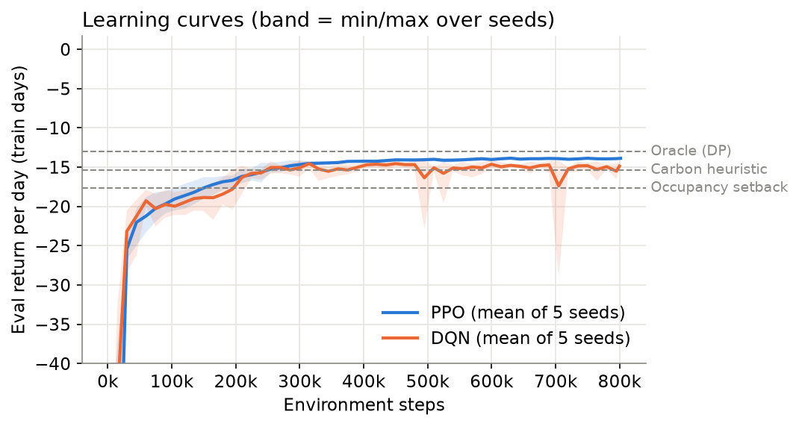
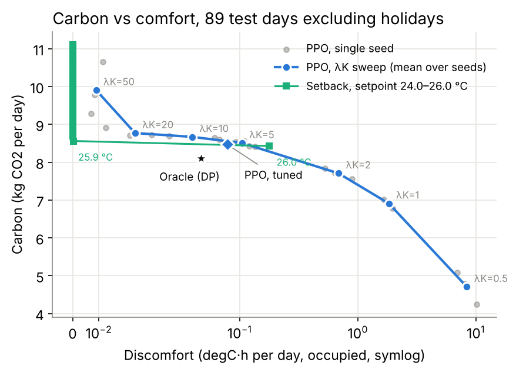
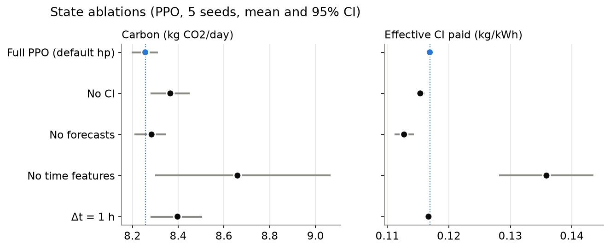

# 1. Abstract


Cooling uses about 60% of a Singapore office's electricity. On a grid whose carbon intensity varies through the day, the timing of cooling can matter as much as its amount. We ask whether reinforcement learning can cut carbon by shifting cooling without unreasonable discomfort. We model one office zone with a first-order thermal network and a synthetic, variable carbon profile, as a Markov decision process charging carbon, cost and discomfort. We compare proximal policy optimisation (PPO) and a deep Q-network with rules tuned under PPO's protocol and a perfect-foresight dynamic-programming oracle, over five seeds and 92 held-out days. Against the best tuned rule, PPO cuts carbon by 3.7%, while occupied time outside the comfort band rises from 0.7% to 5.2%. Three public holidays, when the rule cools an empty room, supply 72% of that saving; against a rule given the holiday calendar, it falls to 0.9%. Even the oracle gains only about 2% of carbon from timing; on ordinary days, knowing who will be present is worth eight times as much reward as knowing future carbon intensity. PPO's extra discomfort falls on late leavers and early arrivals, so for this building the calendar rule is the responsible choice.

# 2. Introduction


Buildings and their construction accounted for 28% of global energy consumption in 2024, and running buildings emitted about 26% of energy-related CO₂ [1]. Air conditioners and fans use nearly a fifth of the electricity in buildings, and without efficiency gains the energy used for cooling will more than triple by 2050 [2]. In a typical Singapore office, cooling takes about 60% of the electricity [3].

Carbon intensity, the CO₂ emitted per kilowatt-hour generated, varies through the day with wind, sunshine and demand. Britain's averaged 125 g/kWh in 2024 and fell as low as 19 g/kWh [4]. Because a building's structure stores heat, an office can pre-cool while the grid is clean and then drift warmer through dirtier hours without leaving the comfort band. Its emissions then depend on when it cools as well as on how much.

This makes cooling a sequential decision problem. Cooling at 07:00 affects comfort hours later. The controller has to trade carbon against cost and comfort, and in our data price and carbon intensity are almost uncorrelated, so the cheapest hour is often not the cleanest. It sees occupancy only through a sensor. A rule-based controller holds a setpoint, the indoor temperature it tries to maintain, and reacts to current conditions. Model predictive control plans ahead but needs an accurate building model. A reinforcement learning agent learns a policy from simulated experience and needs no such model.

Singapore's grid offers little to shift. Natural gas generated 94% of its electricity in 2024 [5], and its 2024 grid emission factor of 0.402 kg CO₂/kWh is an annual average over all plants [6, 7]. We found no published hourly series, and we assume intensity varies little on a grid this dependent on one fuel. We therefore pair Singapore-like weather and prices with a synthetic carbon profile shaped like Britain's, described in §5. Our carbon results describe a variable grid, not what a Singapore office would save today.

We model one office zone with a first-order thermal network and pose its cooling as a Markov decision process, or MDP, with five power levels and a reward that charges carbon, cost and discomfort. We compare PPO, our main method, and DQN with a fixed thermostat, three rule families tuned under the same protocol as PPO, and a dynamic-programming oracle with perfect foresight, over five seeds and 92 held-out test days. Our contributions are:

- §4, §5 and §7 give a simulator and MDP on which PPO, DQN and exact dynamic programming solve the same problem, and two metrics, effective carbon intensity and load shift, that separate timing from energy reduction.
- §6.4 tunes the rules and PPO under one protocol. Before we did this, PPO's carbon saving appeared to be 11.3%, about three times the 3.7% it achieves against a tuned rule.
- §8.1 shows, with paired intervals over seeds, that three public holidays account for 72% of PPO's saving over the best rule, and §8.3 that at matched comfort the tuned rule beats PPO.
- §8.7, our extension, splits the oracle's foresight and finds that on ordinary days knowing future occupancy is worth about eight times as much reward as knowing future carbon intensity.
- §9 asks who sets the comfort weight, who bears the discomfort, and how a controller could game the occupancy sensor.

Against the best tuned rule, PPO cuts carbon by 3.7% while the share of occupied time outside the comfort band rises from 0.7% to 5.2%. On ordinary days its whole advantage is timing, worth about 1% of carbon. Even a planner with perfect foresight gains only about 2% of carbon from timing, because the zone's thermal mass stores little cooling.

# 3. Background and related work


## 3.1 Thermal mass and carbon accounting

An office's thermal mass, the heat stored in its structure and contents, makes the indoor temperature lag its heat gains by hours. Pre-cooling banks cooling in that mass, but the cooling leaks back through the envelope, and the savings depend on construction, equipment, tariffs and climate [8]. Carbon accounting can use an average factor, total emissions over total generation, or a marginal rate, the change in emissions when demand changes. Marginal rates can differ by more than a factor of two between hours in the same region, and the cheapest hours to generate are often the dirtiest at the margin [9]. Our signal is an average intensity, a limitation §10 returns to. §4 and §6 define the MDP and the algorithms.

## 3.2 Conventional control

Most buildings run on rules, such as a fixed setpoint or an occupancy setback. Rules are cheap and easy to audit but react only to current conditions. Model predictive control optimises actions over a forecast horizon using a model of the building. Oldewurtel et al. found that across 1,280 simulated cases, rule-based control used over 40% more non-renewable primary energy than a predictive controller with perfect knowledge in more than half of them, and that bound assumed occupancy was known [10]. Predictive control needs an accurate model, extra infrastructure and an expert team, and its practical use is still at an early stage [11]. Our oracle is a perfect-knowledge bound of the same kind, and we tune our rules as carefully as the learners.

## 3.3 Reinforcement learning for building control

Only about 11% of the reinforcement learning applications Wang and Hong reviewed ran in real buildings [12]. Early studies often reported large savings against weak baselines [13]. Wei et al., for example, cut energy cost by 20% to 70% against an on/off thermostat fixed at 24 °C, from single runs [14]. Against strong rules the gain shrinks. Lu et al. found that PPO performed about the same as ASHRAE Guideline 36 sequences in a five-zone office [15], and in a benchmark of PPO, SAC and TD3 no agent beat the rule-based controller in the office building [13]. Our own results in §8.1 repeat this pattern. The shared benchmarks that track carbon score it rather than reward it. BOPTEST reports CO₂ from time-varying emission factors [16]. CityLearn v2 lets agents observe carbon intensity, but its controllers cut emissions little, which its authors blame on a weak carbon signal [17]. We built a low-order simulator because it is fast enough for five seeds of every controller and simple enough to solve exactly.

## 3.4 Carbon-aware, multi-objective and constrained control

Few studies reward a learned building controller on carbon. Jeen et al.'s agent, rewarded on energy times carbon intensity plus discomfort, cut emissions by up to 31% against a rule in one of three simulated buildings, and the rule emitted less in the other two; their "oracle" is a long-pretrained agent, not an optimum [18]. Kurte et al.'s DQN thermostat for a simulated, unoccupied Tennessee house, driven by a Californian marginal emissions signal, emitted 6% to 16% less than a fixed 74 °F setpoint over three summer months, and 0% to 15% less than a hand-set pre-cooling rule [19]. It used 1% to 4% more energy than the fixed setpoint, so that saving was all timing, although the paper does not report the split. Timing gains therefore depend on the signal and the building. Shifting chiller load in a Californian office at roughly constant annual energy avoided only about 2% of annual emissions [20], and our timing gain of about 1% sits at this low end. Storage sets the ceiling: predictive control with CO₂ forecasts saved about 16% in well-insulated Danish buildings but 0% to 5% in older ones [21].

A weighted reward like ours reaches only the trade-offs on the convex hull of what is achievable [22], so the comfort-weight sweep in §8.3 approximates the trade-off curve. A constrained MDP instead minimises one cost subject to limits on the others [23]. Lagrangian methods adjust the weight during training until the limit holds, and Ray et al. argue that a fixed weight cannot be chosen in advance to hit a target level [24]. Sanchez and Cai found that, in a single-zone office, treating comfort as a constraint gave cost savings comparable to predictive control, while unconstrained learning gave very different results for different penalty weights [25].

## 3.5 Gap

Among the carbon-aware reinforcement learning studies we reviewed, none compares against both a tuned rule-based controller and a perfect-foresight optimum. The closest, Shioda et al., found that a DQN scheduler for a cold-storage tank emitted 11% more than an exact dynamic-programming optimum, but compared it with no rule beyond running without storage, over one three-day test period [26]. None reports how the carbon saving splits into timing and energy reduction, and none measures how much of the achievable saving depends on knowing occupancy rather than carbon intensity, a question predictive-control studies have asked for energy [27]. We do all three, on a building simple enough to solve exactly.

# 4. Problem Formulation


We control the cooling of a single office zone over one day. Each episode starts at 00:00 and runs for H = 96 decision steps of Δt = 15 min. At every step the controller observes the zone and the grid, chooses an air-conditioning power level, and the zone temperature evolves according to the thermal model in §5.

## 4.1 Markov decision process

We formulate the problem as an MDP (S, A, P, R, γ).

**State.** The observation at step t is

  s_t = ( T_in, T_out, ô_t, p_t, CI_t, sin(2πh/24), cos(2πh/24), w_t, { T̂_out, p̂, ĈI }_{t+τ}, τ ∈ {1, 2, 4, 8} h ),

where:
- T_in and T_out are the indoor and outdoor temperatures (°C);
- ô_t is the occupancy *sensor* reading;
- p_t is the wholesale electricity price (SGD/kWh) and CI_t the grid carbon intensity (kg CO₂/kWh);
- h is the hour of day, encoded on the unit circle so that 23:45 and 00:00 are adjacent, and w_t flags a working day;
- the last block holds forecasts of outdoor temperature, price and CI at four lead times.

That gives 8 current and 12 forecast features, 20 in total. Each feature is affinely scaled to roughly [−1, 1] with fixed constants rather than a running normaliser, so every run and every controller sees an identical observation.

**Action.** a_t ∈ {0, 1, 2, 3, 4} selects electrical HVAC power P_t = (a_t / 4)·P_max, with P_max = 14 kW. We use discrete levels for three reasons:

1. Commercial units are typically staged.
2. One discrete action space admits PPO, DQN *and* an exact dynamic-programming solution (§6), so every controller solves exactly the same problem.
3. The fine time step offsets the coarse power resolution: four 15-min steps can realise 17 distinct average power levels within an hour.

**Transition.** T_in follows the 1R1C model of §5, discretised exactly under a zero-order hold:

  T_{t+1} = T_eq + (T_t − T_eq)·exp(−Δt / RC),  T_eq = T_out + R·( Q_int(o_t) + Q_sol − COP(T_out)·P_t ).

Given the exogenous series (weather, occupancy, price, CI), the transition is deterministic. Stochasticity enters only through the day drawn, the initial temperature T_0 ~ U(25.5, 28) °C, and, when enabled for the robustness scenarios (§7.2), sensor and forecast errors.

**Reward.** The reward is the negative of a weighted cost:

  r_t = −[ λ_E·E_t + λ_C·CI_t·E_t + λ_$·p_t·E_t + λ_K·D_t ],  E_t = P_t·Δt,

  D_t = 1[o_t]·( max(0, T_{t+1} − 26) + max(0, 23 − T_{t+1}) )·Δt.

- D_t is a hinge penalty, in °C·h, on the comfort band [23, 26] °C. This spans the 23–25 °C design range of SS 553 [28] and the 26 °C upper limit commonly applied in Singapore offices.
- The penalty is charged only when the zone is **truly** occupied (o_t, not the sensor ô_t). §9 explains why this matters for specification gaming.
- Default weights are λ_E = 0, λ_C = 1 per kg, λ_$ = 0.5 per SGD and λ_K = 5 per °C·h. Carbon is the primary objective and cost a secondary one. λ_K is swept in §8.3 to expose the carbon–comfort trade-off.

**Discount.** γ = 0.99. At 15-min steps this gives an effective horizon 1/(1−γ) = 100 steps ≈ 25 h, long enough to credit cooling at 07:00 for comfort in the afternoon. Episodes end at a fixed horizon with no terminal value. The zone is unoccupied after about 18:00, so the end-of-day temperature carries no cost in reality either.

## 4.2 Carbon-awareness is temporal load shifting

Carbon (CI_t·E_t) and cost (p_t·E_t) are both linear in energy, so any controller that saves energy saves both. What distinguishes a *carbon-aware* controller is **when** it consumes: for a fixed total energy, carbon is minimised by moving consumption into low-CI steps.

The zone's only storage is its thermal mass, C = 15 kWh/K. Pre-cooling by 3 K banks about 45 kWh of cooling, roughly 13 kWh of electricity at COP 3.5, and with τ = RC = 6 h much of it leaks back within a few hours. This bounds how much load can move, and §8 shows the bound is tight.

We therefore report two quantities that separate energy reduction from shifting:
- the **effective CI paid**, Σ CI_t·E_t / Σ E_t;
- the **share of HVAC energy consumed in below-median-CI steps** (load shift).

Both are ratios, so they are energy-weighted over all test days (§7.2). Load shift has no natural 50% baseline here: any controller that cools only in office hours already places about 60% of its energy below the daily median, because the midday solar dip falls inside the working day. It is therefore read relative to the tuned rule and the oracle.

In our data the correlation between price and CI is r = −0.07. Price peaks with afternoon demand, while CI falls with midday solar and windy periods, so the cost-optimal and carbon-optimal schedules genuinely differ.

## 4.3 Partial observability

The true state includes the occupancy o_t and the future exogenous values, neither of which the agent observes directly. It sees a sensor ô_t, which flips with probability ε, and forecasts with multiplicative error growing with lead time. The problem is therefore a POMDP.

We approximate it by **feature augmentation**:
- the forecasts stand in for the hidden future exogenous state;
- the time features let the policy infer the occupancy *schedule*, which covers ordinary workdays. On irregular days, such as public holidays, only the sensor reveals that nobody is coming, and this turns out to drive much of PPO's measured advantage (§8.1).

The main experiments use a perfect sensor and perfect forecasts (ε = 0, zero forecast error); both kinds of noise are configurable for the robustness scenarios (§7.2). A recurrent policy is the natural next step for heavier noise (§10).

The oracle (§6) is given the true o_t and the true future series, which is what makes it an upper bound. Removing each piece of its foresight in turn shows that **occupancy foresight, not carbon foresight, accounts for almost all of the oracle's advantage** over the best rule (§8). This identifies the hidden variable that matters most.

## 4.4 Design choices

**Table 1.** Design choices.

| Choice | Value | Alternative | Reason / evidence |
|---|---|---|---|
| Δt | 15 min | 1 h | CI dips last 1–3 h. Ablation at Δt = 1 h: carbon 8.40 vs 8.26 kg/day and 1.7× the discomfort (§8.4) |
| Horizon | 1 day (96 steps) | 1 week | The occupancy cycle is daily; longer episodes slow learning with no new dynamics |
| γ | 0.99 | 0.995 | 0.99 spans a full day. 0.995 scored worse in tuning (validation reward −11.96 vs −11.82, §6.4) |
| Comfort penalty | dense hinge, occupied only | sparse violation count | Dense learning signal, in physical units (°C·h) |
| Reward scaling | running return normalisation | fixed scale | Early returns span −10 to −300 per day |
| Comfort scoring | true occupancy o_t | sensor ô_t | A controller cannot score well by exploiting sensor errors |

# 5. Environment and Simulator


We implement a single-zone office simulator to study how thermal inertia affects carbon-aware cooling. The simulator combines a first-order thermal model, a capacity-limited cooling unit and synthetic weather, occupancy, electricity-price and carbon-intensity profiles. The environment, rule-based controllers and dynamic-programming oracle share the same thermal transition function, ensuring that their comparisons use consistent physics.

## 5.1 Thermal and HVAC model

The zone is represented by a one-resistance, one-capacitance (1R1C) network:

  C·dT_in/dt = (T_out − T_in)/R + Q_int(o_t) + Q_sol,t − COP(T_out)·P_t.

Here R describes heat exchange with the surroundings, C represents the effective thermal mass of the zone, and P_t is HVAC electrical power. Internal gains are Q_int(o_t) = 1.5 + 12o_t kW, where o_t ∈ [0, 1] is the true occupancy fraction. Solar heat gains are added separately. The model tracks sensible temperature only; humidity, latent cooling, explicit ventilation loads and inter-zone heat transfer are omitted.

**Table 2.** Simulator parameters. These are modelling assumptions for a representative office zone, rather than parameters fitted to a measured building.

| Parameter | Value | Interpretation |
|---|---|---|
| Reference floor area | 500 m² | Used to express cooling electricity per unit area |
| Thermal resistance R | 0.4 K/kW | Aggregate resistance to outdoor heat exchange |
| Thermal capacitance C | 15 kWh/K | Effective zone thermal mass |
| Time constant τ = RC | 6 h | Rate of approach to thermal equilibrium |
| Maximum electrical HVAC power | 14 kW | Five levels: 0, 3.5, 7, 10.5 and 14 kW |
| COP | clip[3.5 − 0.08(T_out − 30), 2.5, 4.5] | Cooling efficiency decreases as outdoor temperature rises |
| Internal / solar gains | 1.5 + 12o_t kW / up to 6 kW | Occupancy-dependent and daylight heat inputs |

At 30 °C outdoors, full electrical power delivers 49 kW of cooling. Inputs are held constant within each 15-minute interval, giving the exact update

  T_eq,t = T_out,t + R[Q_int(o_t) + Q_sol,t − COP(T_out,t)·P_t],

  T_in,t+1 = T_eq,t + (T_in,t − T_eq,t)·exp(−Δt/RC),  Δt = 0.25 h.

This avoids forward-Euler integration error under the assumed constant inputs. In the hourly-control ablation, the action is held for four successive 15-minute simulation steps while external conditions continue to change. Exact integration therefore does not imply that hourly and 15-minute controllers achieve identical performance.

## 5.2 Exogenous data and occupancy

All reported experiments use one synthetic year containing 35,040 quarter-hourly samples. Weather and prices are Singapore-like; carbon intensity is a deliberately variable, UK-like scenario for examining load shifting. The profiles are generated locally and are not downloaded MSS, EMC or UK grid observations.

**Table 3.** Profile construction.

| Signal | Generation assumptions |
|---|---|
| Outdoor temperature and solar gain | A daily temperature cycle peaking at 15:00, a seasonal component and correlated noise. A 30% daily rain flag lowers the daily mean and temperature amplitude. Solar gains follow a 07:00–19:00 daylight curve reduced by cloud cover. |
| Occupancy | Weekdays nominally 08:00–18:00, with arrival jitter of −30 to +30 minutes and departure jitter of −30 to +45 minutes. Occupied fractions are 0.8–1.0, falling to 0.6 during 12:00–13:00. Weekends and randomly designated holidays are unoccupied. |
| Electricity price | A 0.14 SGD/kWh base plus afternoon/evening demand components, correlated variation and occasional spikes of two to four times the underlying price. |
| Carbon intensity | A correlated wind-like component, seasonal midday solar reduction and evening peak, clipped to 0.03–0.40 kg CO₂/kWh. This is a scenario signal, not a measured Singapore emissions factor. |

The temperature scale is broadly consistent with MSS's description of typical Singapore daily minima of 23–25 °C and maxima of 31–33 °C [29]. The stochastic rules, including the rain frequency and occupancy schedule, remain simplifying assumptions rather than an empirical calibration. Consequently, the experiments support comparisons within the constructed scenario, not estimates of actual Singapore building emissions. A CSV loader permits future replacement of temperature, price and carbon profiles, but was not used for these results.

## 5.3 Temporal split and episode design

The synthetic calendar follows 2026. Training and controller selection use January–September, days 0–272; evaluation uses October–December, days 273–364, giving 273 training days and 92 test days. This tests transfer to unseen decision days within the same synthetic process. The split applies to episode days: supplied forecasts may extend across midnight and across the train/test boundary.

Each episode covers one day, with 96 decisions. Initial indoor temperature is sampled from U(25.5, 28.0) °C. Temperature is reset between episodes, so actions have no thermal consequences on the following day. This limits conclusions about overnight storage and multi-day scheduling.

## 5.4 Simulator validation

Validation checks analytical consistency, accounting and energy scale. The ten existing simulator tests pass in the local verification run; they include the following checks.

**Open-loop response.** With cooling and heat gains disabled, an outdoor-temperature step from 20 to 30 °C gives T_in(t) = 30 − 10exp(−t/6). After one time constant, the simulator reaches 26.3212 °C, or 63.2% of the imposed step. Over 24 hours, its trajectory agrees with the analytical solution to within 1.1 × 10⁻¹⁴ °C (Figure 1).


**Figure 1.** Indoor-temperature response to a constant 30 °C outdoor temperature, starting at 20 °C with no internal gains, solar gains or HVAC power. Markers show hourly samples of the 15-minute simulation. The dotted vertical line identifies τ = 6 h.

**Discretisation and bounds.** With unchanged inputs and HVAC power, one 60-minute thermal update agrees with four 15-minute updates to the test tolerance of 10⁻⁹ °C. Increasing HVAC power lowers the predicted next temperature. The accounting checks verify non-negative electricity use, the maximum of 3.5 kWh per 15-minute step, carbon = CI × energy, cost = price × energy, and zero discomfort when the zone is unoccupied. These establish numerical and accounting consistency; they do not constitute validation against measured building temperatures.

**Energy magnitude.** A separate full-year check runs the default occupancy-setback controller (24 °C target, one-hour lead) on all 365 days, using profile seed 0 and episode noise seed 0. It consumes 24,682.875 kWh, corresponding to **49.37 kWh/m²/year** for the assumed 500 m² zone. This includes weekdays, weekends and synthetic holidays, and is the sum of independently reset daily episodes.

For context, BCA's 2025 office benchmarks place the middle two quartiles of whole-building electricity use between 105 and 165 kWh/m²/year [30]. Our lower figure covers only the simulated HVAC electrical input; equipment and lighting appear as heat gains but their electricity is not counted. The comparison is therefore a broad scale check, not evidence that the simulated office meets a whole-building efficiency benchmark. Omitted humidity and ventilation loads, assumed parameters and daily resets also limit its physical interpretation.

## 5.5 Gymnasium interface and reproducibility

The simulator exposes a Gymnasium environment with five discrete actions and the 20 observation features defined in §4. Temperature, price and carbon features use fixed affine scaling:

  T̃_in = (T_in − 24.5)/3,  T̃_out = (T_out − 28.5)/3,

  p̃ = (p − 0.20)/0.10,  CĨ = (CI − 0.17)/0.08.

The same transformations apply to forecasts at 1, 2, 4 and 8 hours; binary features and sine/cosine time encodings are unchanged. Scaling is fixed and does not estimate statistics from the test period. Main experiments use an error-free binary occupancy sensor and perfect forecasts sampled from the generated profiles. Sensor flips and forecast noise are configurable for robustness experiments.

Profile generation, episode sampling and learning use separately controlled seeds. Profile seed 0 fixes the shared synthetic year; fixed day/noise-seed pairs reproduce evaluation episodes across controllers. Reset options can also specify the initial temperature. Each training run saves its seed, environment settings and algorithm configuration. Energy, carbon, cost and discomfort are returned separately at each step, enabling the metrics in §7 to be checked against the same underlying trajectory.

# 6. Methods: baselines, learning algorithms, upper bound and tuning


## 6.1 Rule-based baselines

All rules share one primitive: an ideal staged thermostat that, at each step, selects the power level whose predicted next indoor temperature is closest to a target. The rules differ only in the target and when it applies.

1. **Fixed setpoint.** Holds 24 °C continuously; the reference against which all savings are measured.
2. **Occupancy setback.** Cools to a setpoint from a lead time before the scheduled 08:00 start until 18:00 on workdays, or whenever the occupancy sensor reads occupied; otherwise off. We report it both untuned (24 °C) and tuned, which isolates the value of tuning.
3. **Carbon heuristic.** Setback with a carbon-intensity threshold θ: below θ it cools to a lower setpoint, storing cooling in the thermal mass; above θ it lets the zone drift to a higher setpoint. Optional early-morning pre-cooling applies when CI is low.
4. **Carbon-proportional.** Setback whose setpoint rises linearly with CI: T_set = clip(base + gain·(CI − CI_median), 23, 26) °C, with CI_median the training-period median.

**What tuning found.** Rules 2–4 were tuned under the common protocol of §6.4 (972 configurations; Table A1). For each rule we also record a matched-comfort variant (lowest carbon with ≤1% of occupied steps in violation), used for the comfort-matched comparison in §8.3. **All three converged to essentially the same controller: setback at 25.9 °C with a 1-hour lead.** Tuning disabled the carbon-reactive features: the carbon-proportional gain fell to 0, making it identical to setback, and the heuristic's setpoints narrowed to 25.5/25.9 °C, leaving it marginally worse than setback. With a 6-hour thermal time constant (§5), cooling stored in a low-carbon hour largely leaks away before it is needed, so the best rule is to cool only when occupied, at the top of the comfort band. That setpoint sits just below a cliff: on training days, 25.9 °C leaves 0.7% of occupied steps in violation but 26.0 °C leaves 32%, because the staged thermostat oscillates around its target and crosses the band edge.

## 6.2 Proximal Policy Optimization (main method)

PPO [31] learns a stochastic policy π_θ(a|s) and a value function V_φ(s) by alternating between two phases: collecting a batch of experience with the current policy, then taking several gradient steps on a *clipped* surrogate objective:

  L^CLIP(θ) = E_t[ min( ρ_t(θ)·Â_t, clip(ρ_t(θ), 1−ε, 1+ε)·Â_t ) ],  ρ_t(θ) = π_θ(a_t|s_t) / π_θold(a_t|s_t).

The clip removes any incentive to move the probability ratio outside [1−ε, 1+ε]. This makes it safe to reuse each batch for several epochs without the destructive policy updates that unconstrained policy gradients suffer. Advantages are estimated with generalised advantage estimation (GAE) [32]:

  Â_t = Σ_l (γλ)^l δ_{t+l},  δ_t = r_t + γV_φ(s_{t+1}) − V_φ(s_t).

Here λ trades bias (λ → 0) against variance (λ → 1). The full loss adds a value-function regression term and an entropy bonus, −L^CLIP + c_v·(V_φ − V^target)² − c_e·H[π_θ], which keeps exploration alive early in training.

**Why PPO.** PPO is on-policy and therefore sample-hungry. That is a poor trade on real hardware, but our simulator runs at about 36,000 steps/s, so a 1.5M-step run takes under 5 minutes. In return we get stable, smooth learning and native support for discrete actions.

**Implementation.** We use stable-baselines3 2.9 [33]:
- **Networks:** separate actor and critic MLPs, each with two hidden layers of 64 tanh units. The actor ends in a 5-way softmax over power levels.
- **Rollouts:** 8 parallel environments × 768 steps = 6,144 transitions per update, i.e. 64 simulated days.
- **Optimisation:** 10 epochs of 256-sample minibatches.
- **Training budget:** 1.5M steps (≈244 updates, ≈4.7 min on one CPU core).

Full hyperparameters are in Table A2.

**Stability measures.** Training instability was the main risk named in our proposal. We address it with six measures:
1. Reward normalisation: rewards are divided by a running estimate of the discounted return's standard deviation, with the normaliser's γ matched to the agent's.
2. Per-minibatch advantage normalisation.
3. The ratio clip, ε = 0.2.
4. Gradient-norm clipping at 0.5.
5. A small entropy bonus, c_e = 0.01.
6. Longer rollouts, chosen by tuning (§6.4), which give lower-variance advantage estimates. Large-scale studies show such implementation choices matter for on-policy RL [34].

The result: across the 34 runs with the full state and default weights (5 main, 24 tuning, 5 final), the worst seed finished 0.27 reward/day below its group's median. The final 5 seeds agree within 1.3% on test-period carbon. Over all 72 PPO runs, two finished clearly below their group: one λ_K = 50 sweep seed and one seed of the no-time-features ablation. Both are harder variants. We report every seed, not the best one [35].

## 6.3 Comparison algorithm and upper bound

**DQN.** DQN [36] is our second learner. It is off-policy and value-based: it learns Q(s, a) by regressing toward r + γ·max_a′ Q_target(s′, a′), using a 100k-transition replay buffer and a target network refreshed every 1,000 steps. Exploration is ε-greedy, annealed from 1.0 to 0.02 over the first 30% of training. The network is a 64×64 ReLU MLP trained for 800k steps (Table A2). DQN is the natural comparison because it uses experience more efficiently and handles our discrete action space directly. It was **not** hyperparameter-tuned, which we note as a limitation (§10).

**Oracle (perfect-foresight dynamic programming).** Given one day's realised weather, occupancy, price and CI, the dynamics are deterministic and the state is the scalar T_in. We can therefore solve each day exactly by finite-horizon backward induction (value iteration) [37]:

  V_H(T) = 0,  V_t(T) = min_a [ c_t(T, a) + V_{t+1}( f_t(T, a) ) ],

where c_t is the per-step cost (the negative reward) and f_t the 1R1C transition.
- **Grid:** V is computed on a 401-point temperature grid over [15, 35] °C at 0.05 °C, with linear interpolation between grid points.
- **Execution:** the oracle acts by one-step lookahead from the exact current temperature, so interpolation is the only approximation.
- **Shared code:** dynamics and cost come from the same function the environment uses, so the oracle optimises exactly the objective every controller is scored on.
- **Checks:** unit tests confirm, on sampled test days, that it never loses to a rule-based controller and that its predicted value matches the realised return within 2%. On all 92 test days it scores above every tuned rule on average.
- **Decomposition:** two variants each remove one piece of foresight. One plans with a flat CI; the other plans with the nominal 08:00–18:00 schedule instead of true occupancy. Both are scored on the true outcome, which lets us attribute the oracle's advantage (§8).

## 6.4 Hyperparameter tuning protocol

A learned controller is only meaningfully better than a rule if both have been tuned with comparable care. Our first results compared default-setting PPO against a carbon heuristic with only two of its settings tuned, and overstated PPO's carbon advantage roughly threefold (11.3% vs 3.7%). We therefore tuned every controller under the same protocol:

- **Selection data:** the same 60 fixed days from the training period (January–September) for every controller. The test period (October–December) is never used for any choice.
- **Objective:** mean daily reward, exactly the quantity PPO maximises.
- **Rules:** grid search over 972 configurations of the three rule families (§6.1).
- **PPO:** 12 configurations (Table 4), each changing one or two hyperparameters from the defaults, with 2 seeds × 1.5M steps each (24 runs, ≈25 min on 7 parallel jobs).
- **Final run:** the selected configuration is retrained with 5 fresh seeds and evaluated **once** on the 92 test days.

**Table 4.** PPO tuning on validation days (mean daily reward over 2 seeds; higher is better). For reference, the best tuned rule scores −11.84 and the oracle −11.21 on the same days.

| Configuration | Change from defaults | Validation reward |
|---|---|---|
| **Selected** | rollout length 384 → 768 | **−11.71** |
| ent0 | entropy coefficient 0.01 → 0 | −11.78 |
| clip01 | clip ε 0.2 → 0.1 | −11.79 |
| default | — | −11.82 |
| lr1e4 | learning rate 3×10⁻⁴ → 1×10⁻⁴ | −11.85 |
| net128 | 128×128 networks | −11.93 |
| g995 | γ 0.99 → 0.995 | −11.96 |
| gae098 | GAE λ 0.95 → 0.98 | −12.02 |
| *4 further variants* | entropy 0.001, and combinations of the above | −11.82 to −11.96 |

Two observations matter for interpreting the main results.

1. **The spread across configurations (≈0.3) is only about three times the seed-to-seed spread (≈0.1).** Picking the best of 12 therefore risks a winner's-curse bias. Retraining with 5 fresh seeds and testing once on held-out days is our guard against it.
2. **The two worst single changes, γ = 0.995 and GAE λ = 0.98, both lengthen the credit-assignment horizon. Larger networks did not help either; a longer rollout did.** This is consistent with a problem whose relevant planning horizon is under a day and whose reward is dense. The remaining differences are within seed noise.

Even under this protocol, an aggregate win can hide where it comes from: §8.1 shows that most of PPO's test-period advantage over the tuned rule arises on three public holidays, so we also report a day-type breakdown.

# 7. Experimental Setup


## 7.1 Metrics

Metrics are computed per test day (96 steps of 15 minutes) and aggregated as described in §7.2. Notation follows §4: E_t is HVAC electrical energy, CI_t carbon intensity, p_t the electricity price and D_t the comfort penalty on the 23–26 °C band. Comfort is always scored against true occupancy, not the sensor reading.

**Table 5.** Evaluation metrics.

| Metric | Definition | Unit |
|---|---|---|
| Reward | Σ r_t = −Σ (λ_C·CI_t·E_t + λ_$·p_t·E_t + λ_K·D_t), with λ_C = 1, λ_$ = 0.5, λ_K = 5; the composite score all controllers are tuned on | per day |
| Energy | Σ E_t | kWh/day |
| Carbon | Σ CI_t·E_t | kg CO₂/day |
| Cost | Σ p_t·E_t | SGD/day |
| Discomfort | Σ D_t: distance outside the comfort band, integrated over occupied time | °C·h/day |
| Violation rate | Share of occupied steps with any discomfort | % |
| Max deviation | Largest occupied distance outside the comfort band | °C |
| Effective CI | Carbon ÷ energy: average CI paid per kWh, isolating timing from quantity | kg/kWh |
| Load shift | Share of HVAC energy used in steps with CI below that day's median (50% = no shifting) | % |
| Gap closed | (best tuned rule − controller) ÷ (best tuned rule − oracle), on reward or carbon | % |

Effective CI and load shift are the two metrics that separate *carbon-aware* control from merely *efficient* control: a controller that uses less energy at the same times lowers carbon but leaves both unchanged. Gap closed is measured against the best tuned rule rather than the fixed thermostat, because against the thermostat every tuned controller scores above 90% (PPO 97%, the best rule 94%) and the measure stops discriminating.

## 7.2 Evaluation protocol

**Data split.** The simulator covers one year at 15-minute resolution (§5). Days 0–272 (January–September) are used for training and for every tuning decision; days 273–364 (October–December) form the test period. The 92 test days comprise 63 workdays, 26 weekend days and 3 weekday public holidays (days 273, 277 and 337), on which nobody arrives. Each controller is evaluated on the test period once, after all choices are fixed.

**Fixed test episodes.** One episode is one day (96 steps). Each test day is paired with a fixed noise seed, so every controller faces identical weather, occupancy, price and CI on a given day, and controllers can be compared day by day. Learned policies act greedily at test time.

**Tuning data.** All rule parameters and PPO hyperparameters were selected on the same 60 training days by mean daily reward (§6.4). DQN, the λ_K sweep and the ablations use the default PPO hyperparameters at 800k steps; only the main PPO arm uses the tuned configuration at 1.5M steps. Comparisons inside §8.3 and §8.4 are therefore always against the default-configuration PPO, never the tuned one.

**Seeds and confidence intervals.** Each learned controller is trained with 5 independent seeds (0–4), and the seed is the unit of replication: metrics are averaged over test days within a seed, and we report the mean over seeds with a 95% percentile bootstrap interval (10,000 resamples) [38]. Rules and the oracle are deterministic given a day, so their intervals are bootstrapped over the 92 days and reflect day-to-day variation only. The two kinds of interval are not comparable in width, which is why every headline comparison is paired.

**Paired comparisons.** For a learned controller A and reference B, we compute for each seed the mean per-day difference A − B over the same test days, giving 5 paired differences. We report their mean, a bootstrap 95% CI, and a one-sample t-test against zero. Pairing removes the large day-to-day variation shared by both controllers (weather, occupancy), which dominates unpaired intervals. Families of comparisons (the four ablations) are Holm–Bonferroni corrected [39]. With 5 seeds we treat p-values as supporting evidence and lean on effect sizes and intervals, following the reporting advice of [35, 40].

**Aggregating the timing metrics.** Effective CI and load shift are ratios, so they are aggregated energy-weighted: effective CI = Σ carbon / Σ energy over all test days, not the mean of daily ratios. Weekend and holiday days consume (almost) no energy, and averaging per-day ratios would score those days as 0 and make the result depend on how many idle days a controller happens to have. The load-shift baseline is also not 50%: any controller that cools only during occupied hours already places about 60% of its energy below the daily median CI, because the midday solar dip falls inside the working day. Load shift is therefore read relative to the tuned rule (60.2%) and the oracle (67.3%).

**Reference controller and day-type breakdown.** The protocol comparison is against the best tuned rule, setback at 25.9 °C (§6.1). Inspecting per-day test results showed that this rule follows its workday schedule on the 3 public holidays and cools an empty zone, while the learned controllers react to the occupancy sensor and do not. Because this is a post hoc observation, we keep the protocol result as the primary comparison and add two secondary views: (i) the same comparison restricted to the 89 non-holiday days, and (ii) a *calendar setback*, identical to the tuned setback but switched off on public holidays, as any building-management schedule would be. The calendar setback needs no new tuning or test-set choice: it equals the tuned rule on every non-holiday day.

**Gap closed and sample efficiency.** Gap closed (Table 5) is computed on the same days as the comparison it accompanies. Sample efficiency is the first training step at which the evaluation return on 16 fixed training days, smoothed over 5 evaluations, reaches 90% of its total improvement from the first to the final evaluation.

**Scenarios.** Table 6 lists the evaluation scenarios. All scenario knobs are evaluation-time changes to the environment (`EnvConfig`) and require no retraining.

**Table 6.** Evaluation scenarios.

| Scenario | What changes | Purpose | Status |
|---|---|---|---|
| Main | Held-out test period, perfect sensor and forecasts | Main comparison (§8.1–8.4, 8.6) | Done |
| Shifted CI | CI profile shifted by k hours (`ci_shift_hours`) | Does the policy read the CI signal or rely on the clock? | Done (§8.5) |
| Sensor noise | Occupancy-sensor flip probability ε ∈ {0.1, 0.2} (`occ_flip_prob`) | Robustness of the POMDP approximation (§4.3) | Done (§8.5) |
| Price / CI regimes | Flat or time-of-use price; flat or price-anticorrelated CI | Isolates carbon-awareness from cost-awareness | Done (§8.5) |

**Compute.** The environment runs at about 36,000 steps/s on one CPU core. A PPO run takes about 2.6 min at 800k steps and 4.7 min at 1.5M steps; a DQN run about 6.8 min at 800k steps. The experiment grid (main PPO and DQN, the λ_K sweep and the four ablations; 48 runs) took 26 min wall-clock with 7 parallel jobs (2.8 CPU-hours), the PPO hyperparameter search (24 runs) about 25 min, and the 5 tuned PPO seeds about 5 min. Rule tuning (972 configurations) and the oracle evaluations take about 1 min each. In total, about 5 CPU-hours on an 8-core Apple Silicon laptop, CPU only.

**Reproducibility.** Every run stores its seed, environment configuration and hyperparameters in `config.json`. All tables and figures in §8 are regenerated from the stored per-day test results by `scripts/make_figures.py` and `scripts/holiday_breakdown.py` (https://github.com/btbrandon/carbon-hvac).

# 8. Results and Analysis


All results are on the 92 held-out test days (§7.2). Learned controllers: mean over 5 seeds with 95% bootstrap intervals over seeds; rules and the oracle: intervals over days. Effective CI and load shift are energy-weighted (§7.2).

## 8.1 Main comparison

**Table 7.** Test-period results, per day. Higher reward is better. Violations: share of occupied 15-min steps outside 23–26 °C. Load shift: share of HVAC energy in below-median-CI steps.

| Controller | Reward | Energy (kWh) | Carbon (kg CO₂) | Cost (SGD) | Discomfort (°C·h) | Violations (%) | Effective CI (kg/kWh) | Load shift (%) |
|---|---|---|---|---|---|---|---|---|
| Fixed setpoint (24 °C) | −29.87 [−31.48, −28.26] | 112.1 | 18.96 [17.88, 20.07] | 21.81 | 0.000 | 0.0 | 0.1691 | 53.1 |
| Setback, 24 °C (untuned) | −17.95 [−20.35, −15.43] | 67.8 | 11.10 [9.52, 12.61] | 13.69 | 0.000 | 0.0 | 0.1636 | 60.5 |
| **Setback, tuned (best rule)** | −13.88 [−15.78, −11.89] | 52.0 | 8.52 [7.28, 9.71] | 10.72 | 0.000 | 0.7 | 0.1637 | 60.2 |
| Carbon heuristic, tuned | −13.92 [−15.83, −11.93] | 52.4 | 8.53 [7.30, 9.73] | 10.77 | 0.000 | 0.5 | 0.1629 | 60.9 |
| Setback, tuned + holiday calendar | −13.48 | 50.5 | 8.28 | 10.40 | 0.000 | 0.7 | 0.1639 | 60.7 |
| DQN | −14.90 [−15.12, −14.68] | 53.1 | 8.52 [8.28, 8.77] | 10.60 | 0.215 | 7.6 | 0.1604 | 64.5 |
| **PPO (tuned)** | −13.72 [−13.82, −13.66] | 50.8 | 8.21 [8.18, 8.25] | 10.28 | 0.076 | 5.2 | 0.1616 | 63.2 |
| Oracle (DP) | −13.07 [−15.00, −11.09] | 49.4 | 7.83 [6.64, 8.99] | 10.01 | 0.047 | 3.7 | 0.1586 | 67.3 |

**Tuning the rule matters more than the controller class.** Moving from a 24 °C thermostat to an occupancy setback cuts carbon by 41%; tuning that setback's setpoint on training days (to 25.9 °C, §6.1) removes another 23%. Every learned and oracle controller in Table 7 sits within 8% of the tuned rule's carbon. The tuned carbon heuristic is no better than plain setback: tuning narrowed its CI response to 0.4 K, so it barely acts on the signal.

**Protocol result.** Against the best tuned rule over all 92 days, PPO lowers carbon by 3.7% (paired 95% CI 3.2–4.0%, p < 0.001), cost by 4.1% and energy by 2.4%, and raises reward by 1.1% (0.4–1.6%, p = 0.03). This closes 46% of the carbon gap and 19% of the reward gap between the rule and the oracle. The price is comfort: violations rise from 0.7% to 5.2% of occupied steps (+4.5 percentage points, 3.9–5.1), although the size stays small (0.076 °C·h/day, mean maximum deviation 0.14 °C). The oracle, optimal for the same reward, also accepts 3.7% violations, so small, brief excursions are part of the optimum at λ_K = 5 rather than a learning failure. DQN does not beat the rule: carbon is level (+0.1%, p = 0.97) while reward is 7.4% lower (p = 0.001) and violations 6.9 points higher.

**Where the gain comes from.** Table 8 splits the test days by type. On weekends nobody arrives and every controller stays off. On the 3 weekday public holidays the tuned rule follows its workday schedule and cools an empty zone (46 kWh/day), while PPO reacts to the occupancy sensor and barely runs (3.6 kWh/day). These 3 days account for **72% of PPO's carbon saving and all of its reward advantage**.

**Table 8.** Mean daily energy and carbon by day type.

| Day type | Days | Tuned setback | PPO (tuned) | DQN | Oracle |
|---|---|---|---|---|---|
| Workday | 63 | 73.8 kWh · 12.09 kg | 74.0 kWh · 11.96 kg | 77.0 kWh · 12.36 kg | 72.1 kWh · 11.44 kg |
| Public holiday | 3 | 45.8 kWh · 7.19 kg | 3.6 kWh · 0.36 kg | 12.2 kWh · 1.69 kg | 0.0 kWh · 0.00 kg |
| Weekend | 26 | 0.0 kWh · 0.00 kg | 0.1 kWh · 0.01 kg | 0.1 kWh · 0.01 kg | 0.0 kWh · 0.00 kg |

Table 9 repeats the paired comparison on the 89 non-holiday days, and against a setback given the holiday calendar (§7.2), which equals the tuned rule on every other day.

**Table 9.** PPO (tuned) minus reference, paired over seeds. Percentages relative to the reference; positive Δ reward means PPO is better.

| Comparison | Δ reward | Δ carbon | Δ energy | Δ violations | Carbon gap closed | Reward gap closed |
|---|---|---|---|---|---|---|
| All 92 days vs tuned setback (protocol) | +1.1% [0.4, 1.6], p = 0.03 | −3.7% [−4.0, −3.2], p < 0.001 | −2.4% [−2.6, −2.1] | +4.5 pp [3.9, 5.1] | 46% | 19% |
| 89 non-holiday days vs tuned setback | −1.6% [−2.3, −1.1], p = 0.008 | −1.1% [−1.5, −0.6], p = 0.016 | +0.3% [0.0, 0.6] | +4.7 pp [4.1, 5.3] | 20% | −55% |
| All 92 days vs setback + holiday calendar | −1.8% [−2.5, −1.3], p = 0.007 | −0.9% [−1.3, −0.4], p = 0.02 | +0.5% [0.3, 0.8] | +4.5 pp [3.9, 5.1] | 17% | −60% |

On ordinary days the picture changes: PPO still emits about 1% less carbon, but it does so with slightly *more* energy, so the entire saving is timing (effective CI 0.1618 vs 0.1639 kg/kWh, −1.3%). It pays for that timing with comfort, and on its own objective it is now 1.6% *worse* than the rule. A building-management system with a holiday calendar would capture the holiday saving without any learning. Our reading is that PPO's measurable advantage in this building comes from **reacting to observed occupancy**, a small genuine **carbon-timing** effect, and nothing else. §8.6 and the foresight decomposition in §8.7 support this.

## 8.2 Learning dynamics



**Figure 2.** Evaluation return per day on 16 fixed training days; line = mean of 5 seeds, band = min/max. Dashed: tuned setback and oracle on the same days.

PPO learns smoothly and consistently. The tuned configuration reaches 90% of its total improvement after 250k–300k steps on every seed and comes within 0.1 reward/day of its final level between 750k and 1.3M steps. Final returns on the curve days range from −13.61 to −13.90 across seeds, level with or slightly below the tuned rule on those days (−13.55); it pulls ahead only on the larger validation set and the test set, and §8.1 shows how much of that is holidays. The default configuration reaches its 90% point sooner (75k–135k steps) but plateaus lower (final −13.81 to −14.00), so the longer rollout selected in §6.4 trades early speed for a better final policy. On the test period the 5 tuned seeds agree within 1.3% on carbon (8.18–8.28 kg).

DQN reaches its 90% point at a similar pace (75k–150k steps) but plateaus about one reward unit per day lower (final −14.68 to −15.56) and drops sharply and repeatedly late in training (Figure 2, near 500k and 700k steps). Its seeds also diverge on the test period: violations range from 2.0% to 14.3% across seeds, against 4.4%–6.1% for PPO. This is the familiar instability of bootstrapped off-policy value learning. PPO's clipped on-policy updates fit a simulator where fresh data is almost free (§6.2).

The reward components show the order of learning: on tuned PPO seed 0, discomfort falls from 49.7 to 0.9 °C·h/day within the first 50k steps while carbon is still at 11.8 kg/day (final 8.2). The agent first learns to keep occupants comfortable, then spends the remaining training trimming energy and timing.

## 8.3 Carbon vs comfort trade-off



**Figure 3.** Carbon vs discomfort on the 89 non-holiday days (symlog x-axis). Blue: PPO trained with λ_K ∈ {0.5, 1, 2, 5, 10, 20, 50} (3 seeds each; λ_K = 5 is the 5-seed default-configuration main run). Green: tuned setback with its setpoint swept from 24.0 to 26.0 °C. Holidays are excluded so that neither front is credited with the holiday effect of §8.1; the all-days version is `results/figures/pareto.png`.

**Table 10.** PPO across comfort weights (89 non-holiday days).

| λ_K | Carbon (kg) | Discomfort (°C·h) | Violations (%) | Effective CI | Load shift (%) |
|---|---|---|---|---|---|
| 0.5 | 4.71 | 8.35 | 44.7 | 0.1474 | 77.9 |
| 1 | 6.91 | 1.83 | 20.8 | 0.1545 | 71.9 |
| 2 | 7.71 | 0.69 | 11.2 | 0.1571 | 68.4 |
| 5 (default) | 8.51 | 0.105 | 5.7 | 0.1610 | 64.0 |
| 10 | 8.67 | 0.046 | 3.3 | 0.1619 | 62.8 |
| 20 | 8.77 | 0.024 | 2.0 | 0.1621 | 62.8 |
| 50 | 9.91 | 0.009 | 0.9 | 0.1612 | 63.7 |
| *Setback 25.9 °C* | *8.56* | *0.0002* | *0.7* | *0.1639* | *60.7* |
| *Setback 26.0 °C* | *8.43* | *0.178* | *35.0* | | |

**At matched comfort the rule wins.** At discomfort below 0.05 °C·h/day, every PPO setting is dominated by the tuned setback: λ_K = 10 emits 8.67 kg at 0.046 °C·h, against 8.56 kg at essentially zero for the rule, and λ_K = 50 is 16% worse. PPO beats the rule on carbon only in the narrow band between 0.08 and 0.1 °C·h/day. The staged thermostat cannot reach that band at all: its front jumps from 25.9 °C (0.7% violations) to 26.0 °C (35% violations), because it oscillates around its target and crosses the band edge (§6.1). PPO, choosing power directly, fills that gap.

**Relaxing comfort unlocks real shifting.** As λ_K falls, PPO moves its consumption into clean hours: load shift rises from 64% to 78% and effective CI falls from 0.161 to 0.147 kg/kWh, below the 0.159 the oracle pays under the default weights. The agent can therefore learn carbon-aware timing; at sensible comfort weights the building's thermal storage simply makes it not worth much. Below λ_K = 2 the discomfort (0.7–8 °C·h/day, 11–45% of occupied steps) would be unacceptable in any real office.

The weight λ_K is the operating point, and choosing it is a value judgement about whose comfort is traded for how much carbon; §9 takes this up.

## 8.4 Ablations



**Figure 4.** Default-configuration PPO with one observation group removed or the control interval changed; 5 seeds × 800k steps each.

**Table 11.** Ablations, all 92 test days, relative to full default-configuration PPO. p-values: Welch test over seeds, Holm-corrected within each column family.

| Variant | Carbon (kg) | Δ carbon | Δ reward | Discomfort (°C·h) | Violations (%) | Effective CI | Load shift (%) |
|---|---|---|---|---|---|---|---|
| Full PPO (default) | 8.26 [8.20, 8.31] | | | 0.101 | 5.5 | 0.1608 | 64.0 |
| No CI in state | 8.37 [8.28, 8.45] | +1.3% (p = 0.38) | +0.3% (p = 0.86) | 0.066 | 3.4 | 0.1625 | 62.4 |
| No forecasts | 8.28 [8.21, 8.35] | +0.3% (p = 0.61) | +0.3% (p = 0.86) | 0.084 | 6.0 | 0.1620 | 62.8 |
| No time features | 8.66 [8.30, 9.07] | +4.9% (p = 0.38) | −9.1% (p = 0.02) | 0.231 | 6.6 | 0.1589 | 65.9 |
| Δt = 1 h | 8.40 [8.28, 8.50] | +1.7% (p = 0.38) | −4.2% (p = 0.002) | 0.174 | 9.0 | 0.1615 | 65.4 |

**The CI input produces PPO's timing advantage, and that advantage is small.** Without CI in its state, PPO's effective CI rises from 0.1608 to 0.1625 kg/kWh (p = 0.02 uncorrected, 0.09 after Holm across the four ablations), almost back to the rule's 0.1637, and its load shift falls from 64.0% to 62.4%. Carbon rises 1.3% but the difference is not significant over 5 seeds, and reward is unchanged, partly because the no-CI agent gives some of the saved comfort back (3.4% violations). This matches the foresight decomposition (§8.7): the carbon signal enables a real but small amount of timing, worth little under the current reward. Removing forecasts changes nothing measurable, consistent with a reactive policy that does not plan hours ahead.

**The clock carries the schedule.** Removing time features is the most damaging change: reward falls 9.1% (significant after correction), energy rises 6%, discomfort more than doubles and seeds diverge (carbon CI 8.30–9.07). The agent then uses more energy, some of it in the clean midday hours (effective CI 0.1589, lower than full PPO), and the extra energy outweighs the better timing. With a perfect occupancy sensor, the time features still matter because they let the policy anticipate arrivals rather than react to them, which is exactly the occupancy information the foresight decomposition (§8.7) identifies as valuable.

**Control resolution.** Hourly control is worse on reward (−4.2%, significant) and above all on comfort (9.0% violations): one-hour steps cannot track the end of occupancy or the midday solar gain. This supports Δt = 15 min (§4.4).

## 8.5 Generalisation and robustness

All results above are on held-out months, so they already measure generalisation from the January–September training period to October–December. Table 12 and Figure 5 add the evaluation-time scenarios of Table 6, on the same 92 days and noise seeds. The PPO weights behind §8.1 were not stored, so PPO is evaluated with five models retrained from the same code, configuration and seeds. On the main scenario the retrain matches the original seeds within seed-to-seed variation (reward −13.70 vs −13.72, carbon 8.22 vs 8.21 kg/day, violations 4.3% vs 5.2%, Welch p = 0.11 over seeds), and we report each PPO scenario as a paired change from the retrain's own main run.


**Figure 5.** Carbon (left) and violation rate (right) for the tuned setback, the setback with a holiday calendar, PPO (5 retrained seeds) and the oracle under each scenario. Error bars are 95% bootstrap intervals, over the 92 days for the rules and the oracle, where they mostly reflect day-to-day variation, and over seeds for PPO; Table 12 and the text give the paired differences.

**Table 12.** Robustness scenarios, 92 test days. Δ vs main: paired change in the tuned setback's daily carbon relative to the main scenario. Oracle gap: oracle minus tuned setback, paired over days, mean [95% CI].

| Scenario | Setback carbon (kg) | Setback energy (kWh) | Δ setback carbon vs main | Oracle carbon (kg) | Oracle gap, carbon (kg) | Oracle gap, reward |
|---|---|---|---|---|---|---|
| Main | 8.52 | 52.0 | | 7.83 | −0.68 [−0.98, −0.45] | +0.80 [0.42, 1.31] |
| CI shifted +3 h | 8.27 | 52.0 | −2.9% | 7.76 | −0.51 [−0.81, −0.30] | +0.72 [0.34, 1.21] |
| CI shifted −3 h | 9.31 | 52.0 | +9.3% | 8.64 | −0.67 [−1.00, −0.42] | +0.81 [0.40, 1.34] |
| Sensor flips, ε = 0.1 | 10.52 | 63.3 | +23.5% | 7.83 | −2.69 [−3.08, −2.34] | +3.89 [3.31, 4.54] |
| Sensor flips, ε = 0.2 | 11.59 | 69.3 | +36.1% | 7.83 | −3.76 [−4.28, −3.27] | +5.60 [4.79, 6.48] |
| Flat price | 8.52 | 52.0 | 0.0% | 7.84 | −0.68 [−0.98, −0.45] | +0.72 [0.35, 1.20] |
| Time-of-use price | 8.52 | 52.0 | 0.0% | 7.88 | −0.64 [−0.94, −0.41] | +0.91 [0.51, 1.44] |
| Flat CI | 8.52 | 52.0 | 0.0% | 8.06 | −0.46 [−0.76, −0.22] | +0.68 [0.28, 1.19] |
| CI anticorrelated with price | 8.24 | 52.0 | −3.2% | 7.85 | −0.39 [−0.68, −0.17] | +0.63 [0.26, 1.12] |

**Sensor noise is the largest risk.** The setback rule, like PPO, cools whenever the occupancy sensor reads occupied (§6.1). With 10% of readings flipped, false "occupied" readings make it cool empty rooms at weekends (0 to 21 kWh/day) and outside working hours (workdays 74 to 81 kWh/day), so energy rises 22% and carbon 24%; at ε = 0.2 carbon rises 36%. Comfort barely changes (violations 0.7% to 0.8–1.0%), because false "empty" readings during the working day are overridden by the schedule. A holiday calendar does not help, since the false readings switch the rule on regardless of the day type. The oracle plans on true occupancy and is unaffected, so its advantage over the rule grows four- to five-fold.

**PPO loses comfort as well as carbon.** It reads the same sensor and is hit harder. Paired over seeds against its own main run, ε = 0.1 raises its carbon by 22.0% [19.0, 24.7] and its violations by 5.4 points [4.3, 6.7], to 9.7% of occupied steps; ε = 0.2 raises carbon by 32.8% [28.2, 36.9] and violations by 13.6 points [10.9, 17.3], to 17.9%. Its workday energy rises at the same time (74 to 83 kWh/day at ε = 0.2), so the extra discomfort comes from cooling at the wrong times rather than cooling less. A likely reason is that, unlike the rule, PPO has no fixed schedule to override a false "empty" reading during working hours. PPO still emits less carbon than the tuned rule (4.7% [2.8, 6.5] less at ε = 0.1 and 5.8% [3.2, 8.6] at ε = 0.2), but its violations now exceed the rule's by 8.9 and 16.9 points. Its holiday saving, the source of 72% of its main-scenario advantage (§8.1), largely disappears: false "occupied" readings make it cool empty holiday zones for 27 and 41 kWh/day, about as much as the calendar rule (26 and 39 kWh/day). Any controller that reacts to the raw sensor inherits this weakness; requiring several consecutive occupied readings before cooling is a natural mitigation that we did not test.

**Shifting the carbon profile changes the opportunity, not the ranking.** Moving the CI profile 3 hours later pushes the midday dip further into working hours and lowers the CI-blind rule's carbon by 2.9%; moving it 3 hours earlier raises it by 9.3%. A building's carbon therefore depends on when the grid is clean relative to its occupancy schedule as much as on its controller. The oracle's advantage over the rule is similar in both directions (0.51–0.67 kg/day), so neither shift creates more room for timing. PPO's carbon moves in the same direction as the rule's (−1.4% and +8.6%, against −2.9% and +9.3%), so these scenarios cannot tell whether PPO follows the CI signal or the clock; the ablations in §8.4 point to the clock.

**Most of the oracle's carbon advantage is not timing.** With a flat CI, timing cannot reduce carbon at all, yet the oracle still emits 0.46 kg/day (5.4%) less than the rule by using less energy, with an identical effective CI. That is two-thirds of its advantage in the main scenario (0.68 kg/day), consistent with the foresight decomposition in §8.7. When CI is anticorrelated with price, cheap hours are dirty, cost and carbon timing pull against each other, and the oracle's carbon advantage shrinks to 0.39 kg/day. The price regime barely affects carbon: neither rule reads price, and the oracle's carbon moves by at most 0.04 kg/day, although under time-of-use pricing its reward advantage widens (0.91 per day) because cost timing becomes worth more.

## 8.6 Policy behaviour


**Figure 6.** Test day 302 (a Friday): indoor temperature, HVAC power and grid CI for tuned PPO and the tuned setback. Shading: occupied hours.

On a typical workday the two controllers look alike. Both leave the HVAC off overnight, start at the same time before the 08:00 arrival, and hold the zone near the top of the comfort band; neither pre-cools overnight. With a 6-hour time constant, cooling stored before dawn leaks back through the envelope before occupants arrive, which is also why tuning kept only the shortest and shallowest pre-cooling in the carbon heuristic's grid (from 06:00, to 25.5 °C, when CI is low) and its matched-comfort variant drops pre-cooling altogether (§6.1, Table A1).

The differences are small but systematic. PPO cools a little harder, with short bursts at 75% power, during the 10:00 and 12:00–15:00 CI dips, reaching about 25.6 °C where the rule holds 25.9 °C, then coasts up to 26 °C as CI rises towards the evening. It also lets the zone drift just above 26 °C around 09:00 and again near 17:00–18:00. Those excursions are where its 5.2% violations come from, and they fall on early arrivals and late leavers (§9).

Across the test period this behaviour shows up in the timing metrics. PPO places 63.2% of its energy in below-median-CI steps, against 60.2% for the rule and 67.3% for the oracle, and pays 0.1616 kg/kWh against 0.1637 and 0.1586. PPO therefore recovers about 41% of the timing benefit available to a perfect-foresight controller, and on ordinary days timing is its only source of carbon saving (§8.1). On the 3 holidays its behaviour is different in kind: depending on seed and day it runs for 0–17 kWh before settling off, 3.6 kWh on average against the rule's 46.

For a facility manager, the policy can be summarised in one sentence: "cool only while people are present, hold about 25.7–25.9 °C, and cool slightly harder when the grid is cleanest." That is close enough to the tuned rule that the rule, with a holiday calendar, is a credible and fully transparent alternative (§9).

## 8.7 Extension: where the headroom is

Our planned extension, Lagrangian PPO with comfort as a constraint rather than a weight, was not completed in time and is left to future work (§10). We report instead the extension we did complete: decomposing the oracle's foresight to locate where the remaining headroom lies. Two oracle variants each remove one piece of the oracle's foresight and are scored on the true outcome (§6.3).

**Table 13.** Oracle foresight decomposition (89 non-holiday days; all-days values in brackets).

| Controller | Reward | Carbon (kg) | Violations (%) | Effective CI |
|---|---|---|---|---|
| Oracle, full foresight | −13.51 (−13.07) | 8.10 (7.83) | 3.8 | 0.1586 |
| Oracle, plans with flat CI | −13.59 (−13.15) | 8.28 (8.01) | 4.1 | 0.1628 |
| Oracle, plans with nominal 08:00–18:00 occupancy | −14.16 (−14.08) | 7.96 (7.92) | 5.7 | 0.1580 |
| Tuned setback | −13.94 (−13.88) | 8.56 (8.52) | 0.7 | 0.1639 |
| PPO (tuned) | −14.16 (−13.72) | 8.47 (8.21) | 5.4 | 0.1618 |

Knowing the future CI is worth only 0.078 reward/day (95% CI 0.063–0.094), although it is worth 0.18 kg of carbon (2.2%): almost all of the oracle's timing advantage over the rule disappears without it (effective CI 0.1628, close to the rule's 0.1639). The reward values that timing little because carbon is only one term and price timing pulls the other way (§4.2, r = −0.07). Knowing true occupancy is worth 0.65 reward/day on ordinary days (0.48–0.83), eight times as much, and 1.01 including holidays. Without it, the oracle under-cools for early arrivals and late leavers, so it uses less energy but incurs 5.7% violations and falls below the tuned rule. In this building the binding uncertainty is **who is in the room**, not **how clean the grid is**. It is also notable that, on ordinary days, PPO scores the same reward as a perfect planner that knows CI exactly but only the nominal schedule. The flat-CI scenario in §8.5 reaches the same conclusion from the other side: with no carbon variation to exploit, the oracle keeps two-thirds of its carbon advantage.

## 8.8 Failure cases and negative results

1. **No win at matched comfort.** At λ_K ≥ 10 the tuned setback dominates PPO, and at λ_K = 50 PPO emits 16% more carbon. PPO's carbon advantage exists only where 0.08–0.1 °C·h/day of discomfort is accepted.
2. **Below the rule on its own objective on ordinary days.** On the 89 non-holiday days PPO's reward is 1.6% below the rule's, so it does not find the rule's policy even though that policy is within its action space. The rule's optimum is narrow (25.9 °C is safe; 26.0 °C gives 35% violations), and a stochastic policy trained on noisy returns settles on a smoother policy that crosses the band edge more often. Constrained PPO (future work, §10) or a longer budget may close this; DQN does not.
3. **A headline that depended on 3 days.** The protocol result (−3.7% carbon, +1.1% reward) is real, but 72% of the carbon saving and all of the reward gain come from 3 public holidays on which the rule cools an empty zone. A holiday calendar recovers the same saving with no learning. The broader lesson matches §6.4: the strength of the baseline decides most of the reported gain, and checking where a gain comes from day by day is as important as tuning.
4. **Comfort at the edges of the day.** PPO's violations cluster around arrival and departure, so the people at the edges of the schedule bear its savings.
5. **DQN instability.** DQN matched the rule on carbon only by giving up comfort (2–14% violations across seeds) and collapsed repeatedly during training. It was also not tuned (§6.3), which we note as a limitation.
6. **Metric pitfalls we hit.** Our first draft averaged effective CI and load shift per day, which scored idle days as 0 and produced misleading values (0.115 vs 0.118 kg/kWh and 45% vs 42%), and on the ablations even reversed the sign of the no-time-features effect. All timing metrics in this section are energy-weighted (§7.2).

Taken together, the results point to the building rather than the controller as the limit. With a 6-hour time constant and a 3 K comfort band, the thermal mass stores little, so the carbon signal is worth about 2% of carbon even to a perfect-foresight planner. The value lies in knowing who is present. The natural next steps (§10) are an explicit storage lever, such as a battery or chilled-water tank, which would make carbon timing worth learning, and occupancy prediction, which is where the oracle shows the headroom is.

# 9. Responsible AI


Our proposal asked whether energy savings come at the expense of unreasonable comfort. §8 answers that for the average occupant. This section asks who chose the trade-off, who bears it, and whether we reported it fairly.

**Who sets the weights, and who pays.** The reward is a multi-attribute utility function, and its weights encode a value judgement, not physics. At λ_K = 5 it treats one degree-hour of discomfort as equal to 5 kg of CO₂, and that exchange rate decides the result. On non-holiday days PPO's violations range from 45% to 0.9% of occupied steps as λ_K goes from 0.5 to 50 (Table 10). In a building, the facility manager would set the weight while the occupants bear its effects. We therefore report the full Pareto front rather than one tuned point. We also favour a comfort *constraint*, which is why Lagrangian PPO is our first item of future work (§10). "Violations below 1%" is a satisficing criterion [41]: occupants can agree to it and audit it in a way they cannot a weight. A further step would be to learn the trade-off from occupants' stated preferences rather than fix it by hand [42]. The 23–26 °C band [28] is itself a choice, and thermal preference varies between people [43, 44]. Our hinge penalty is also linear, although people weigh a loss of comfort more heavily than an equal gain [45]. Comfort also has to be treated as a distribution rather than a mean. PPO's average discomfort is small (0.076 °C·h/day over all test days), but its violations fall at the edges of the occupied day (§8.6), with more than half of them between 17:00 and 18:30. Late leavers above all, and early arrivals, therefore bear the cost of the savings. We therefore report violation rate and maximum deviation alongside the mean (§7.1).

**Specification gaming and proxies.** An agent optimises the reward it is given, not the intent behind it [46]. The standard mitigation for this reward over-optimisation is to evaluate independently of the signal the agent can influence. Our reward therefore charges discomfort on *true* occupancy, not the sensor reading (§4.1). Otherwise a policy could profit whenever the sensor wrongly reads "empty". Outside simulation the reward would have to come from the sensor, so sensor reliability becomes a safety issue. That matters here because 72% of PPO's carbon saving comes from reading the sensor on three holidays (§8.1). A sensor stuck at "empty" on a workday would leave people without cooling. §8.5 shows what random sensor errors cost. With 10% of readings flipped, the tuned rule's carbon rises by 24% but its comfort barely changes, because its schedule overrides false "empty" readings during working hours. PPO has no such fallback: its violations more than double, to 9.7% of occupied steps, and reach 17.9% at 20% flips, against 1.0% for the rule, while its holiday saving largely disappears. A sensor stuck at "empty", which we did not test, is a harsher case still. The carbon signal is also a proxy: our CI profiles are UK-shaped and synthetic, so the carbon figures are not Singapore savings.

**Honest baselines.** How strong the baseline is decides most of the reported gain. Our first comparison, default-setting PPO against a carbon heuristic with only two settings tuned, showed an 11.3% carbon saving (§6.4). Tuned PPO saves 3.7% against the tuned rule and 0.9% against a rule with a holiday calendar (Table 9). Only the last answers the question a building owner would ask. The first number would have anchored readers [47], and us, on a gain that tuning the rule removes; checking the result day by day is what exposed the holiday effect. We report all three and tune the rules and PPO under one protocol (§6.4). DQN was not tuned, which we note as a limitation (§8.8).

**Transparency and oversight.** The tuned rule fits in one sentence ("cool to 25.9 °C while people are present") and anyone can check it. PPO's policy is close to it but can only be described after the fact. Because the rule with a calendar captures nearly all of PPO's benefit at almost no discomfort, and keeps occupants comfortable when the sensor errs (§8.5), the rule is the responsible choice for this building. RL justifies its lower explainability only where there is a real lever to learn, such as storage or many zones (§10). In that setting humans must stay in command: a hard comfort constraint, a fallback to the rule, an occupant override, and monitoring of violations by time of day. The facility manager who sets the constraint remains accountable for its effects.

# 10. Limitations and Future Work


1. **A simple, uncalibrated building.** Our ranking is for one 1R1C zone with assumed parameters, daily resets and sensible heat only, ignoring the humidity that matters in the tropics (§5). A calibrated multi-zone model with latent loads, such as BOPTEST (§3.3), then shadow-mode trials in a real building, would test whether it transfers.
2. **No storage beyond thermal mass.** With τ = 6 h and a 3 K band, carbon timing is worth about 2% of carbon even to the oracle (§8.1), so learning's small value may be specific to this building. A battery or chilled-water tank, or several zones, would add a lever worth learning, the only case in which §9 accepts RL's lower explainability.
3. **Idealised occupancy information.** The main runs use a perfect sensor and forecasts (§4.3), yet occupancy holds most of the oracle's headroom and PPO's holiday response gives 72% of its saving (§8.1). Random sensor errors raise carbon by 22–36% for both PPO and the rule and push PPO's violations to 10–18% (§8.5), and a stuck sensor (§9) is untested; occupancy prediction, filtering the sensor, and a recurrent policy for noisy inputs come next.
4. **A synthetic, average carbon signal.** The CI profile is synthetic, UK-shaped and an average rather than a marginal intensity (§3.1, §5.2), so our figures are not Singapore savings, and marginal rates could rank hours differently. Measured hourly average and marginal series could replace it through the existing CSV loader (§5.2).
5. **A fixed comfort weight.** At matched comfort the tuned rule beats penalty-based PPO (§8.3, §8.8). Lagrangian PPO with a comfort limit set by stakeholders (§9) may close the gap; it was planned as our extension but not completed (§8.7).
6. **Limited breadth.** Five seeds and one synthetic year leave small effects, such as the no-CI ablation, short of significance (§8.4), and DQN was not tuned (§6.3); more seeds and years, and tuning DQN under §6.4, would fix both.

Items 2 and 3 come first: §8 finds the headroom in occupancy, and only storage would make carbon timing worth learning.

# 11. Conclusion


We posed cooling one office zone as an MDP charging carbon, cost and discomfort, and compared PPO and DQN with rules tuned under PPO's protocol and a perfect-foresight oracle on 92 held-out days. Against the best tuned rule, PPO cut carbon by 3.7% while comfort violations rose from 0.7% to 5.2% of occupied time. Three public holidays supplied 72% of that saving; against a holiday-calendar rule it is 0.9%. Even the oracle gains only about 2% of carbon from timing; on ordinary days, occupancy foresight is worth about eight times as much reward as carbon foresight. The building, not the controller, is the limit; the value lies in knowing who is present. Discomfort is small on average but falls on late leavers and early arrivals; for this building the calendar rule is the responsible choice. Learning earns its place where a building offers a real lever, such as storage.

# References

1. United Nations Environment Programme, Global Alliance for Buildings and Construction. Global status report for buildings and construction 2025–2026 [Internet]. Paris: UNEP; 2026 [cited 2026 Nov 15]. Available from: https://globalabc.org/sites/default/files/resources/2026-05/global-status-report-for-buildings-and-construction-2025_2026.pdf
2. International Energy Agency. The future of cooling: opportunities for energy-efficient air conditioning [Internet]. Paris: IEA; 2018 [cited 2026 Nov 15]. Available from: https://www.iea.org/reports/the-future-of-cooling
3. Building and Construction Authority. Super low energy building technology roadmap [Internet]. Singapore: BCA; [date unknown] [cited 2026 Nov 15]. Available from: https://www1.bca.gov.sg/docs/default-source/docs-corp-buildsg/digitalisation/sle_tech_roadmap_report.pdf
4. National Energy System Operator. Britain's electricity explained: 2024 review [Internet]. NESO; 2025 [cited 2026 Nov 15]. Available from: https://www.neso.energy/news/britains-electricity-explained-2024-review
5. Energy Market Authority. Fuel mix for electricity generation (yearly) [Internet]. Singapore: EMA; [date unknown] [cited 2026 Nov 15]. Available from: https://www.ema.gov.sg/content/dam/corporate/resources/statistics/files/pdf/Fuel-Mix-for-Electricity-Generation-Yearly.pdf.coredownload.pdf
6. National Climate Change Secretariat. Power [Internet]. Singapore: NCCS; [date unknown] [cited 2026 Nov 15]. Available from: https://www.nccs.gov.sg/singapores-climate-action/mitigation-efforts/power/
7. Energy Market Authority. Singapore energy statistics: technical notes and glossary [Internet]. Singapore: EMA; [date unknown] [cited 2026 Nov 15]. Available from: https://ema.gov.sg/resources/singapore-energy-statistics/technical-notes-glossary
8. Braun JE. Load control using building thermal mass. J Sol Energy Eng. 2003;125(3):292–301. doi:10.1115/1.1592184
9. Graff Zivin JS, Kotchen MJ, Mansur ET. Spatial and temporal heterogeneity of marginal emissions: implications for electric cars and other electricity-shifting policies. J Econ Behav Organ. 2014;107(Pt A):248–68. doi:10.1016/j.jebo.2014.03.010
10. Oldewurtel F, Parisio A, Jones CN, Gyalistras D, Gwerder M, Stauch V, et al. Use of model predictive control and weather forecasts for energy efficient building climate control. Energy Build. 2012;45:15–27. doi:10.1016/j.enbuild.2011.09.022
11. Drgoňa J, Arroyo J, Cupeiro Figueroa I, Blum D, Arendt K, Kim D, et al. All you need to know about model predictive control for buildings. Annu Rev Control. 2020;50:190–232. doi:10.1016/j.arcontrol.2020.09.001
12. Wang Z, Hong T. Reinforcement learning for building controls: the opportunities and challenges. Appl Energy. 2020;269:115036. doi:10.1016/j.apenergy.2020.115036
13. Manjavacas A, Campoy-Nieves A, Jiménez-Raboso J, Molina-Solana M, Gómez-Romero J. An experimental evaluation of deep reinforcement learning algorithms for HVAC control. Artif Intell Rev. 2024;57(7):173. doi:10.1007/s10462-024-10819-x
14. Wei T, Wang Y, Zhu Q. Deep reinforcement learning for building HVAC control. In: Proceedings of the 54th ACM/EDAC/IEEE Design Automation Conference (DAC); 2017 Jun 18–22; Austin, TX, USA. New York: ACM; 2017. doi:10.1145/3061639.3062224
15. Lu X, Fu Y, Xu S, Zhu Q, O'Neill Z, Yang Z. Comparison study of high-performance rule-based HVAC control with deep reinforcement learning-based control in a multi-zone VAV system. In: Proceedings of the 7th International High Performance Buildings Conference at Purdue; 2022; West Lafayette, IN, USA. Paper 407. Available from: https://docs.lib.purdue.edu/ihpbc/407
16. Blum D, Arroyo J, Huang S, Drgoňa J, Jorissen F, Walnum HT, et al. Building optimization testing framework (BOPTEST) for simulation-based benchmarking of control strategies in buildings. J Build Perform Simul. 2021;14(5):586–610. doi:10.1080/19401493.2021.1986574
17. Nweye K, Kaspar K, Buscemi G, Fonseca T, Pinto G, Ghose D, et al. CityLearn v2: energy-flexible, resilient, occupant-centric, and carbon-aware management of grid-interactive communities. J Build Perform Simul. 2025;18(1):17–38. doi:10.1080/19401493.2024.2418813
18. Jeen SR, Abate A, Cullen JM. Low emission building control with zero-shot reinforcement learning. Proc AAAI Conf Artif Intell. 2023;37(12):14259–67. doi:10.1609/aaai.v37i12.26668
19. Kurte K, Amasyali K, Munk J, Zandi H. Deep reinforcement learning based HVAC control for reducing carbon footprint of buildings. In: 2023 IEEE Power & Energy Society Innovative Smart Grid Technologies Conference (ISGT); 2023 Jan 16–19; Washington, DC, USA. Piscataway (NJ): IEEE; 2023. p. 1–5. doi:10.1109/ISGT51731.2023.10066358
20. Zou A, Duarte Roa C, Schiavon S. Quantifying office building HVAC marginal operating carbon emissions and load shift potential: a case study in California. In: ASHRAE Winter Conference Proceedings; 2025 Feb. Available from: https://escholarship.org/uc/item/6nx97049
21. Leerbeck K, Bacher P, Junker RG, Tveit A, Corradi O, Madsen H, et al. Control of heat pumps with CO2 emission intensity forecasts. Energies. 2020;13(11):2851. doi:10.3390/en13112851
22. Roijers DM, Vamplew P, Whiteson S, Dazeley R. A survey of multi-objective sequential decision-making. J Artif Intell Res. 2013;48:67–113. doi:10.1613/jair.3987
23. Altman E. Constrained Markov decision processes. Boca Raton (FL): Chapman & Hall/CRC; 1999.
24. Ray A, Achiam J, Amodei D. Benchmarking safe exploration in deep reinforcement learning [Internet]. San Francisco: OpenAI; 2019 [cited 2026 Nov 15]. Available from: https://cdn.openai.com/safexp-short.pdf
25. Sanchez J, Cai J. Building demand response control through constrained reinforcement learning with linear policies. Appl Energy. 2025;398:126404. doi:10.1016/j.apenergy.2025.126404
26. Shioda T, Terashima K, Nagai T. Verifier-based reinforcement fine-tuning of reasoning models for thermal energy storage control [preprint]. arXiv:2607.12856. 2026 [cited 2026 Nov 15]. Available from: https://arxiv.org/abs/2607.12856
27. Oldewurtel F, Sturzenegger D, Morari M. Importance of occupancy information for building climate control. Appl Energy. 2013;101:521–32. doi:10.1016/j.apenergy.2012.06.014
28. SPRING Singapore. SS 553:2009 Code of practice for air-conditioning and mechanical ventilation in buildings. Singapore: SPRING Singapore; 2009.
29. Meteorological Service Singapore. Climate of Singapore [Internet]. Singapore: MSS; [date unknown] [cited 2026 Nov 11]. Available from: https://www.weather.gov.sg/climate-climate-of-singapore
30. Building and Construction Authority. Building energy benchmarking report and building energy performance data [spreadsheet on the Internet]. Singapore: BCA; 2025 [cited 2026 Nov 11]. Sheet "Building Energy Benchmarks", 2025 office benchmarks. Available from: https://go.gov.sg/bca-bebr-data
31. Schulman J, Wolski F, Dhariwal P, Radford A, Klimov O. Proximal policy optimization algorithms [Preprint]. arXiv:1707.06347. 2017.
32. Schulman J, Moritz P, Levine S, Jordan M, Abbeel P. High-dimensional continuous control using generalized advantage estimation. In: Proceedings of the 4th International Conference on Learning Representations (ICLR); 2016.
33. Raffin A, Hill A, Gleave A, Kanervisto A, Ernestus M, Dormann N. Stable-Baselines3: reliable reinforcement learning implementations. J Mach Learn Res. 2021;22(268):1–8.
34. Andrychowicz M, Raichuk A, Stańczyk P, Orsini M, Girgin S, Marinier R, et al. What matters in on-policy reinforcement learning? A large-scale empirical study. In: Proceedings of the 9th International Conference on Learning Representations (ICLR); 2021.
35. Henderson P, Islam R, Bachman P, Pineau J, Precup D, Meger D. Deep reinforcement learning that matters. In: Proceedings of the AAAI Conference on Artificial Intelligence. 2018;32(1).
36. Mnih V, Kavukcuoglu K, Silver D, Rusu AA, Veness J, Bellemare MG, et al. Human-level control through deep reinforcement learning. Nature. 2015;518(7540):529–33.
37. Bellman R. Dynamic programming. Princeton (NJ): Princeton University Press; 1957.
38. Efron B, Tibshirani RJ. An introduction to the bootstrap. New York: Chapman & Hall; 1993.
39. Holm S. A simple sequentially rejective multiple test procedure. Scand J Stat. 1979;6(2):65–70.
40. Agarwal R, Schwarzer M, Castro PS, Courville AC, Bellemare MG. Deep reinforcement learning at the edge of the statistical precipice. In: Advances in Neural Information Processing Systems 34 (NeurIPS); 2021.
41. Simon HA. Models of man: social and rational. New York: Wiley; 1957.
42. Christiano PF, Leike J, Brown T, Martic M, Legg S, Amodei D. Deep reinforcement learning from human preferences. In: Advances in Neural Information Processing Systems 30 (NIPS); 2017.
43. de Dear RJ, Brager GS. Developing an adaptive model of thermal comfort and preference. ASHRAE Trans. 1998;104(1):145–67.
44. Kingma B, van Marken Lichtenbelt W. Energy consumption in buildings and female thermal demand. Nat Clim Chang. 2015;5(12):1054–6.
45. Kahneman D, Tversky A. Prospect theory: an analysis of decision under risk. Econometrica. 1979;47(2):263–91.
46. Skalse J, Howe NHR, Krasheninnikov D, Krueger D. Defining and characterizing reward hacking. In: Advances in Neural Information Processing Systems 35 (NeurIPS); 2022.
47. Tversky A, Kahneman D. Judgment under uncertainty: heuristics and biases. Science. 1974;185(4157):1124–31.

# Appendix

## A. Rule tuning

**Table A1.** Rule tuning on the 60 selection days (mean daily reward; higher is better).

| Rule | Configurations | Selected (best reward) | Matched-comfort variant | Reward |
|---|---|---|---|---|
| Setback | 84 | 25.9 °C, 1 h lead | 25.9 °C, 0.5 h lead | −11.84 |
| Carbon heuristic | 756 | θ = 0.122 kg/kWh, 25.5/25.9 °C, pre-cool from 06:00 | θ = 0.137 kg/kWh, 25.5/25.9 °C, no pre-cool | −11.92 |
| Carbon-proportional | 132 | base 25.9 °C, gain 0, 1 h lead | base 25.9 °C, gain 0, 0.5 h lead | −11.84 |

## B. Hyperparameters

**Table A2.** Final hyperparameters.

| | PPO (selected) | DQN |
|---|---|---|
| Library | stable-baselines3 2.9.2 | stable-baselines3 2.9.2 |
| Network | actor and critic 64×64 tanh (separate) | Q-network 64×64 ReLU |
| Parallel environments | 8 | 1 |
| Rollout length / replay buffer | 768 steps per env | 100,000 transitions |
| Minibatch / epochs | 256 / 10 | 128, 1 gradient step per 4 env steps |
| Learning rate | 3×10⁻⁴ | 5×10⁻⁴ |
| γ / GAE λ | 0.99 / 0.95 | 0.99 / — |
| Clip ε / entropy c_e / value c_v | 0.2 / 0.01 / 0.5 | — |
| Exploration | stochastic policy + entropy bonus | ε-greedy 1.0 → 0.02 over 30% of training |
| Target network update | — | every 1,000 steps |
| Gradient-norm clip | 0.5 | 10 (library default) |
| Reward normalisation | running return std (γ-matched) | running return std |
| Training steps | 1.5M | 800k |
| Wall-clock per run | ≈4.7 min | ≈6.8 min |
| Seeds | 5 (0–4) | 5 (0–4) |

## C. Simulator reproduction notes

The section was checked against repository commit `0eb3d2a`. Verification used Python 3.13.1, NumPy 2.2.3, pandas 2.2.3, Gymnasium 1.2.3 and pytest 9.2.0; these local verification versions differ from the project's pinned experiment dependencies. The unchanged suite returned `10 passed`. From the repository root:

```bash
PYTHONPATH=src python -m pytest -q
```

The 49.37 kWh/m²/year value comes from the separate full-year calculation below. The existing unit test still samples every seventh day, which selects Thursdays and produces approximately 70.35 kWh/m²/year. The report uses all 365 days; no simulator or test-code changes are required to reproduce this report calculation.

```bash
PYTHONPATH=src python - <<'PY'
from carbonhvac.baselines import OccupancySetback
from carbonhvac.env import CarbonHVACEnv, EnvConfig
from carbonhvac.metrics import run_episode

env = CarbonHVACEnv(EnvConfig(split="all", data_seed=0))
controller = OccupancySetback(setpoint=24.0, lead_hours=1.0)
kwh = sum(
    run_episode(env, controller, day, noise_seed=0)["energy_kwh"].sum()
    for day in range(365)
)
print(f"Cooling electricity: {kwh:.3f} kWh")
print(f"Cooling EUI: {kwh / 500:.2f} kWh/m²/year")
PY
```

At the end of the synthetic year, the current forecast implementation wraps to the start of the profile. Together with forecasts crossing the September/October boundary, this should qualify any statement elsewhere in the report that the holdout is completely isolated from training inputs. Future exogenous forecasts are provided inputs; held-out controller outcomes are not used for tuning.
