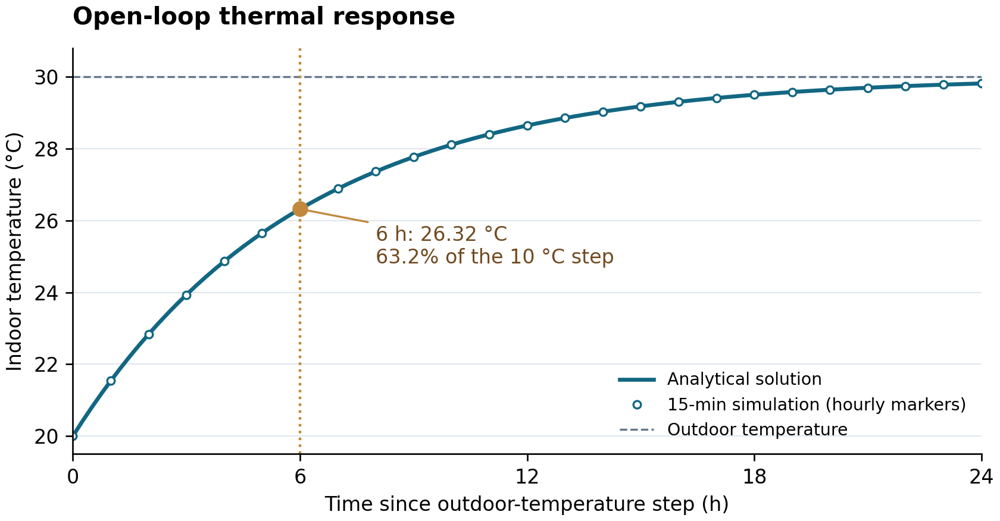

# 5. Environment and Simulator

*Author: Ethan. Citations are numbered locally; renumber when merging. Reproduction notes after the references may be moved to the appendix.*

We implement a single-zone office simulator to study how thermal inertia affects carbon-aware cooling. The simulator combines a first-order thermal model, a capacity-limited cooling unit and synthetic weather, occupancy, electricity-price and carbon-intensity profiles. The environment, rule-based controllers and dynamic-programming oracle share the same thermal transition function, ensuring that their comparisons use consistent physics.

## 5.1 Thermal and HVAC model

The zone is represented by a one-resistance, one-capacitance (1R1C) network:

  C·dT_in/dt = (T_out − T_in)/R + Q_int(o_t) + Q_sol,t − COP(T_out)·P_t.

Here R describes heat exchange with the surroundings, C represents the effective thermal mass of the zone, and P_t is HVAC electrical power. Internal gains are Q_int(o_t) = 1.5 + 12o_t kW, where o_t ∈ [0, 1] is the true occupancy fraction. Solar heat gains are added separately. The model tracks sensible temperature only; humidity, latent cooling, explicit ventilation loads and inter-zone heat transfer are omitted.

**Table 5.1. Simulator parameters.** These are modelling assumptions for a representative office zone, rather than parameters fitted to a measured building.

| Parameter | Value | Interpretation |
|---|---|---|
| Reference floor area | 500 m² | Used to express cooling electricity per unit area |
| Thermal resistance R | 0.4 K/kW | Aggregate resistance to outdoor heat exchange |
| Thermal capacitance C | 15 kWh/K | Effective zone thermal mass |
| Time constant τ = RC | 6 h | Rate of approach to thermal equilibrium |
| Maximum electrical HVAC power | 14 kW | Five levels: 0, 3.5, 7, 10.5 and 14 kW |
| COP | clip[3.5 − 0.08(T_out − 30), 2.5, 4.5] | Cooling efficiency decreases as outdoor temperature rises |
| Internal / solar gains | 1.5 + 12o_t kW / up to 6 kW | Occupancy-dependent and daylight heat inputs |

At 30 °C outdoors, full electrical power delivers 49 kW of cooling. Inputs are held constant within each 15-minute interval, giving the exact update

  T_eq,t = T_out,t + R[Q_int(o_t) + Q_sol,t − COP(T_out,t)·P_t],

  T_in,t+1 = T_eq,t + (T_in,t − T_eq,t)·exp(−Δt/RC),  Δt = 0.25 h.

This avoids forward-Euler integration error under the assumed constant inputs. In the hourly-control ablation, the action is held for four successive 15-minute simulation steps while external conditions continue to change. Exact integration therefore does not imply that hourly and 15-minute controllers achieve identical performance.

## 5.2 Exogenous data and occupancy

All reported experiments use one synthetic year containing 35,040 quarter-hourly samples. Weather and prices are Singapore-like; carbon intensity is a deliberately variable, UK-like scenario for examining load shifting. The profiles are generated locally and are not downloaded MSS, EMC or UK grid observations.

**Table 5.2. Profile construction.**

| Signal | Generation assumptions |
|---|---|
| Outdoor temperature and solar gain | A daily temperature cycle peaking at 15:00, a seasonal component and correlated noise. A 30% daily rain flag lowers the daily mean and temperature amplitude. Solar gains follow a 07:00–19:00 daylight curve reduced by cloud cover. |
| Occupancy | Weekdays nominally 08:00–18:00, with arrival jitter of −30 to +30 minutes and departure jitter of −30 to +45 minutes. Occupied fractions are 0.8–1.0, falling to 0.6 during 12:00–13:00. Weekends and randomly designated holidays are unoccupied. |
| Electricity price | A 0.14 SGD/kWh base plus afternoon/evening demand components, correlated variation and occasional spikes of two to four times the underlying price. |
| Carbon intensity | A correlated wind-like component, seasonal midday solar reduction and evening peak, clipped to 0.03–0.40 kg CO₂/kWh. This is a scenario signal, not a measured Singapore emissions factor. |

The temperature scale is broadly consistent with MSS's description of typical Singapore daily minima of 23–25 °C and maxima of 31–33 °C. [1](https://www.weather.gov.sg/climate-climate-of-singapore) The stochastic rules, including the rain frequency and occupancy schedule, remain simplifying assumptions rather than an empirical calibration. Consequently, the experiments support comparisons within the constructed scenario, not estimates of actual Singapore building emissions. A CSV loader permits future replacement of temperature, price and carbon profiles, but was not used for these results.

## 5.3 Temporal split and episode design

The synthetic calendar follows 2026. Training and controller selection use January–September, days 0–272; evaluation uses October–December, days 273–364, giving 273 training days and 92 test days. This tests transfer to unseen decision days within the same synthetic process. The split applies to episode days: supplied forecasts may extend across midnight and across the train/test boundary.

Each episode covers one day, with 96 decisions. Initial indoor temperature is sampled from U(25.5, 28.0) °C. Temperature is reset between episodes, so actions have no thermal consequences on the following day. This limits conclusions about overnight storage and multi-day scheduling.

## 5.4 Simulator validation

Validation checks analytical consistency, accounting and energy scale. The ten existing simulator tests pass in the local verification run; they include the following checks.

**Open-loop response.** With cooling and heat gains disabled, an outdoor-temperature step from 20 to 30 °C gives T_in(t) = 30 − 10exp(−t/6). After one time constant, the simulator reaches 26.3212 °C, or 63.2% of the imposed step. Over 24 hours, its trajectory agrees with the analytical solution to within 1.1 × 10⁻¹⁴ °C (Figure 5.1).



*Figure 5.1. Indoor-temperature response to a constant 30 °C outdoor temperature, starting at 20 °C with no internal gains, solar gains or HVAC power. Markers show hourly samples of the 15-minute simulation. The dotted vertical line identifies τ = 6 h.*

**Discretisation and bounds.** With unchanged inputs and HVAC power, one 60-minute thermal update agrees with four 15-minute updates to the test tolerance of 10⁻⁹ °C. Increasing HVAC power lowers the predicted next temperature. The accounting checks verify non-negative electricity use, the maximum of 3.5 kWh per 15-minute step, carbon = CI × energy, cost = price × energy, and zero discomfort when the zone is unoccupied. These establish numerical and accounting consistency; they do not constitute validation against measured building temperatures.

**Energy magnitude.** A separate full-year check runs the default occupancy-setback controller (24 °C target, one-hour lead) on all 365 days, using profile seed 0 and episode noise seed 0. It consumes 24,682.875 kWh, corresponding to **49.37 kWh/m²/year** for the assumed 500 m² zone. This includes weekdays, weekends and synthetic holidays, and is the sum of independently reset daily episodes.

For context, BCA's 2025 office benchmarks place the middle two quartiles of whole-building electricity use between 105 and 165 kWh/m²/year. [2](https://go.gov.sg/bca-bebr-data) Our lower figure covers only the simulated HVAC electrical input; equipment and lighting appear as heat gains but their electricity is not counted. The comparison is therefore a broad scale check, not evidence that the simulated office meets a whole-building efficiency benchmark. Omitted humidity and ventilation loads, assumed parameters and daily resets also limit its physical interpretation.

## 5.5 Gymnasium interface and reproducibility

The simulator exposes a Gymnasium environment with five discrete actions and the 20 observation features defined in §4. Temperature, price and carbon features use fixed affine scaling:

  T̃_in = (T_in − 24.5)/3,  T̃_out = (T_out − 28.5)/3,

  p̃ = (p − 0.20)/0.10,  CĨ = (CI − 0.17)/0.08.

The same transformations apply to forecasts at 1, 2, 4 and 8 hours; binary features and sine/cosine time encodings are unchanged. Scaling is fixed and does not estimate statistics from the test period. Main experiments use an error-free binary occupancy sensor and perfect forecasts sampled from the generated profiles. Sensor flips and forecast noise are configurable for robustness experiments.

Profile generation, episode sampling and learning use separately controlled seeds. Profile seed 0 fixes the shared synthetic year; fixed day/noise-seed pairs reproduce evaluation episodes across controllers. Reset options can also specify the initial temperature. Each training run saves its seed, environment settings and algorithm configuration. Energy, carbon, cost and discomfort are returned separately at each step, enabling the metrics in §7 to be checked against the same underlying trajectory.

## References

1. Meteorological Service Singapore. [Climate of Singapore](https://www.weather.gov.sg/climate-climate-of-singapore) [Internet]. Singapore: MSS; cited 2026 Nov 11.
2. Building and Construction Authority. [Building Energy Benchmarking Report and Building Energy Performance Data](https://go.gov.sg/bca-bebr-data) [spreadsheet]. Sheet “Building Energy Benchmarks”, 2025 office benchmarks, cells B4:G4; cited 2026 Nov 11. EUI methodology: [Building Energy Benchmarking Report](https://www1.bca.gov.sg/sustainability/legislation-on-environmental-sustainability-for-buildings/existing-buildings/building-energy-benchmarking-report/).

## Appendix 5.A. Reproduction and integration notes

The section was checked against repository commit `0eb3d2a`. Verification used Python 3.13.1, NumPy 2.2.3, pandas 2.2.3, Gymnasium 1.2.3 and pytest 9.2.0; these local verification versions differ from the project's pinned experiment dependencies. The unchanged suite returned `10 passed`. From the repository root:

```bash
PYTHONPATH=src python -m pytest -q
```

The 49.37 kWh/m²/year value comes from the separate full-year calculation below. The existing unit test still samples every seventh day, which selects Thursdays and produces approximately 70.35 kWh/m²/year. The report uses all 365 days; no simulator or test-code changes are required to reproduce this report calculation.

```bash
PYTHONPATH=src python - <<'PY'
from carbonhvac.baselines import OccupancySetback
from carbonhvac.env import CarbonHVACEnv, EnvConfig
from carbonhvac.metrics import run_episode

env = CarbonHVACEnv(EnvConfig(split="all", data_seed=0))
controller = OccupancySetback(setpoint=24.0, lead_hours=1.0)
kwh = sum(
    run_episode(env, controller, day, noise_seed=0)["energy_kwh"].sum()
    for day in range(365)
)
print(f"Cooling electricity: {kwh:.3f} kWh")
print(f"Cooling EUI: {kwh / 500:.2f} kWh/m²/year")
PY
```

At the end of the synthetic year, the current forecast implementation wraps to the start of the profile. Together with forecasts crossing the September/October boundary, this should qualify any statement elsewhere in the report that the holdout is completely isolated from training inputs. Future exogenous forecasts are provided inputs; held-out controller outcomes are not used for tuning.

Figure 5.1 is supplied as both PNG and SVG in `docs/report/figures/`. The SVG is suitable for resizing during final report assembly.
