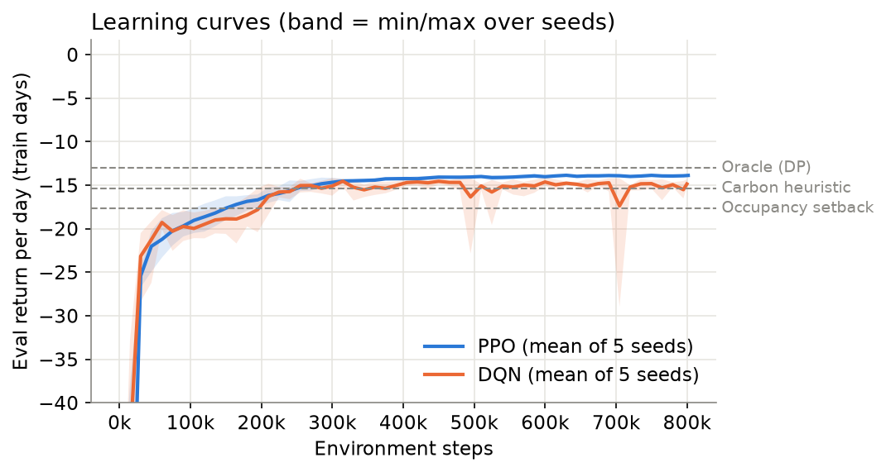
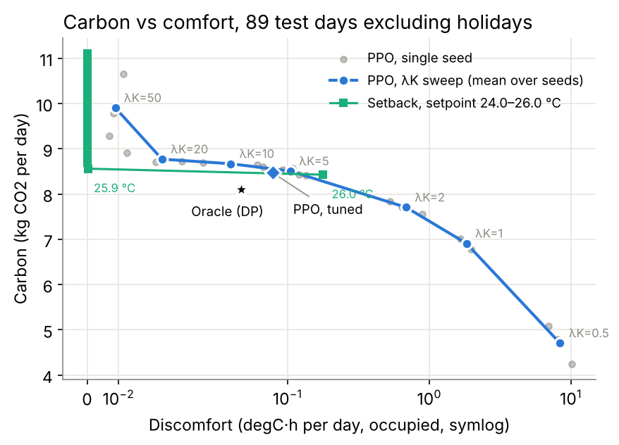
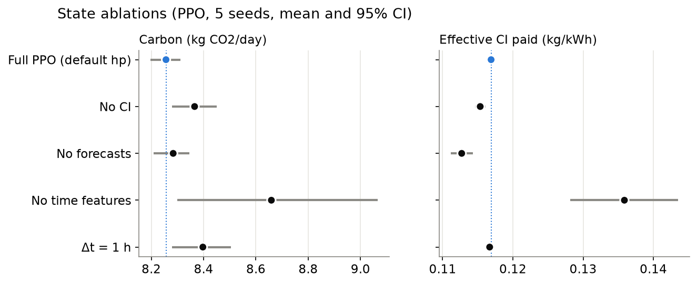
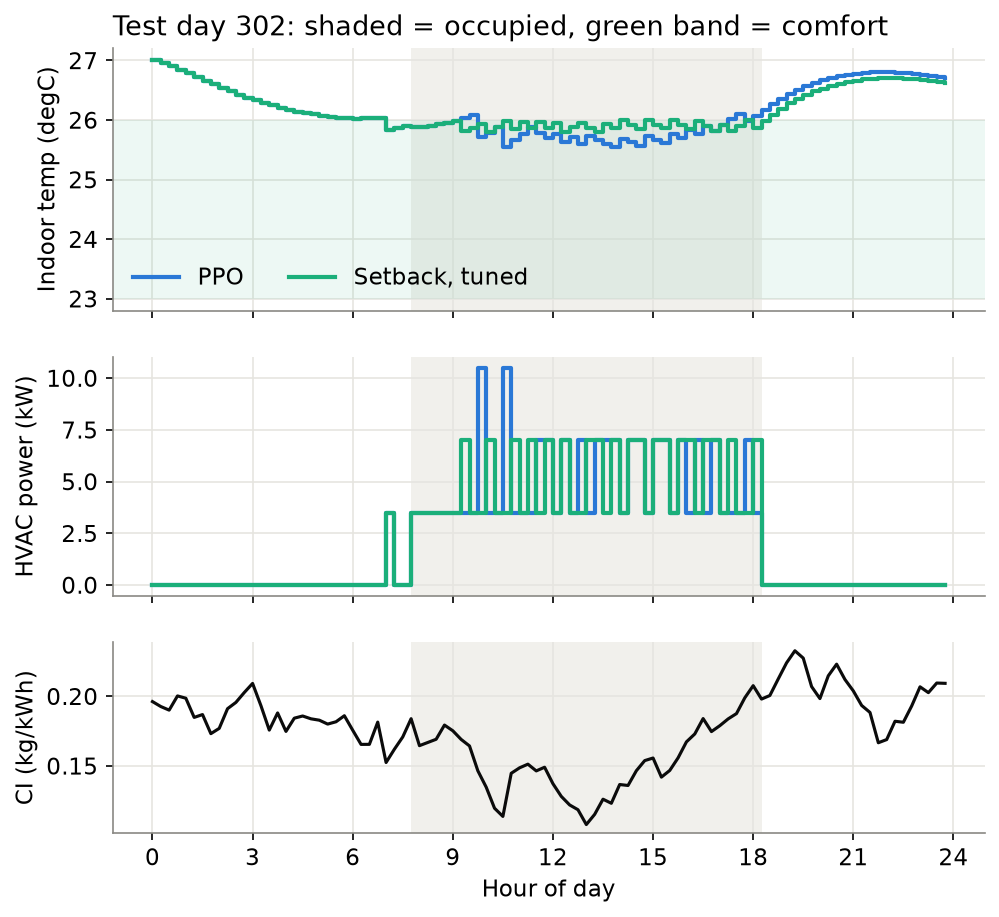

# 8. Results and Analysis

*Author: Sean. Target ≈ 4 pages in the body (35–40% of the report). Tables 8.6 and per-seed results go in the appendix if space is short. Every number is regenerated by `scripts/make_figures.py` and `scripts/holiday_breakdown.py` from the stored per-day test results (`results/tables/main.csv`, `s8_*.csv`, `s8_headline.json`). Renumber figures and references when merging.*

All results are on the 92 held-out test days (§7.2). Learned controllers: mean over 5 seeds with 95% bootstrap intervals over seeds; rules and the oracle: intervals over days. Effective CI and load shift are energy-weighted (§7.2).

## 8.1 Main comparison

**Table 8.1** Test-period results, per day. Higher reward is better. Violations: share of occupied 15-min steps outside 23–26 °C. Load shift: share of HVAC energy in below-median-CI steps.

| Controller | Reward | Energy (kWh) | Carbon (kg CO₂) | Cost (SGD) | Discomfort (°C·h) | Violations (%) | Effective CI (kg/kWh) | Load shift (%) |
|---|---|---|---|---|---|---|---|---|
| Fixed setpoint (24 °C) | −29.87 [−31.48, −28.26] | 112.1 | 18.96 [17.88, 20.07] | 21.81 | 0.000 | 0.0 | 0.1691 | 53.1 |
| Setback, 24 °C (untuned) | −17.95 [−20.35, −15.43] | 67.8 | 11.10 [9.52, 12.61] | 13.69 | 0.000 | 0.0 | 0.1636 | 60.5 |
| **Setback, tuned (best rule)** | −13.88 [−15.78, −11.89] | 52.0 | 8.52 [7.28, 9.71] | 10.72 | 0.000 | 0.7 | 0.1637 | 60.2 |
| Carbon heuristic, tuned | −13.92 [−15.83, −11.93] | 52.4 | 8.53 [7.30, 9.73] | 10.77 | 0.000 | 0.5 | 0.1629 | 60.9 |
| Setback, tuned + holiday calendar | −13.48 | 50.5 | 8.28 | 10.40 | 0.000 | 0.7 | 0.1639 | 60.7 |
| DQN | −14.90 [−15.12, −14.68] | 53.1 | 8.52 [8.28, 8.77] | 10.60 | 0.215 | 7.6 | 0.1604 | 64.5 |
| **PPO (tuned)** | −13.72 [−13.82, −13.66] | 50.8 | 8.21 [8.18, 8.25] | 10.28 | 0.076 | 5.2 | 0.1616 | 63.2 |
| Oracle (DP) | −13.07 [−15.00, −11.09] | 49.4 | 7.83 [6.64, 8.99] | 10.01 | 0.047 | 3.7 | 0.1586 | 67.3 |

**Tuning the rule matters more than the controller class.** Moving from a 24 °C thermostat to an occupancy setback cuts carbon by 41%; tuning that setback's setpoint on training days (to 25.9 °C, §6.1) removes another 23%. Every learned and oracle controller in Table 8.1 sits within 8% of the tuned rule's carbon. The tuned carbon heuristic is no better than plain setback: tuning narrowed its CI response to 0.4 K, so it barely acts on the signal.

**Protocol result.** Against the best tuned rule over all 92 days, PPO lowers carbon by 3.7% (paired 95% CI 3.2–4.0%, p < 0.001), cost by 4.1% and energy by 2.4%, and raises reward by 1.1% (0.4–1.6%, p = 0.03). This closes 46% of the carbon gap and 19% of the reward gap between the rule and the oracle. The price is comfort: violations rise from 0.7% to 5.2% of occupied steps (+4.5 percentage points, 3.9–5.1), although the size stays small (0.076 °C·h/day, mean maximum deviation 0.14 °C). The oracle, optimal for the same reward, also accepts 3.7% violations, so small, brief excursions are part of the optimum at λ_K = 5 rather than a learning failure. DQN does not beat the rule: carbon is level (+0.1%, p = 0.97) while reward is 7.4% lower (p = 0.001) and violations 6.9 points higher.

**Where the gain comes from.** Table 8.2 splits the test days by type. On weekends nobody arrives and every controller stays off. On the 3 weekday public holidays the tuned rule follows its workday schedule and cools an empty zone (46 kWh/day), while PPO reacts to the occupancy sensor and barely runs (3.6 kWh/day). These 3 days account for **72% of PPO's carbon saving and all of its reward advantage**.

**Table 8.2** Mean daily energy and carbon by day type.

| Day type | Days | Tuned setback | PPO (tuned) | DQN | Oracle |
|---|---|---|---|---|---|
| Workday | 63 | 73.8 kWh · 12.09 kg | 74.0 kWh · 11.96 kg | 77.0 kWh · 12.36 kg | 72.1 kWh · 11.44 kg |
| Public holiday | 3 | 45.8 kWh · 7.19 kg | 3.6 kWh · 0.36 kg | 12.2 kWh · 1.69 kg | 0.0 kWh · 0.00 kg |
| Weekend | 26 | 0.0 kWh · 0.00 kg | 0.1 kWh · 0.01 kg | 0.1 kWh · 0.01 kg | 0.0 kWh · 0.00 kg |

Table 8.3 repeats the paired comparison on the 89 non-holiday days, and against a setback given the holiday calendar (§7.2), which equals the tuned rule on every other day.

**Table 8.3** PPO (tuned) minus reference, paired over seeds. Percentages relative to the reference; positive Δ reward means PPO is better.

| Comparison | Δ reward | Δ carbon | Δ energy | Δ violations | Carbon gap closed | Reward gap closed |
|---|---|---|---|---|---|---|
| All 92 days vs tuned setback (protocol) | +1.1% [0.4, 1.6], p = 0.03 | −3.7% [−4.0, −3.2], p < 0.001 | −2.4% [−2.6, −2.1] | +4.5 pp [3.9, 5.1] | 46% | 19% |
| 89 non-holiday days vs tuned setback | −1.6% [−2.3, −1.1], p = 0.008 | −1.1% [−1.5, −0.6], p = 0.016 | +0.3% [0.0, 0.6] | +4.7 pp [4.1, 5.3] | 20% | −55% |
| All 92 days vs setback + holiday calendar | −1.8% [−2.5, −1.3], p = 0.007 | −0.9% [−1.3, −0.4], p = 0.02 | +0.5% [0.3, 0.8] | +4.5 pp [3.9, 5.1] | 17% | −60% |

On ordinary days the picture changes: PPO still emits about 1% less carbon, but it does so with slightly *more* energy, so the entire saving is timing (effective CI 0.1618 vs 0.1639 kg/kWh, −1.3%). It pays for that timing with comfort, and on its own objective it is now 1.6% *worse* than the rule. A building-management system with a holiday calendar would capture the holiday saving without any learning. Our reading is that PPO's measurable advantage in this building comes from **reacting to observed occupancy**, a small genuine **carbon-timing** effect, and nothing else. §8.6 and the oracle decomposition below support this.

**Where the headroom is.** Two oracle variants each remove one piece of the oracle's foresight and are scored on the true outcome (§6.3).

**Table 8.4** Oracle foresight decomposition (89 non-holiday days; all-days values in brackets).

| Controller | Reward | Carbon (kg) | Violations (%) | Effective CI |
|---|---|---|---|---|
| Oracle, full foresight | −13.51 (−13.07) | 8.10 (7.83) | 3.8 | 0.1586 |
| Oracle, plans with flat CI | −13.59 (−13.15) | 8.28 (8.01) | 4.1 | 0.1628 |
| Oracle, plans with nominal 08:00–18:00 occupancy | −14.16 (−14.08) | 7.96 (7.92) | 5.7 | 0.1580 |
| Tuned setback | −13.94 (−13.88) | 8.56 (8.52) | 0.7 | 0.1639 |
| PPO (tuned) | −14.16 (−13.72) | 8.47 (8.21) | 5.4 | 0.1618 |

Knowing the future CI is worth only 0.078 reward/day (95% CI 0.063–0.094), although it is worth 0.18 kg of carbon (2.2%): almost all of the oracle's timing advantage over the rule disappears without it (effective CI 0.1628, close to the rule's 0.1639). The reward values that timing little because carbon is only one term and price timing pulls the other way (§4.2, r = −0.07). Knowing true occupancy is worth 0.65 reward/day on ordinary days (0.48–0.83), eight times as much, and 1.01 including holidays. Without it, the oracle under-cools for early arrivals and late leavers, so it uses less energy but incurs 5.7% violations and falls below the tuned rule. In this building the binding uncertainty is **who is in the room**, not **how clean the grid is**. It is also notable that, on ordinary days, PPO scores the same reward as a perfect planner that knows CI exactly but only the nominal schedule.

## 8.2 Learning dynamics

**Figure 8.1** Evaluation return per day on 16 fixed training days; line = mean of 5 seeds, band = min/max. Dashed: tuned setback and oracle on the same days.

PPO learns smoothly and consistently. The tuned configuration reaches 90% of its total improvement after 250k–300k steps on every seed and comes within 0.1 reward/day of its final level between 750k and 1.3M steps. Final returns on the curve days range from −13.61 to −13.90 across seeds, level with or slightly below the tuned rule on those days (−13.55); it pulls ahead only on the larger validation set and the test set, and §8.1 shows how much of that is holidays. The default configuration reaches its 90% point sooner (75k–135k steps) but plateaus lower (final −13.81 to −14.00), so the longer rollout selected in §6.4 trades early speed for a better final policy. On the test period the 5 tuned seeds agree within 1.3% on carbon (8.18–8.28 kg).

DQN reaches its 90% point at a similar pace (75k–150k steps) but plateaus about one reward unit per day lower (final −14.68 to −15.56) and drops sharply and repeatedly late in training (Figure 8.1, near 500k and 700k steps). Its seeds also diverge on the test period: violations range from 2.0% to 14.3% across seeds, against 4.4%–6.1% for PPO. This is the familiar instability of bootstrapped off-policy value learning. PPO's clipped on-policy updates fit a simulator where fresh data is almost free (§6.2).

The reward components show the order of learning: on tuned PPO seed 0, discomfort falls from 49.7 to 0.9 °C·h/day within the first 50k steps while carbon is still at 11.8 kg/day (final 8.2). The agent first learns to keep occupants comfortable, then spends the remaining training trimming energy and timing.

## 8.3 Carbon vs comfort trade-off

**Figure 8.2** Carbon vs discomfort on the 89 non-holiday days (symlog x-axis). Blue: PPO trained with λ_K ∈ {0.5, 1, 2, 5, 10, 20, 50} (3 seeds each; λ_K = 5 is the 5-seed default-configuration main run). Green: tuned setback with its setpoint swept from 24.0 to 26.0 °C. Holidays are excluded so that neither front is credited with the holiday effect of §8.1; the all-days version is `results/figures/pareto.png`.

**Table 8.5** PPO across comfort weights (89 non-holiday days).

| λ_K | Carbon (kg) | Discomfort (°C·h) | Violations (%) | Effective CI | Load shift (%) |
|---|---|---|---|---|---|
| 0.5 | 4.71 | 8.35 | 44.7 | 0.1474 | 77.9 |
| 1 | 6.91 | 1.83 | 20.8 | 0.1545 | 71.9 |
| 2 | 7.71 | 0.69 | 11.2 | 0.1571 | 68.4 |
| 5 (default) | 8.51 | 0.105 | 5.7 | 0.1610 | 64.0 |
| 10 | 8.67 | 0.046 | 3.3 | 0.1619 | 62.8 |
| 20 | 8.77 | 0.024 | 2.0 | 0.1621 | 62.8 |
| 50 | 9.91 | 0.009 | 0.9 | 0.1612 | 63.7 |
| *Setback 25.9 °C* | *8.56* | *0.0002* | *0.7* | *0.1639* | *60.7* |
| *Setback 26.0 °C* | *8.43* | *0.178* | *35.0* | | |

**At matched comfort the rule wins.** At discomfort below 0.05 °C·h/day, every PPO setting is dominated by the tuned setback: λ_K = 10 emits 8.67 kg at 0.046 °C·h, against 8.56 kg at essentially zero for the rule, and λ_K = 50 is 16% worse. PPO beats the rule on carbon only in the narrow band between 0.08 and 0.1 °C·h/day. The staged thermostat cannot reach that band at all: its front jumps from 25.9 °C (0.7% violations) to 26.0 °C (35% violations), because it oscillates around its target and crosses the band edge (§6.1). PPO, choosing power directly, fills that gap.

**Relaxing comfort unlocks real shifting.** As λ_K falls, PPO moves its consumption into clean hours: load shift rises from 64% to 78% and effective CI falls from 0.161 to 0.147 kg/kWh, below the 0.159 the oracle pays under the default weights. The agent can therefore learn carbon-aware timing; at sensible comfort weights the building's thermal storage simply makes it not worth much. Below λ_K = 2 the discomfort (0.7–8 °C·h/day, 11–45% of occupied steps) would be unacceptable in any real office.

The weight λ_K is the operating point, and choosing it is a value judgement about whose comfort is traded for how much carbon; §9 takes this up.

## 8.4 Ablations

**Figure 8.3** Default-configuration PPO with one observation group removed or the control interval changed; 5 seeds × 800k steps each.

**Table 8.6** Ablations, all 92 test days, relative to full default-configuration PPO. p-values: Welch test over seeds, Holm-corrected within each column family.

| Variant | Carbon (kg) | Δ carbon | Δ reward | Discomfort (°C·h) | Violations (%) | Effective CI | Load shift (%) |
|---|---|---|---|---|---|---|---|
| Full PPO (default) | 8.26 [8.20, 8.31] | | | 0.101 | 5.5 | 0.1608 | 64.0 |
| No CI in state | 8.37 [8.28, 8.45] | +1.3% (p = 0.38) | +0.3% (p = 0.86) | 0.066 | 3.4 | 0.1625 | 62.4 |
| No forecasts | 8.28 [8.21, 8.35] | +0.3% (p = 0.61) | +0.3% (p = 0.86) | 0.084 | 6.0 | 0.1620 | 62.8 |
| No time features | 8.66 [8.30, 9.07] | +4.9% (p = 0.38) | −9.1% (p = 0.02) | 0.231 | 6.6 | 0.1589 | 65.9 |
| Δt = 1 h | 8.40 [8.28, 8.50] | +1.7% (p = 0.38) | −4.2% (p = 0.002) | 0.174 | 9.0 | 0.1615 | 65.4 |

**The CI input produces PPO's timing advantage, and that advantage is small.** Without CI in its state, PPO's effective CI rises from 0.1608 to 0.1625 kg/kWh (p = 0.02 uncorrected, 0.09 after Holm across the four ablations), almost back to the rule's 0.1637, and its load shift falls from 64.0% to 62.4%. Carbon rises 1.3% but the difference is not significant over 5 seeds, and reward is unchanged, partly because the no-CI agent gives some of the saved comfort back (3.4% violations). This matches the oracle decomposition: the carbon signal enables a real but small amount of timing, worth little under the current reward. Removing forecasts changes nothing measurable, consistent with a reactive policy that does not plan hours ahead.

**The clock carries the schedule.** Removing time features is the most damaging change: reward falls 9.1% (significant after correction), energy rises 6%, discomfort more than doubles and seeds diverge (carbon CI 8.30–9.07). The agent then uses more energy, some of it in the clean midday hours (effective CI 0.1589, lower than full PPO), and the extra energy outweighs the better timing. With a perfect occupancy sensor, the time features still matter because they let the policy anticipate arrivals rather than react to them, which is exactly the occupancy information the oracle decomposition identifies as valuable.

**Control resolution.** Hourly control is worse on reward (−4.2%, significant) and above all on comfort (9.0% violations): one-hour steps cannot track the end of occupancy or the midday solar gain. This supports Δt = 15 min (§4.4).

## 8.5 Generalisation and robustness [PENDING]

All results above are on held-out months, so they already measure generalisation across the seasonal split. The scenario evaluations in Table 7.2 are scheduled after the presentation and need no retraining:

- **Shifted CI** (`ci_shift_hours`, e.g. ±3 h). A policy that reads CI should move its cooling with the shift; a clock-driven one will not. From §8.4 we expect PPO's timing gain (about 1% of carbon) to vanish, with the rest of its behaviour unchanged.
- **Occupancy-sensor noise** (`occ_flip_prob` 0.1, 0.2). Comfort is scored on true occupancy. This is the more important test given §8.1, because PPO's holiday advantage relies on the sensor, and the rule's setback also reacts to it.
- **Price and CI regimes.** Flat CI should remove PPO's timing gain entirely; price-anticorrelated CI tests whether it trades cost against carbon as the weights imply.

[FIGURE 8.4 when available: grouped bars, controller × scenario, carbon and violations with 95% CIs.]

## 8.6 Policy behaviour

**Figure 8.4** Test day 302 (a Friday): indoor temperature, HVAC power and grid CI for tuned PPO and the tuned setback. Shading: occupied hours.

On a typical workday the two controllers look alike. Both leave the HVAC off overnight, start at the same time before the 08:00 arrival, and hold the zone near the top of the comfort band; neither pre-cools overnight. With a 6-hour time constant, cooling stored before dawn leaks back through the envelope before occupants arrive, which is also why tuning switched off the carbon heuristic's pre-cooling (§6.1).

The differences are small but systematic. PPO cools a little harder, with short bursts at 75% power, during the 10:00 and 12:00–15:00 CI dips, reaching about 25.6 °C where the rule holds 25.9 °C, then coasts up to 26 °C as CI rises towards the evening. It also lets the zone drift just above 26 °C around 09:00 and again near 17:00–18:00. Those excursions are where its 5.2% violations come from, and they fall on early arrivals and late leavers (§9).

Across the test period this behaviour shows up in the timing metrics. PPO places 63.2% of its energy in below-median-CI steps, against 60.2% for the rule and 67.3% for the oracle, and pays 0.1616 kg/kWh against 0.1637 and 0.1586. PPO therefore recovers about 41% of the timing benefit available to a perfect-foresight controller, and on ordinary days timing is its only source of carbon saving (§8.1). On the 3 holidays its behaviour is different in kind: depending on seed and day it runs for 0–17 kWh before settling off, 3.6 kWh on average against the rule's 46.

For a facility manager, the policy can be summarised in one sentence: "cool only while people are present, hold about 25.7–25.9 °C, and cool slightly harder when the grid is cleanest." That is close enough to the tuned rule that the rule, with a holiday calendar, is a credible and fully transparent alternative (§9).

## 8.7 Extension results [PENDING]

Planned: Lagrangian constrained PPO, which treats comfort as a constraint (violation rate ≤ a target such as 1%) rather than a fixed weight. §8.3 makes this the decisive test: with a penalty weight, PPO loses to the rule at matched comfort. To report: constraint satisfaction on the test period; carbon and reward at matched comfort against the tuned setback (with and without holiday calendar) and penalty-PPO; the multiplier's trajectory during training; all on the 89 non-holiday days as well as all 92.

## 8.8 Failure cases and negative results

1. **No win at matched comfort.** At λ_K ≥ 10 the tuned setback dominates PPO, and at λ_K = 50 PPO emits 16% more carbon. PPO's carbon advantage exists only where 0.08–0.1 °C·h/day of discomfort is accepted.
2. **Below the rule on its own objective on ordinary days.** On the 89 non-holiday days PPO's reward is 1.6% below the rule's, so it does not find the rule's policy even though that policy is within its action space. The rule's optimum is narrow (25.9 °C is safe; 26.0 °C gives 35% violations), and a stochastic policy trained on noisy returns settles on a smoother policy that crosses the band edge more often. Constrained PPO (§8.7) or a longer budget may close this; DQN does not.
3. **A headline that depended on 3 days.** The protocol result (−3.7% carbon, +1.1% reward) is real, but 72% of the carbon saving and all of the reward gain come from 3 public holidays on which the rule cools an empty zone. A holiday calendar recovers the same saving with no learning. The broader lesson matches §6.4: the strength of the baseline decides most of the reported gain, and checking where a gain comes from day by day is as important as tuning.
4. **Comfort at the edges of the day.** PPO's violations cluster around arrival and departure, so the people at the edges of the schedule bear its savings.
5. **DQN instability.** DQN matched the rule on carbon only by giving up comfort (2–14% violations across seeds) and collapsed repeatedly during training. It was also not tuned (§6.3), which we note as a limitation.
6. **Metric pitfalls we hit.** Our first draft averaged effective CI and load shift per day, which scored idle days as 0 and produced misleading values (0.115 vs 0.118 kg/kWh and 45% vs 42%), and on the ablations even reversed the sign of the no-time-features effect. All timing metrics in this section are energy-weighted (§7.2).

Taken together, the results point to the building rather than the controller as the limit. With a 6-hour time constant and a 3 K comfort band, the thermal mass stores little, so the carbon signal is worth about 2% of carbon even to a perfect-foresight planner. The value lies in knowing who is present. The natural next steps (§10) are an explicit storage lever, such as a battery or chilled-water tank, which would make carbon timing worth learning, and occupancy prediction, which is where the oracle shows the headroom is.
