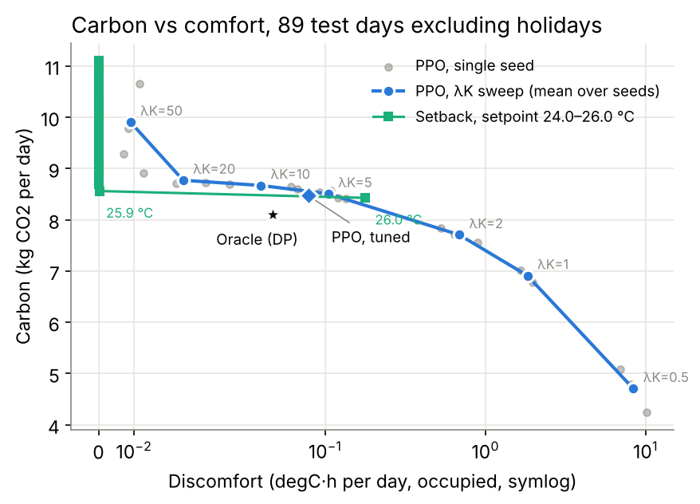

<!-- _class: title -->
<!-- _paginate: false -->
<!-- _footer: "" -->

CS4246/5446 · Group 23

# Carbon-Aware Smart Building Energy Controller

Learning <em>when</em> to cool an office so the grid burns less carbon

Ethan · Jaylon · Brandon · Sean · Patrick

Reinforcement Learning and Sequential Decision Making · 12 Nov 2026

---

Motivation

## When a building uses power matters as much as how much

- Buildings use about 30% of global final energy; in Singapore, air-conditioning dominates commercial electricity
- Grid carbon intensity swings hour to hour with wind and solar output
- A building's thermal mass stores cooling, so load can be moved in time
- But an action now affects comfort hours later, which makes this a sequential decision problem

Can an RL controller cut HVAC carbon beyond a well-tuned rule, without hurting comfort?

<!-- Patrick -->

---

Approach

## What we built

### Simulator
A 1R1C office zone driven by a year of weather, occupancy, price and carbon data

### Formulation
An MDP whose reward combines carbon, cost and comfort

### Controllers
PPO and DQN against tuned rule-based controllers and an exact DP upper bound

### Evaluation
5 seeds, held-out months, 95% CIs, a Pareto sweep, state ablations and policy traces

### Responsible AI
What the agent actually learned, and who pays for it

<!-- Patrick -->

---

Simulator

## A single office zone with a 6-hour time constant

C·dT/dt = (Tout − Tin)/R + Qint + Qsol − COP·P

- R = 0.4 K/kW and C = 15 kWh/K, so τ = 6 h
- 14 kW HVAC whose COP falls on hot afternoons
- Exact discretisation at 15-minute steps
- Validated by 10 unit tests: step response, energy range, oracle dominance

| Series | Source |
|---|---|
| Weather | Singapore-like, 25–33 °C, rainy days |
| Occupancy | Weekdays 08–18, jitter, holidays |
| Price | USEP-like, SGD/kWh |
| Carbon intensity | UK-grid-like (Singapore's ~95% gas grid is nearly flat) |

Train January–September · test October–December (92 unseen days)

<!-- Ethan -->

---

Formulation

## The decision problem

| Element | Definition |
|---|---|
| State | 20 features: Tin, Tout, occupancy sensor, price, CI, time, weekday, forecasts at +1, 2, 4, 8 h |
| Action | HVAC power ∈ {0, 25, 50, 75, 100}%, shared by PPO, DQN and the DP oracle |
| Reward | −[λC·CI·E + λ$·price·E + λK·discomfort], discomfort counted only when occupied, outside 23–26 °C |
| Discount | γ = 0.99, a ~25 h horizon: enough to credit 5 am pre-cooling for 2 pm comfort |

Carbon and cost both scale with energy, so being carbon-aware means **shifting when you consume**.

Price and CI are nearly uncorrelated here (r = −0.07): the cheapest hour is not the cleanest.

<!-- Brandon -->

---

Controllers

## Rules and PPO are tuned under one protocol

| Controller | Behaviour | Tuned |
|---|---|---|
| Fixed setpoint | Holds 24 °C around the clock | — |
| Setback | Cools during working hours only | setpoint, start time |
| Carbon heuristic | Cools deeper when CI is low, drifts warmer when high | 4 parameters |
| Carbon-proportional | Setpoint rises with CI | gain, base |
| PPO · DQN | Clipped surrogate, GAE, return normalisation | PPO: 12 settings × 2 seeds |
| Oracle (DP) | Backward induction with perfect foresight | upper bound |

All tuning on training days only (972 rule settings), scored with the reward PPO maximises. Tested once on 92 unseen days; 5 seeds per learner, paired 95% bootstrap CIs.

<!-- Jaylon: baselines + tuning. Brandon: PPO/oracle rows -->

---

Main result

## Tuning matters most; PPO's extra gain is small

| Controller | kg CO₂/day | Violations* |
|---|---|---|
| Fixed setpoint | 18.96 | 0% |
| Setback, 24 °C (untuned) | 11.10 | 0% |
| Best tuned rule (25.9 °C) | 8.52 | 0.7% |
| DQN | 8.52 | 7.6% |
| **PPO (tuned)** | **8.21** | **5.2%** |
| Oracle (DP) | 7.83 | 3.7% |

*occupied 15-minute steps outside 23–26 °C

−23%

carbon from tuning one setpoint

−3.7%

PPO vs best tuned rule, 95% CI [−4.0, −3.2] reward +1.1% (p = 0.03), cost −4.1%

72%

of that saving is from 3 public holidays, when the rule cools an empty office. Other 89 days: −1.1% carbon, reward −1.6%

<!-- Sean -->

---

Learning dynamics

## PPO learns stably; DQN is noisy

PPO's 5 seeds settle by 0.75–1.3M steps and land within 1.3% on test carbon. On these 16 training days it ends level with the tuned rule. DQN drops out repeatedly.

<!-- Sean (Brandon for PPO stability questions) -->

---

Policy behaviour

## PPO rides the band edge and cools a little in carbon dips

<!-- Sean: Both hold ~25.7-25.9 °C. PPO cools slightly more in the 10:00 and 12:00-15:00 CI dips, then coasts to 26 °C as CI rises. Effective CI paid (energy-weighted): PPO 0.162 vs rule 0.164 vs oracle 0.159 kg/kWh; 63% vs 60% of energy in below-median-CI hours. -->

---

Where the headroom is

## The bottleneck is occupancy, not the carbon signal

| Oracle variant (test) | Reward | kg CO₂ |
|---|---|---|
| Full foresight | −13.07 | 7.83 |
| No carbon foresight | −13.15 | 8.01 |
| **No occupancy foresight** | **−14.08** | 7.92 |
| Best tuned rule | −13.88 | 8.52 |
| PPO (tuned) | −13.72 | 8.21 |

0.08

reward/day from knowing future carbon intensity

~1.0

reward/day from knowing when people arrive and leave (0.65 on ordinary days)

PPO's own win is occupancy too: it stays off on holidays. Removing CI from its state costs 1.3% carbon (not significant). One room with τ = 6 h is a leaky battery.

<!-- Sean, with Brandon -->

---

Trade-off

## At matched comfort, the tuned rule wins

89 ordinary days. At strict comfort every PPO setting is beaten by the rule. PPO only wins at 0.08–0.1 °C·h/day, a band the thermostat skips (25.9 °C → 26.0 °C jumps from 0.7% to 35% violations).

<!-- Sean presents; Patrick links to RAI -->

---

Responsible AI

## What the numbers do not show on their own

### Who sets λ?
The reward is a utility function: its weights decide whose comfort is traded for carbon. The Pareto front makes that trade visible.

### Specification gaming
Comfort is charged only when occupied, so a faulty sensor invites reward over-optimisation. We score comfort on true occupancy.

### Comfort is a distribution
More than half of PPO's violations fall between 17:00 and 18:30. Late leavers bear them; the mean hides it.

### Honest baselines
A partly tuned rule inflated PPO's gain to 11%, an anchor that fair tuning removed; a holiday calendar shrinks it to 0.9%. Check where a gain comes from.

### Transparency
A tuned thermostat gets most of the benefit and anyone can explain it. That is a legitimate choice. RL would need a human override.

<!-- Patrick -->

---

Limitations

## What this study cannot claim yet

### Limits

- One zone and a simplified thermal model
- Synthetic profiles, with UK carbon intensity standing in for Singapore's
- A small RL margin; DQN, the λ sweep and the ablations used default PPO settings

### Next, for the report

- Occupancy prediction, where the oracle's headroom is
- Robustness: shifted CI, noisy occupancy, tariff regimes
- Constrained PPO: comfort as a constraint, not a weight
- Battery storage: a real lever for shifting carbon

<!-- Patrick -->

---

Summary

## Takeaways

1. **Tune the baseline first.** One setpoint gives −23% carbon; skipping this inflated our RL gain about threefold.
2. **Tuned PPO wins by 3.7% carbon**, mostly by staying off on holidays; on ordinary days it is ~1%, paid for in comfort.
3. **In one room the carbon signal is worth little.** Occupancy foresight is the real headroom.
4. **An oracle plus fair tuning** is what reveals all of this.

Thank you. Questions?

<!-- Patrick -->
