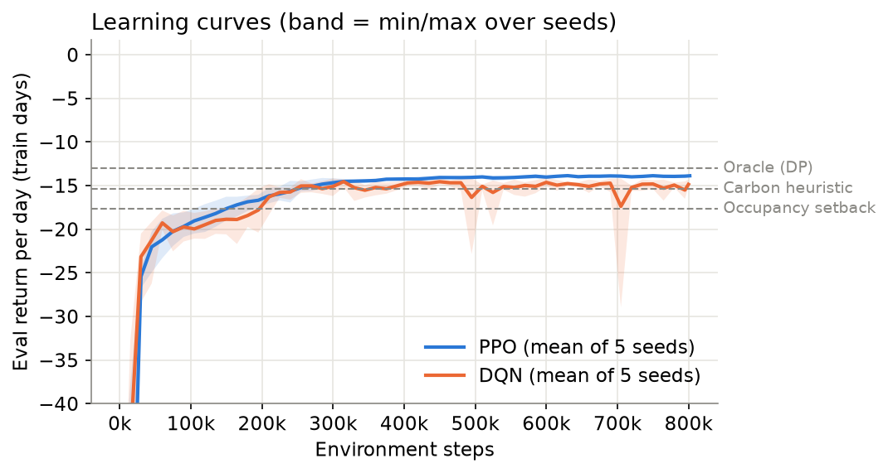
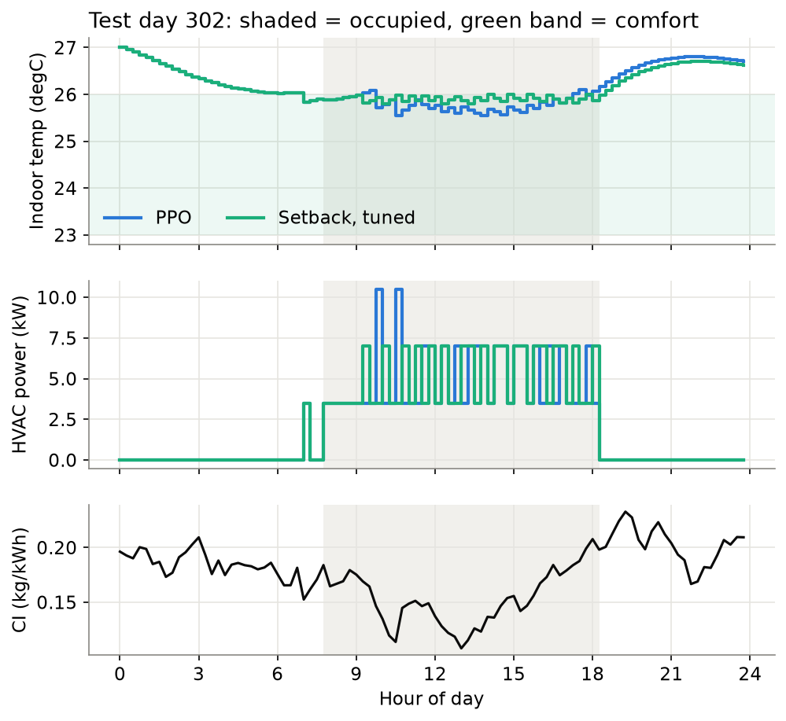
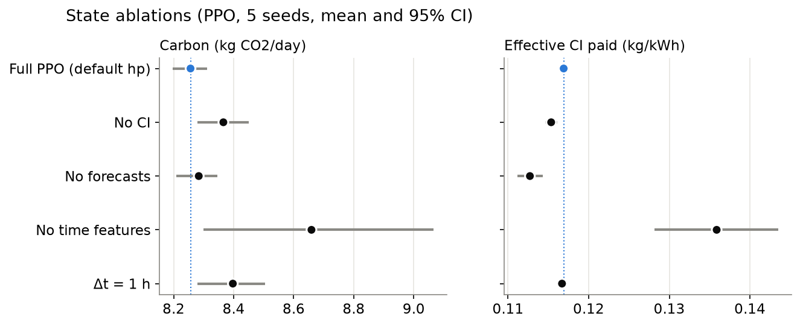
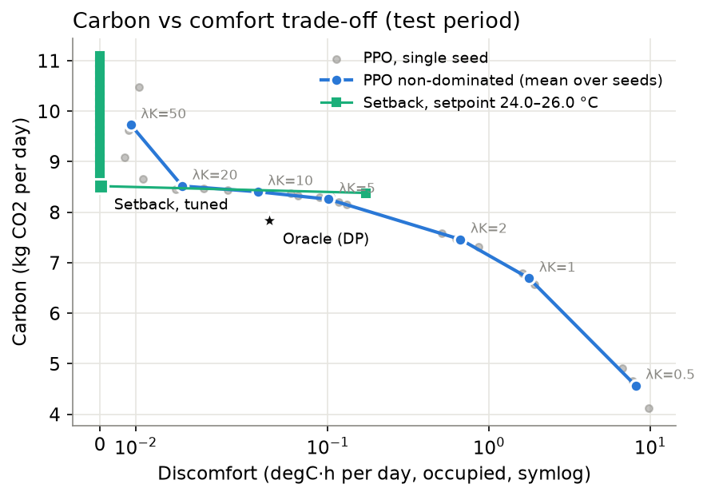

<!-- _paginate: false -->
<!-- _footer: "" -->

# Carbon-Aware Smart Building Energy Controller

Learning *when* to cool an office so the grid burns less carbon

 

**Group 23** · Ethan · Jaylon · Brandon · Sean · Patrick
CS4246/5446 Reinforcement Learning and Sequential Decision Making · 12 Nov 2026

---

## Why: when a building consumes matters as much as how much

- Buildings use **~30% of global final energy**; in Singapore, air-conditioning dominates commercial electricity
- Grid **carbon intensity changes hour to hour** with wind and solar output
- Buildings store "coolth" in their thermal mass → they *can* shift load in time
- But thermal inertia means an action now affects comfort **hours later** → a sequential decision problem

**Question:** can an RL controller cut HVAC carbon beyond a well-tuned carbon-aware rule, without hurting comfort?

<!-- Patrick -->

---

## What we built

1. **Simulator** of an office zone (1R1C thermal model) with a year of weather, occupancy, price and carbon data
2. **Formal MDP** with a multi-objective reward (carbon, cost, comfort)
3. **PPO and DQN** vs three rule-based controllers and an **exact DP upper bound**
4. **Analysis**: 5 seeds, held-out months, 95% CIs, Pareto sweep, state ablations, policy traces
5. **Responsible-AI** reading of what the agent actually learned

<!-- Patrick -->

---

## Simulator: a 1R1C office zone

C·dT/dt = (T_out − T_in)/R + Q_int + Q_sol − COP·P

- R = 0.4 K/kW, C = 15 kWh/K → **τ = 6 h**
- 14 kW HVAC, COP falls on hot afternoons
- Exact discretisation, 15-min steps
- **Validated:** step response hits 63% at τ; energy ≈ office ACMV range; DP oracle dominates every baseline (10 unit tests)

| Series | Source |
|---|---|
| Weather | Singapore-like, 25–33 °C, rainy days |
| Occupancy | Weekday 08–18 + jitter, holidays |
| Price | USEP-like, SGD/kWh |
| Carbon intensity | **UK-grid-like** (SG grid ~95% gas → nearly flat CI) |

Train Jan–Sep · **test Oct–Dec (92 unseen days)**

<!-- Ethan -->

---

## The MDP

- **State (20 features):** T_in, T_out, occupancy sensor, price, CI, time of day, weekday, forecasts of T_out / price / CI at +1, 2, 4, 8 h
- **Action:** HVAC power ∈ {0, 25, 50, 75, 100}% — the same space for PPO, DQN *and* exact DP
- **Reward:** r_t = −[ λ_C·CI_t·E_t + λ_$·p_t·E_t + λ_K·discomfort_t ], discomfort = °C·h outside **23–26 °C, only when occupied**
- **γ = 0.99** at 15 min ≈ 25 h effective horizon, long enough to credit 5 am pre-cooling for 2 pm comfort

**Key observation:** carbon and cost are both ∝ energy, so carbon-awareness = **shifting when you consume**. Price and CI are nearly uncorrelated here (r = −0.07): the cheapest hour is not the cleanest.

<!-- Brandon -->

---

## Controllers, weakest to strongest

| Controller | What it does |
|---|---|
| Fixed setpoint | Holds 24 °C around the clock |
| Occupancy setback | 24 °C from 07:00 on workdays, off otherwise |
| **Carbon heuristic** | Setback + cool to 23.5 °C when CI is low, drift to 25.5 °C when high; threshold tuned on training months |
| DQN | Off-policy, ε-greedy, replay buffer |
| **PPO** | Clipped surrogate, GAE λ = 0.95, entropy 0.01, return normalisation, 8 parallel envs, 800k steps |
| **Oracle (DP)** | Backward induction with perfect foresight, a true upper bound |

Protocol: 5 seeds per learner · 92 fixed test days · deterministic policies at test · paired 95% bootstrap CIs

<!-- Jaylon: baselines + metrics. Brandon: PPO/DQN/oracle row -->

---

## Result: PPO cuts carbon 11% vs the best rule

| Controller | kg CO₂/day | Violations* |
|---|---|---|
| Fixed setpoint | 18.96 | 0% |
| Occupancy setback | 11.10 | 0% |
| Carbon heuristic | 9.31 | 0% |
| DQN | 8.52 | 7.6% |
| **PPO** | **8.26** | 5.5% |
| Oracle (DP) | 7.83 | 3.7% |

*share of occupied 15-min steps outside 23–26 °C

−11.3%

carbon vs carbon heuristic
95% CI [−12.0, −10.7]%, p < 0.001

**71%** of the gap from the heuristic to the oracle

Cost −11.8% as well

Price: 0.10 °C·h/day of discomfort, mostly 17:00–18:30 and the 13:00–15:00 heat peak

<!-- Sean -->

---

## Learning: PPO is stable, DQN is noisy

PPO passes the carbon heuristic at ~300k steps; all 5 seeds land within ±1.2% of each other on test carbon. DQN reaches a similar level but collapses intermittently.

<!-- Sean (Brandon for PPO stability questions) -->

---

## What did PPO learn? Ride the top of the comfort band

<!-- Sean: PPO holds ~25.7 °C, no pre-cooling. Heuristic over-cools in low-CI dips; with τ = 6 h that "stored" cooling leaks back through the walls. -->

---

## Is it really carbon-aware? Mostly not, and here is how we know

- **Removing CI from the state:** carbon barely changes (+1.3%)
- **Effective CI paid:** PPO 0.117 ≈ heuristic 0.116 kg/kWh; the oracle pays **0.109**
- **Removing time features** hurts most: the policy leans on the clock
- PPO's gain is **energy reduction** (−12% kWh), not time-shifting
- With τ = 6 h and a 3 K band, the room is a leaky battery: little room to shift

<!-- Sean, with Brandon -->

---

## The trade-off is a choice, not a fact

λ_K sweeps from 4.6 kg at 8 °C·h/day to 9.7 kg at ≈0 discomfort. At strict comfort (λ_K = 50) **the heuristic is not beaten**.

<!-- Sean presents; Patrick links to RAI -->

---

## Responsible AI

- **Who sets λ?** The weights encode whose comfort is traded for carbon. The Pareto front makes that trade visible to occupants *and* operators.
- **Specification gaming:** the agent learned to sit at the edge of the comfort band. Comfort is charged only when occupied, so a faulty sensor invites exploitation. We **score comfort on true occupancy**, never the sensor.
- **Comfort is a distribution:** ~43% of violating steps fall at 17:00–18:30. PPO eases off as the day ends, so **late leavers** bear the discomfort. The mean hides this.
- **Transparency:** the policy is simple enough to explain ("hold ~25.7 °C while occupied") → human override and fallback rules.
- **Carbon accounting:** average vs marginal emission factors can change the conclusion.

<!-- Patrick -->

---

## Limitations and what is next

- Single zone, simplified thermal model, **synthetic profiles** (UK CI substituted for Singapore)
- Thermal mass is a weak store, so the shifting headroom is small (oracle CI 0.109 vs 0.117)

**In progress for the report**
- Robustness: unseen CI shift (reads signal vs memorises clock), noisy occupancy, price regimes, anti-correlated CI
- **Constrained PPO** (Lagrangian): comfort as a constraint, not a weight
- Battery storage action, to give the agent a real lever for load shifting

<!-- Patrick -->

---

## Takeaways

1. PPO beats a tuned carbon-aware rule by **11% carbon** and gets **71%** of the way to the DP optimum
2. But it wins by **using less energy at the edge of comfort**, not by chasing low-carbon hours
3. Honest evaluation (oracle, ablations, effective CI) is what reveals the difference
4. The carbon–comfort trade-off is a **value judgement**; we expose it rather than hide it

 

**Thank you · Questions?**

<!-- Patrick -->
